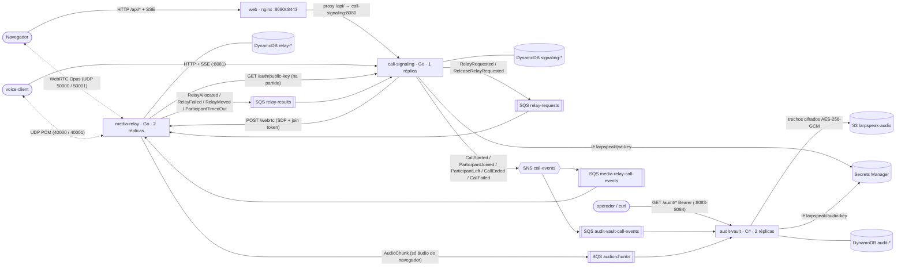
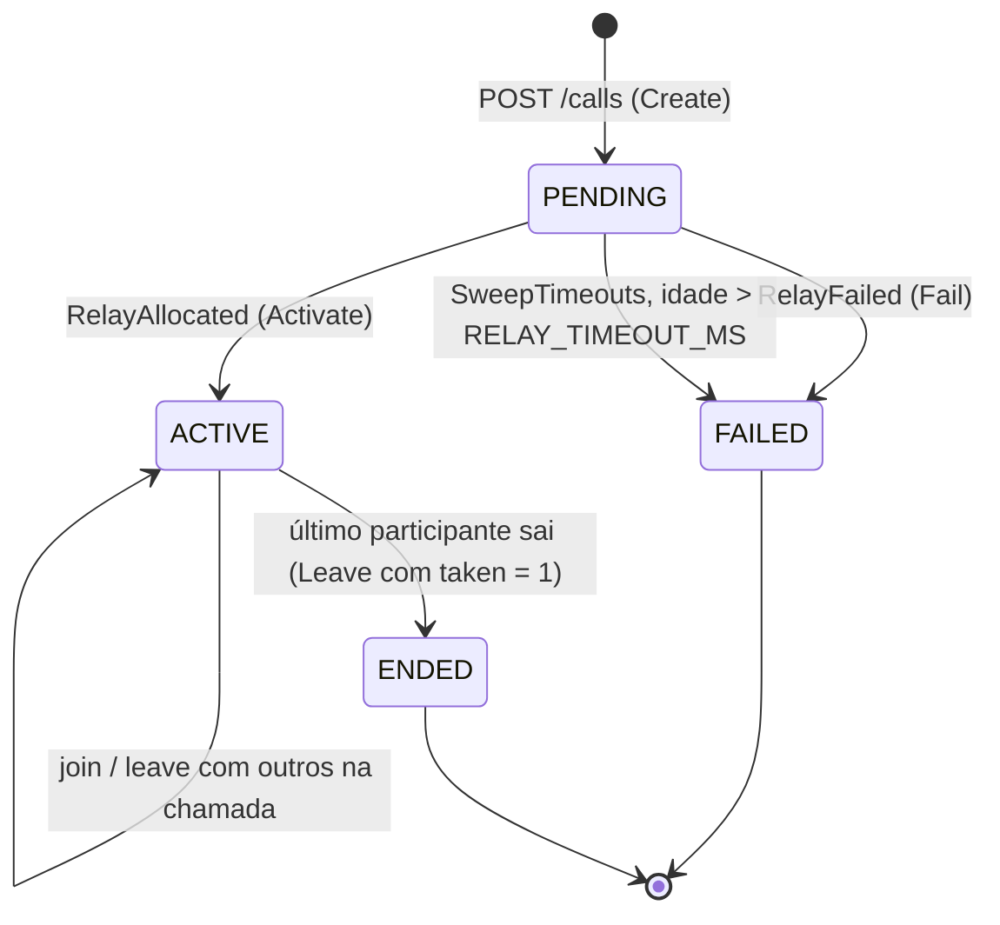
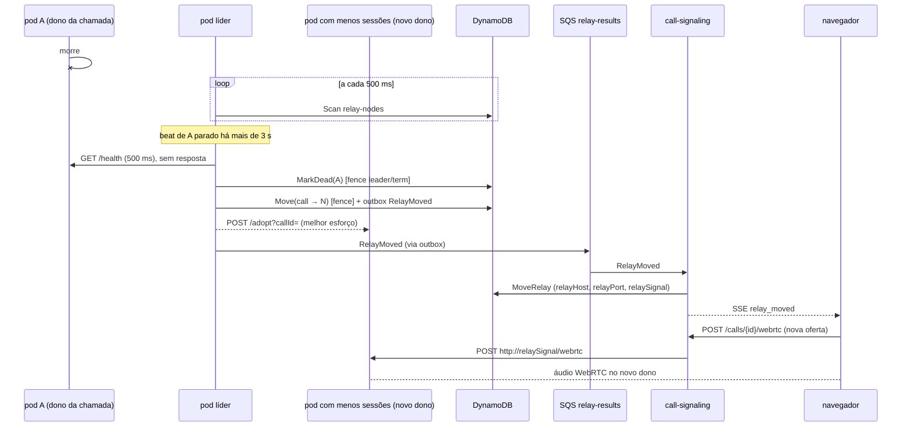
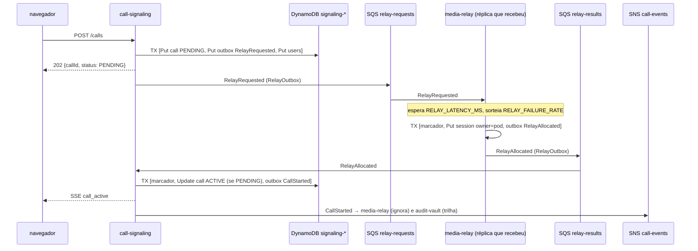

# Arquitetura do Larpspeak

Este documento descreve o sistema **como o código está hoje**: diagramas, serviços, mensagens, bancos, fluxos,
mecanismos de falha e decisões de arquitetura (o quê, por quê e a alternativa descartada). Cada afirmação aponta o
arquivo que a comprova. Quando o código e outro documento divergem, vale o código.

Convenções:

- `CS` = `services/call-signaling`, `MR` = `services/media-relay`, `AV` = `services/audit-vault`.
- Nomes de filas, tabelas, bucket e segredos são os valores do `docker-compose.yml`. No código eles sempre vêm de
  variáveis de ambiente.
- Identificadores, tipos de mensagem e textos de log ficam em inglês, como no código.

---

## 1. Visão geral

Larpspeak é um backend de chamadas de voz em grupo. Três serviços se coordenam por eventos e usam serviços AWS
emulados localmente pelo **MiniStack** (`ministackorg/ministack:1.5.40`, porta 4566). O código é o mesmo da AWS real:
só muda `AWS_ENDPOINT_URL`.

| Serviço | Linguagem | Papel |
|---|---|---|
| **call-signaling** | Go 1.27 | API HTTP, contas e tokens, ciclo de vida da chamada (saga), notificações SSE |
| **media-relay** | Go 1.27 | Aloca o relay de áudio, encaminha o áudio (SFU WebRTC e UDP legado), detecta quedas, faz failover entre pods e corta a gravação em trechos |
| **audit-vault** | C# / .NET 10 | Trilha de auditoria imutável dos eventos de chamada e gravações cifradas no S3 |
| web | nginx 1.29 + React 19 | Interface do navegador; faz proxy de `/api/` para o call-signaling (não tem regra de negócio) |

Clientes: o navegador (`web/`), o cliente de terminal `tools/voice-client` (UDP, PCM) e o cliente de teste
`tools/webrtc-probe` (WebRTC, usado pelos cenários do audit-vault).

### 1.1 Diagrama do sistema



Pontos que o diagrama fixa:

- **Só o call-signaling publica no SNS** `call-events` (`CS/internal/adapter/messaging/bus.go:140-151`). O media-relay
  só envia para filas SQS e não tem código de SNS (`MR/internal/adapter/messaging/bus.go`).
- Há **duas chamadas HTTP síncronas entre serviços**, e só essas duas (ver decisão D11):
  - call-signaling → media-relay `POST /webrtc` (`CS/internal/adapter/relayhttp/client.go:23`);
  - media-relay → call-signaling `GET /auth/public-key`, na partida (`MR/internal/adapter/pubkey/pubkey.go`).
- O audit-vault não chama nenhum serviço: só consome filas e responde à API de leitura.

### 1.2 Os três elementos exigidos no fluxo principal

O enunciado exige três elementos no fluxo principal. No Larpspeak, o fluxo principal é **criar uma chamada, entrar e
falar**:

| Elemento exigido | Onde está | Detalhe |
|---|---|---|
| **Transação distribuída com compensação** | criação da chamada: call-signaling ↔ media-relay | O call-signaling grava a chamada PENDING, reserva o usuário e pede o relay. Se o relay falha (`RelayFailed`) ou demora mais que `RELAY_TIMEOUT_MS`, a compensação marca FAILED, libera as vagas e a reserva do usuário, e avisa o cliente (`call_failed`). Se a alocação chega atrasada, o relay alocado é liberado (`ReleaseRelayRequested`). Seção 6.4 |
| **Dependência lenta ou instável** | alocação do relay no media-relay | `RELAY_LATENCY_MS` (latência) e `RELAY_FAILURE_RATE` (taxa de falha, de 0 a 1), ambas por variável de ambiente. Seção 7.2 |
| **Evento com vários interessados** | tópico SNS `call-events` | `CallStarted`, `ParticipantJoined`, `ParticipantLeft`, `CallEnded` e `CallFailed` são publicados uma vez pelo call-signaling e consumidos pelo **media-relay** (libera a sessão, atualiza os membros) e pelo **audit-vault** (trilha de auditoria). Seção 2.3 |

### 1.3 Implantação (compose)

| Serviço | Réplicas | Portas no host | Observações |
|---|---|---|---|
| ministack | 1 | 4566 | healthcheck `/_ministack/health`; estado só em memória, sem volume |
| infra-init | 1 (roda e termina) | — | `amazon/aws-cli:2.39.0` executa `infra/init/init.sh` |
| call-signaling | 1 | 8081→8080 | depende de `infra-init` concluído |
| web | 1 | 8080→80, 8443→443 | HTTPS só se houver certificados em `web/certs` (`web/nginx/30-tls.sh`) |
| media-relay | `${MEDIA_RELAY_REPLICAS:-2}` | nenhuma | no modo voz (`compose.voice.yml`) vira `media-relay` (UDP 40000, WebRTC 50000) + `media-relay-2` (40001, 50001), ambos com `RELAY_HOST` obrigatório |
| audit-vault | `${AUDIT_VAULT_REPLICAS:-2}` | 8083-8084→8080 | uma porta por réplica; acima de 2 réplicas é preciso ampliar a faixa |

Os serviços de aplicação herdam a âncora `x-after-init` (`docker-compose.yml:8-13`):
- `stop_grace_period: 20s`;
- `restart: unless-stopped`;
- `depends_on: infra-init (service_completed_successfully)`.

**Dockerfile e health check por serviço** (exigência do enunciado):

| Serviço | Dockerfile | Health check |
|---|---|---|
| call-signaling | `services/call-signaling/Dockerfile` | `GET /health` → `{"status":"ok","service":"call-signaling"}`; `HEALTHCHECK` com `wget` a cada 10 s |
| media-relay | `services/media-relay/Dockerfile` | `GET /health` → `{"status":"ok","service":"media-relay","replica":<hostname>}`; `HEALTHCHECK` com `wget` a cada 10 s |
| audit-vault | `services/audit-vault/Dockerfile` | `GET /health` → `{"status":"ok","service":"audit-vault"}`, aberto, sem token; `HEALTHCHECK` com `bash /dev/tcp` a cada 10 s |
| web | `web/Dockerfile` | `GET /health` → `{"status":"ok","service":"web"}`; healthcheck no `docker-compose.yml` |

O sistema inteiro sobe com `docker compose up --build`. O MiniStack sobe primeiro, o `infra-init` cria os recursos e
só então os serviços partem.

`make start` usa `docker-compose.yml` + `compose.voice.yml` e exporta `RELAY_HOST` (IP da rede local, ou o valor
informado) (`Makefile:5-8`). `make start` não reconstrói as imagens: use `make build` depois de mudar código.

---

## 2. Mensageria

### 2.1 Filas, tópico e DLQs (`infra/init/init.sh`)

- **Filas padrão** (não FIFO), cada uma com `<nome>-dlq`, `VisibilityTimeout=30` e
  `RedrivePolicy.maxReceiveCount=5` (`init.sh:6-13, 23-27`):
  - `relay-requests`;
  - `relay-results`;
  - `media-relay-call-events`;
  - `audit-vault-call-events`;
  - `audio-chunks`.
- **Tópico SNS** `call-events` com duas assinaturas SQS (`media-relay-call-events`, `audit-vault-call-events`),
  `RawMessageDelivery=true` (`init.sh:29-36`). Não há filtro: as duas filas recebem todos os tipos publicados no
  tópico.
- O script é idempotente: cada recurso só é criado se ainda não existir.

### 2.2 Envelope

Toda mensagem segue `contracts/envelope.schema.json`: `messageId` (uuid), `correlationId` (o `callId`), `type`,
`version` (≥ 1), `occurredAt` (data-hora), `payload` (objeto), sem propriedades extras.

- Os dois serviços Go criam o envelope com `uuid.New()` da biblioteca padrão, `version: 1` e `occurredAt` em UTC
  (`domain/envelope.go:21-34` em CS e MR).
- **Go valida só o envelope** (`ParseEnvelope`, `domain/envelope.go:38-52`): JSON válido, `messageId`/`correlationId`/
  `type` não vazios, `version ≥ 1`, `occurredAt` presente, `payload` objeto. Não valida o payload contra os schemas.
- **C# valida o envelope** em `Envelope.TryParse` (`AV/Envelope.cs:19-52`) e, para áudio, também o payload em
  `AudioChunk.TryParse`.
- Envelope inválido = **mensagem venenosa**. Ela não é apagada e vai para a DLQ após 5 recebimentos.

### 2.3 Catálogo de mensagens (`contracts/events/*.v1.schema.json`, 12 tipos)

| Tipo | Natureza | Canal | Produtor (código) | Consumidor e efeito (código) |
|---|---|---|---|---|
| `RelayRequested` | comando | SQS `relay-requests` | CS `app/saga.go:49`, via outbox, no `POST /calls` | MR `relay.go:83` `allocate` |
| `ReleaseRelayRequested` | comando | SQS `relay-requests` | CS `saga.go:142`, quando chega um `RelayAllocated` atrasado | MR `relay.go:85` `release("late allocation")`. Libera pelo `callId`; o `relayId` do payload não é usado |
| `RelayAllocated` | resposta | SQS `relay-results` | MR `relay.go:202`, via outbox | CS `saga.go:121` ativa a chamada, ou `:140` libera o relay atrasado |
| `RelayFailed` | resposta | SQS `relay-results` | MR `relay.go:189` (falha simulada) | CS `saga.go:95` compensa |
| `RelayMoved` | fato | SQS `relay-results` | MR `failover.go:212` (líder move a chamada) | CS `saga.go:98` atualiza host/porta/endereço e avisa por SSE |
| `ParticipantTimedOut` | fato | SQS `relay-results` | MR `relay.go:369` (`Sweep`) | CS `saga.go:109` executa uma saída normal |
| `CallStarted` | fato | SNS `call-events` | CS `saga.go:123` | AV: trilha. MR: recebe e ignora (`relay.go:108`) |
| `ParticipantJoined` | fato | SNS | CS `saga.go:175` | MR `member ADD`; AV: trilha |
| `ParticipantLeft` | fato | SNS | CS `saga.go:260` | MR `member DELETE`; AV: trilha |
| `CallEnded` | fato | SNS | CS `saga.go:266` (último participante saiu) | MR `release("call ended")`; AV: trilha |
| `CallFailed` | fato | SNS | CS `saga.go:160` | MR `release("call failed")`; AV: trilha |
| `AudioChunk` | fato | SQS `audio-chunks` | MR `recorder.go:172`, envio direto, sem outbox | AV `AudioProcessor`: cifra e grava no S3 |

Separação adotada: **comandos e respostas** entre dois serviços andam em filas ponto a ponto (`relay-requests`,
`relay-results`). **Fatos** de interesse geral andam no tópico SNS com fan-out. `ParticipantTimedOut` vai só para
`relay-results`, então o audit-vault não o recebe. A queda aparece na trilha como o `ParticipantLeft` que o
call-signaling publica ao remover o participante.

---

## 3. Bancos de dados (DynamoDB)

Todas as tabelas têm só a chave de partição `pk` (string), cobrança `PAY_PER_REQUEST`, sem GSI, sem TTL e sem streams
(`init.sh:15-20, 39-40`). Cada serviço lê e escreve **somente as próprias tabelas**.

### 3.1 call-signaling

| Tabela | `pk` | Atributos |
|---|---|---|
| `signaling-calls` | `callId` | `kind` (`direct`/`group`), `callerId`, `invited` (lista), `participants` (SS), `taken` (N, vagas ocupadas), `capacity`, `status` (`PENDING`/`ACTIVE`/`FAILED`/`ENDED`), `reason`, `relayId`, `relayHost`, `relayPort`, `relaySignal` (endereço HTTP do pod dono; não sai na API), `muted`/`deafened` (SS), `createdAt`/`startedAt`/`endedAt` (ms) (`domain/call.go:35-54`) |
| `signaling-users` | `userId` | `callId`: a chamada atual do usuário (uma por usuário) |
| `signaling-outbox` | `messageId` | `dest` (`call-events` = SNS, senão nome da fila SQS), `body` (envelope JSON), `createdAt` |
| `signaling-processed` | `messageId` | nenhum (marcador de idempotência) |
| `signaling-accounts` | `username` | `pwHash`, `salt`, `iter`, `createdAt` |
| `signaling-refresh` | SHA-256 hex do token, ou `family#<uuid>` | token: `userId`, `family`, `status` (`ACTIVE`/`USED`), `usedAt`, `expiresAt`; família: `status` (`ACTIVE`/`REVOKED`), `userId`, `expiresAt` |

### 3.2 media-relay

| Tabela | `pk` | Atributos |
|---|---|---|
| `relay-sessions` | `callId` | `relayId`, `host`, `port`, `participants` (SS), `state` (`ALLOCATED`/`RELEASED`), `reason`, `owner` (hostname do pod dono) (`domain/session.go:22-31`) |
| `relay-nodes` | id do pod, ou `leader` | pod: `beat` (N), `status` (`ALIVE`/`DEAD`), `addr` (HTTP), `host`, `port` (UDP). Linha `leader`: `holder`, `term`, `beat` |
| `relay-outbox` | `messageId` | `dest` (nome da fila), `body`, `createdAt` |
| `relay-processed` | `messageId` | nenhum |

### 3.3 audit-vault

| Tabela / bucket | Chave | Conteúdo |
|---|---|---|
| `audit-records` | `call#{callId}` | `events` (lista só de acréscimo), `callId`, `updatedAt` (ms). Cada evento: `messageId`, `type`, `version`, `occurredAt`, `receivedAt`, `payload` (JSON em texto), `sha256` (da mensagem bruta), `envelope` (mensagem bruta) |
| `audit-processed` | `messageId` | `at`. Guarda os marcadores das duas filas |
| S3 `larpspeak-audio` | `audio/{callId}/{userId}/{startMs:D13}-{messageId}.bin` | trecho cifrado (formato `LSA1`). Bucket com SSE AES256 padrão e acesso público bloqueado (`init.sh:43-56`; se o emulador não tiver a API, só um aviso) |

---

## 4. Serviços de nuvem e justificativa

| Categoria | Serviço | Por que este | Alternativa descartada |
|---|---|---|---|
| Mensageria | SNS + SQS | SNS distribui um fato para uma fila por consumidor. SQS dá consumidores concorrentes, reentrega por visibility timeout e DLQ nativa. Não há broker para operar | RabbitMQ/Kafka em contêiner: mais um componente para manter, sem ganho para este volume |
| Banco | DynamoDB | Escritas condicionais contam vagas sem lock (R2). `TransactWriteItems` grava efeito, marcador e outbox de forma atômica (R1). Um conjunto de tabelas por serviço | Banco relacional: precisaria de lock/transação própria e de um servidor |
| Objetos | S3 | Gravações são binárias e grandes; mantém os itens do DynamoDB pequenos (limite de 400 KB por item) | Guardar áudio no DynamoDB |
| Segredos | Secrets Manager | A semente da chave JWT (`larpspeak/jwt-key`) e a chave AES do áudio (`larpspeak/audio-key`) nunca ficam no código nem em arquivos de ambiente; o código é o mesmo na AWS real | Variáveis de ambiente: o segredo vazaria em `docker inspect` e no compose |

Os dois segredos têm 32 bytes aleatórios em base64, criados pelo `init.sh:57-63`.

---

## 5. Padrões comuns a todos os consumidores

### 5.1 Entrega pelo menos uma vez + efeito idempotente (R1)

O SQS pode entregar a mesma mensagem mais de uma vez. Por isso quem tem de ser idempotente é o **efeito**, não a
entrega:

- **call-signaling** (`CS/internal/adapter/dynamo/store.go:380-398` `commit`): quando há `msgID`, o item 0 da
  transação é `Put signaling-processed` com `attribute_not_exists(pk)`. Se esse item falha, o erro vira `ErrDuplicate`.
  - Passam `msgID`, e portanto gravam o marcador, só os caminhos de consumidor: `Activate`, `MoveRelay`, `Fail` (vindo
    de `RelayFailed`), `Leave` (vindo de `ParticipantTimedOut`) e `Ack`.
  - Os caminhos HTTP (`Create`, `Join`, `SetState`, saída por HTTP) e o varredor de timeout não usam marcador. A
    proteção deles vem das condições de estado.
- **media-relay** (`MR/internal/adapter/dynamo/sessions.go:163-178`): o marcador é **sempre** o item 0 em `Allocate`,
  `Ack`, `Release` e `Member`.
  - A primeira condição que falha decide o erro: índice 0 vira `ErrDuplicate`; qualquer outro índice vira `ErrReleased`.
  - `Emit` (usado por `ParticipantTimedOut`), `MarkDead` e `Move` não têm marcador.
- **audit-vault**: veja a seção 9. Os eventos usam marcador + trilha numa transação. O áudio é a exceção: chave S3
  determinística (decisão D19).

### 5.2 Outbox transacional (call-signaling e media-relay)

A mudança de estado e a mensagem a publicar são gravadas **na mesma transação** (item de outbox). Uma goroutine
(`RelayOutbox`) faz o resto:
- lê a tabela de outbox inteira, com leitura consistente, percorrendo todas as páginas do `Scan`;
- publica cada item (SNS se `dest == "call-events"`, senão `SendMessage` na fila);
- apaga o item;
- espera 200 ms entre varreduras (`CS bus.go:114-138`, `MR bus.go:112-136`).

Se a publicação falha, o laço faz backoff e tenta de novo na varredura seguinte. Se o processo morre entre publicar e
apagar, a mesma mensagem (mesmo `messageId`) é publicada de novo, e o consumidor a descarta como duplicada. A varredura
não tem ordem: dois itens pendentes da mesma chamada podem sair em qualquer ordem.

No media-relay, cada réplica varre a tabela inteira, então qualquer réplica publica o que outra deixou pendente. O
custo é que duas réplicas podem publicar o mesmo item (mesmo `messageId`). O consumidor descarta a cópia pelo marcador
(`duplicate ignored`).

### 5.3 Laço de consumo (R6)

| Aspecto | Go (CS e MR, `messaging/bus.go` `Consume`) | C# (AV, `QueueConsumer.RunAsync`) |
|---|---|---|
| Long poll | `WaitTimeSeconds=10`, até 10 mensagens | igual |
| URL da fila | resolvida sob demanda, guardada só após sucesso | igual (`SqsQueue`) |
| Erro do broker | `broker unreachable, retrying` se falha ao resolver a URL da fila; `receive failed, retrying` se falha o `ReceiveMessage` (o caso comum numa queda, pois a URL já está guardada); o outbox registra `outbox scan failed, retrying`. Backoff `min(max(2d, 250ms), 5s)` | `broker unreachable, retrying` para qualquer falha no recebimento; mesmo backoff |
| Cliente AWS | `http.Client{Timeout: 15s}`, `RetryMaxAttempts(1)` (`main.go`) | `Timeout = 15s`, `MaxErrorRetry = 0` (`Program.cs:29-36`) |
| Envelope inválido | não apaga → DLQ (`poison message left for DLQ`) | `Outcome.Poison`, não apaga |
| Duplicada | `duplicate ignored` + apaga | `Outcome.Duplicate` + apaga |
| Outro erro | não apaga → volta em 30 s (`handling failed, will be redelivered`) | `Outcome.Failed`, não apaga |
| Parada | contexto `WithoutCancel`: o poll em andamento termina e o lote é processado | `CancellationToken.None` no poll; mesmo efeito |

O timeout de 15 s é maior que o long poll de 10 s. Com o MiniStack pausado, a conexão presa falha em 15 s e o laço
registra o erro, em vez de ficar parado em silêncio. As tentativas ficam todas no laço, nunca no SDK.

### 5.4 Parada graciosa

- `stop_grace_period: 20s` no compose. No audit-vault, `HostOptions.ShutdownTimeout = 15s` (`Program.cs:23`).
- **call-signaling** (`CS/main.go:82-89`): espera só o consumidor SQS terminar o último poll. O `srv.Shutdown` roda em
  outra goroutine e o `main` não espera que ele termine. `RelayOutbox` e `SweepTimeouts` também não são aguardados.
- **media-relay** (`MR/main.go:107-114`): espera os dois consumidores e o `Recorder.Run`, que esvazia a gravação por
  até 5 s. Não são aguardados: outbox, `Sweep`, failover, servidor UDP e o socket WebRTC.
- **audit-vault**: o host espera os dois `ConsumerService`.

### 5.5 Ordenação (R4)

O sistema **não depende de ordem de entrega**. Nenhum canal garante ordem:
- as filas são SQS padrão (não FIFO), com entrega pelo menos uma vez e sem ordem garantida;
- com 2 ou mais réplicas, mensagens da mesma chamada são processadas em paralelo por pods diferentes;
- o outbox publica os itens pendentes em qualquer ordem (seção 5.2).

Em vez de ordenar as mensagens, cada efeito confere o estado atual antes de ser aplicado:

| Onde | Mecanismo | Exemplo de mensagem fora de ordem |
|---|---|---|
| call-signaling, saga | Cada transição tem condição de estado: `Activate` e `Fail` só com `status = PENDING`; `MoveRelay` só com `status = ACTIVE` | `RelayAllocated` que chega depois do timeout encontra FAILED: não reativa a chamada e libera o relay (`ReleaseRelayRequested`) |
| call-signaling, vagas | `Join` exige `taken < capacity`; `Leave` fixa o `taken` lido na condição e tenta de novo até 3 vezes | duas saídas simultâneas não deixam `taken` errado nem duas chamadas ENDED |
| media-relay, sessão | `Release` e `Member` só com `state = ALLOCATED` | `ParticipantJoined` que chega depois de `CallEnded` é reconhecido e descartado, sem efeito |
| media-relay, failover | `Move` exige `owner = pod morto` e o fence de `term` | um `Move` de um líder antigo não sobrescreve a decisão do novo líder |
| audit-vault, trilha | A trilha guarda os eventos na ordem de chegada, mas `CallTrail.Build` reordena por `occurredAt` (e `receivedAt`) a cada leitura | `CallEnded` gravado antes de `ParticipantLeft` produz o mesmo estado final |
| audit-vault, áudio | A chave S3 começa por `startMs` com 13 dígitos | trechos gravados fora de ordem são exportados na ordem do tempo |

O caso que essas condições **não** cobrem: `ParticipantJoined` e `ParticipantLeft` do **mesmo usuário** trocados de
ordem no media-relay. `DELETE` e depois `ADD` deixam o usuário em `relay-sessions.participants` mesmo fora da chamada.
O call-signaling continua correto: ele não repassa ofertas WebRTC de quem não é participante. Ver limitações (seção 14).

---

## 6. call-signaling

### 6.1 Partida (`CS/main.go`)

1. Carrega a configuração; se faltar variável obrigatória, sai com código 1.
2. Lê `JWT_KEY_SECRET` no Secrets Manager (tenta de novo com espera de 500 ms dobrando até 10 s). A semente precisa
   ter exatamente 32 bytes (Ed25519).
3. Inicia `RelayOutbox`, um consumidor de `RELAY_RESULTS_QUEUE` e `SweepTimeouts`.
4. Sobe o servidor HTTP em `:PORT` (8080).

### 6.2 API HTTP (`httpapi/handlers.go`, `httpapi/auth.go`)

O usuário vem sempre do token `Authorization: Bearer` (JWT `access`). Sem token válido: 401 `{"error":"unauthorized"}`.

| Rota | Corpo | Sucesso | Erros |
|---|---|---|---|
| `GET /health` | — | 200 `{"status":"ok","service":"call-signaling"}` | — |
| `POST /auth/register` | `{username, password}` | 201 `{userId}` | 400, 409 `username taken`, 503 |
| `POST /auth/login` | `{username, password}` | 200 `{accessToken, expiresIn, userId}` + cookie `refresh` | 401 `invalid credentials` |
| `POST /auth/refresh` | cookie `refresh` | 200 igual ao login, com o cookie trocado | 401 |
| `POST /auth/logout` | cookie | 204, cookie apagado | — |
| `GET /auth/public-key` | — | 200 `{"alg":"EdDSA","key":<base64url>}` | — |
| `GET /me` | — | 200 `{userId}` | 401 |
| `POST /sse-ticket` | — | 200 `{ticket}` (JWT `sse`, 1 min) | 401 |
| `GET /notifications` | `?ticket=` ou Bearer | fluxo SSE | 401 |
| `POST /calls` | `{calleeIds?, maxParticipants?}` | **202** `{callId, status:"PENDING", statusUrl}` + `Location` | 400; 503 `try again` (timeout de 3 s ou corrida) |
| `GET /calls/{id}` | — | 200 a chamada | 404 |
| `POST /calls/{id}/join` | — | 200 `{callId, relayHost, relayPort, participants, taken, capacity, muted, deafened}` | 409 cheia / não ativa / já está; 503 |
| `POST /calls/{id}/leave` | — | 202 `{callId, userId, status:"left"}` | 409 |
| `POST /calls/{id}/invite` | `{inviteeId}` | 202 | 400, 409 |
| `POST /calls/{id}/webrtc` | `{sdp}` | 200 `{sdp}` (resposta do relay) | 400; 409 `relay not ready, retry`; 503 |
| `POST /calls/{id}/state` | `{muted, deafened}` | 202 | 409 `user not in call` |

Não existe rota `/end`: a chamada termina quando o último participante sai.

### 6.3 Autenticação

- **Senha**: PBKDF2-HMAC-SHA256 com 600 000 iterações, sal de 16 bytes e chave de 32 bytes, comparada em tempo
  constante (`domain/account.go`).
  - Usuário: `^[a-z0-9_-]{3,32}$`. Senha: 8 a 128 caracteres.
  - No login, um usuário inexistente também passa pelo PBKDF2 (com sal zero), para que a resposta não revele se o
    usuário existe.
- **JWT EdDSA** (Ed25519, biblioteca padrão; `domain/token.go`). Cabeçalho fixo `{"alg":"EdDSA","typ":"JWT"}`; claims
  `sub`, `typ`, `cid`, `iat`, `exp`. A verificação rejeita qualquer `alg` diferente de EdDSA. Tipos de token:
  - `access`: `ACCESS_TOKEN_TTL_S` (300 s);
  - `sse`: 1 min, criado por `POST /sse-ticket`;
  - `join`: 1 min, com `cid = callId`, criado na hora de repassar a oferta WebRTC.
- **Chave pública**: só o call-signaling assina. O media-relay baixa a chave pública em `GET /auth/public-key` e só
  verifica.
- **Refresh token**: 32 bytes aleatórios; só o SHA-256 dele é guardado em `signaling-refresh`. Vai em cookie `refresh`
  com `HttpOnly`, `SameSite=Strict`, `Secure=COOKIE_SECURE` e `MaxAge=REFRESH_TTL_S` (7 dias). Regras
  (`app/auth.go:91-118`):
  - **Rotação**: em uma transação, marca o token antigo como `USED`, grava o novo e confere que a família está `ACTIVE`.
  - **Reuso**: um token `USED` apresentado de novo **mais de 5 s** depois revoga a família inteira.
  - **Até 5 s** (duas abas renovando ao mesmo tempo): 401 `refresh token just rotated, retry`, sem revogar e mantendo o
    cookie.
  - Qualquer falha de condição na rotação também cai no 401 "just rotated" com o cookie mantido. Isso inclui a família
    já revogada por logout e o token expirado entre a leitura e a escrita.
- **Logout**: revoga a família. Os tokens de acesso já emitidos valem até expirar, porque são stateless.

### 6.4 Saga do ciclo de vida da chamada (`app/saga.go`)

O call-signaling **orquestra** a saga. O passo que pode falhar é a alocação do relay no media-relay.



| Transição | Disparo | Transação DynamoDB (ordem dos itens) | Mensagens | SSE |
|---|---|---|---|---|
| → PENDING | `POST /calls` (`Start`, `saga.go:47-57`), depois de `moveOut(caller)` | `Create`: 0 `Put` call (`attribute_not_exists`), 1 `Put` outbox `RelayRequested`, 2 `Put` `signaling-users` (`attribute_not_exists`) | `RelayRequested {callId, participants}` | — |
| PENDING → ACTIVE | `RelayAllocated` com a chamada PENDING | `Activate`: marcador, 0 `Update` (`status = PENDING`) grava relay e `startedAt`, 1 outbox `CallStarted` | `CallStarted {callId, kind, capacity, relayId, participants}` | `call_active` ao criador; `incoming_call` a cada convidado |
| PENDING → FAILED | `RelayFailed`, ou o varredor | `Fail`: [marcador], 0 `Update` (`status = PENDING`) `status=FAILED, reason, taken=0`, 1 outbox `CallFailed` | `CallFailed {callId, reason}` | `call_failed` ao criador |
| ACTIVE → ACTIVE | `RelayMoved` | `MoveRelay`: marcador, 0 `Update` (`status = ACTIVE`) `relayHost, relayPort, relaySignal` | — | `relay_moved` a todos os participantes |
| entrada | `POST /join` | `Join` (seção 6.5) | `ParticipantJoined` | `participant_joined` aos outros |
| saída / fim | `POST /leave`, `moveOut` ou `ParticipantTimedOut` | `Leave` (seção 6.5) | `ParticipantLeft` e, se for o último, `CallEnded {callId, relayId, durationMs, reason:"everyone left"}` | `participant_left` aos que ficam; `left_call` a quem saiu por `moveOut` ou timeout |

Regras de compensação e de tempo:

- **Compensação** (`compensate`, `saga.go:159-171`): `Fail` só vale com `status = PENDING`, então roda no máximo uma
  vez. Ela zera as vagas (`taken=0`), libera o usuário (`ForgetUser`, melhor esforço, fora da transação) e notifica o
  criador.
- **Varredor de timeout** (`SweepTimeouts`, `saga.go:375-397`): a cada 1 s lê as chamadas PENDING e compensa as
  criadas há mais de `RELAY_TIMEOUT_MS` (3000) com `reason = "relay timeout"`. O timeout efetivo fica entre 3 e ~4 s.
- **Resposta atrasada** (`saga.go:140-150`): um `RelayAllocated` que chega com a chamada fora de PENDING grava o
  marcador e um `ReleaseRelayRequested` na mesma transação (`Ack`). O media-relay libera a sessão com
  `reason = "late allocation"`.
- **Corrida entre ativar e o varredor**: se `Activate` perde para `Fail`, a mensagem não é apagada. Ela volta depois do
  visibility timeout (30 s) e cai no ramo da resposta atrasada.
- **Ramo `default`** (`saga.go:152-153`): `RelayFailed` com a chamada fora de PENDING, `RelayMoved` com a chamada fora
  de ACTIVE e **qualquer tipo desconhecido** são reconhecidos com `Ack` (só o marcador) e apagados.
- **Chamada desconhecida** (`callId` que não existe): retorna erro. A mensagem é reentregue e vai para a DLQ após 5
  recebimentos.
- O `POST /calls` usa contexto de 3 s; se estourar, responde 503.

### 6.5 Vagas, uma chamada por usuário e entradas concorrentes (R2)

**Entrada** (`store.go:169-178`) é uma transação com três itens:
- **item 0**: `Update` na chamada, com
  - `SET taken = taken + 1 ADD participants :u`
  - condição `status = ACTIVE AND taken < capacity AND NOT contains(participants, :uid)`
- **item 1**: outbox `ParticipantJoined`
- **item 2**: `Put signaling-users` com `attribute_not_exists(pk)`

Mapeamento de erros: item 0 falha → `ErrSeatLost` (vira 409 `call is full`, ou um erro mais preciso depois de reler a
chamada); item 2 falha → `ErrStateChanged` (503).

**Saída** (`store.go:181-191`):
- **item 0**: `Update`
  - `SET taken = taken - 1`; se for o último, também `status=ENDED, endedAt, reason`
  - `DELETE participants, muted, deafened`
  - condição `status = ACTIVE AND contains(participants, :uid) AND taken = :n` (o valor lido fica fixado na condição)
- **item 1**: `Delete signaling-users` com `attribute_not_exists(pk) OR callId = :c`
- **itens 2..**: outbox `ParticipantLeft` e, se for o último, `CallEnded`

A saída tenta até 3 vezes se o `taken` mudou no meio.

Outras regras:

- **Uma chamada por usuário** (`moveOut`, `saga.go:62-77`): ao criar ou entrar em uma chamada, o usuário primeiro sai
  da atual (SSE `left_call` com `reason = "joined another call"`). `canJoin` confere o destino antes, então um destino
  cheio não tira o usuário de onde ele está.
  - Exceção: no `POST /calls`, o `moveOut` roda antes da transação `Create`. Se a criação falhar, o usuário já saiu da
    chamada anterior.
- **Direta x grupo** (`handlers.go:57-67`): a chamada é `direct` só quando é criada com exatamente 1 convidado e sem
  `maxParticipants`. A capacidade é sempre `MAX_PARTICIPANTS` (10), ou o `maxParticipants` informado (de 2 até
  `MAX_PARTICIPANTS`). Ela vira `group` (melhor esforço, `makeGroup`) quando a terceira vaga é ocupada ou quando alguém
  convida um não participante.
- **Convite** (`saga.go:294-315`): só um participante convida, e só com a chamada ACTIVE. O convidado entra em
  `invited` e recebe `incoming_call`. Convites pendentes são reenviados quando o usuário conecta o SSE
  (`ReplayInvites`).
- **Mudo/surdo** (`SetState`): conjuntos `muted`/`deafened` na chamada, com condição de participante e chamada ativa.
  SSE `participant_state` para todos, inclusive quem mudou.

### 6.6 Notificações SSE (`adapter/sse/hub.go`)

- O hub fica **em memória**: um mapa usuário → canais, cada canal com buffer de 16. Se o buffer enche, a notificação é
  descartada. Por isso o call-signaling roda com 1 réplica (decisão D15).
- Formato `event: <nome>\ndata: <json>\n\n`. A conexão começa com `: connected` e recebe `: ping` a cada 20 s.
- Eventos emitidos: `incoming_call`, `call_active`, `call_failed`, `participant_joined`, `participant_left`,
  `participant_state`, `left_call`, `relay_moved`.
- `call_ended` **não é emitido**. O front-end e o voice-client têm tratamento para ele, mas esse código nunca dispara.
- Não há `id:` nem reenvio por `Last-Event-ID`; só os convites são reenviados na reconexão.

---

## 7. media-relay

### 7.1 Partida (`MR/main.go`)

O `hostname` do contêiner é o id do pod. Na partida, o media-relay:
1. abre o socket UDP legado (`UDP_PORT`);
2. cria o `Relay`:
   - `Host` = `RELAY_HOST`, ou o IP do contêiner;
   - `ProbeAddr` = `IP do contêiner:PORT`;
3. inicia as goroutines: outbox; consumidores de `relay-requests` e `media-relay-call-events`; `Sweep`; `Failover`;
   servidor UDP;
4. abre o socket WebRTC (`WEBRTC_UDP_PORT`), o SFU e, se `AUDIO_CHUNKS_QUEUE` estiver definida, o `Recorder`;
5. busca a chave pública do call-signaling (tenta de novo com espera de 500 ms dobrando até 10 s; enquanto não houver
   chave, `/webrtc` responde 503);
6. sobe o HTTP em `:PORT`.

`RELAY_HOST` é lido direto com `os.Getenv`, fora do pacote `config`.

### 7.2 Alocação: como uma chamada ganha um pod (`app/relay.go:176-219`)

1. **A réplica que recebe o `RelayRequested` do SQS vira a dona da chamada** (consumidores concorrentes). Na alocação
   não há outro balanceamento.
2. Ela espera `RELAY_LATENCY_MS` (0 na config, 200 no compose) e sorteia contra `RELAY_FAILURE_RATE`. Esses dois
   valores simulam a dependência instável (R5).
3. **Falha**: transação `Ack` = marcador + outbox `RelayFailed {callId, reason:"simulated relay failure"}`.
4. **Sucesso**: transação `Allocate`:
   - 0 marcador;
   - 1 `Put relay-sessions` (`attribute_not_exists`) com `owner = hostname`, `state = ALLOCATED`;
   - 2 outbox `RelayAllocated {callId, relayId, host, port, signalAddr}`.
5. Se a sessão já existe (`ErrReleased`): log `relay already allocated for call, ignoring` e só o marcador.

Valores anunciados:
- `host` = `RELAY_HOST`, ou o IP do contêiner;
- `port` = `UDP_PORT` (porta UDP legada, não a do WebRTC);
- `signalAddr` = `IP do contêiner:PORT`, o endereço HTTP interno que o call-signaling usa em `POST /webrtc`.

O endereço WebRTC chega ao navegador pelo candidato ICE da resposta SDP: IP `RELAY_HOST` (NAT 1:1) e porta
`WEBRTC_UDP_PORT`.

Numa reentrega, a espera e o sorteio rodam de novo antes de a transação descobrir a duplicata.

### 7.3 Eventos de chamada (`relay.go:94-108`)

| Tipo | Efeito |
|---|---|
| `CallEnded` / `CallFailed` | `Release`: marcador + `SET state=RELEASED, reason` com condição `state = ALLOCATED`; tira a chamada da memória |
| `ParticipantJoined` / `ParticipantLeft` | `Member`: marcador + `ADD`/`DELETE participants` com condição `state = ALLOCATED` |
| outros (`CallStarted`) | ignorados e apagados, sem marcador |

Os dois consumidores exigem um `callId` no payload. Sem ele, a mensagem vai para a DLQ após 5 recebimentos.

### 7.4 Caminhos de áudio

**SFU WebRTC** (`adapter/webrtc/sfu.go`, pion v4.2.26). Configuração:
- só Opus (PT 111, 48 kHz, 2 canais, `useinbandfec=1`);
- ICE num único socket UDP (`WEBRTC_UDP_PORT`), só UDP4;
- NAT 1:1 = `RELAY_HOST`;
- sem STUN/TURN.

Oferta (`POST /webrtc`, `health.go:26-57`):
1. Corpo até 128 KiB: `{callId, userId, sdp, joinToken}`.
2. 503 se a chave pública ainda não foi carregada.
3. 403 se o token `join` não confere (assinatura, `typ`, `cid == callId`, `sub == userId`, validade).
4. `Admit` lê a sessão: 404 se o pod não é o dono; 409 se o usuário ainda não está em `participants`.
5. Cria um `track` de saída ("slot") para cada m-line de áudio da oferta. O navegador oferece
   `max(capacity, 10) − 1` m-lines: 1 envia e recebe, o resto só recebe.
6. Espera a coleta de ICE até 3 s (sem trickle) e responde 200 `{sdp}`. Se o mesmo usuário já tinha um peer, ele é
   fechado.

Encaminhamento:
- Cada pacote RTP recebido chama `Touch`. Se o usuário não é mais participante, o peer é fechado.
- O pacote é escrito no slot que a fala ocupa em cada outro peer. Quando surge um novo falante, ele ganha o primeiro
  slot livre, e o mapa slot→usuário vai pelo DataChannel `meta` (`{"slots":{"<mid>":"<userId>"}}`).
- Cada slot mantém a própria linha do tempo RTP (`slot.rewrite` em `adapter/webrtc/sfu.go`). Quando a origem do slot
  muda (outro falante, ou o mesmo usuário com uma PeerConnection nova após sair/entrar ou recarregar), seq e timestamp
  de saída continuam em último+1 e último+960 (um quadro Opus de 20 ms). Por quê: o pion só troca SSRC e payload
  type; um salto aleatório de seq/timestamp no mesmo SSRC faz o jitter buffer do navegador descartar os pacotes
  (silêncio até quem escuta recarregar). Cada slot recebe uma cópia do cabeçalho; o payload é compartilhado. A gravação
  continua com o timestamp original.
- O RTCP também mantém o participante vivo.

**UDP legado** (`adapter/udp/server.go`): cada pacote é `"<callId> <userId> <seq>\n" + payload`. O relay guarda o
endereço do remetente e reenvia o pacote intacto aos outros participantes cujo endereço já conhece. Pacote de quem não
é participante é descartado. É o caminho do `voice-client` (PCM 16 kHz, quadros de 20 ms, com o quadro anterior
repetido como redundância).

### 7.5 Presença dos participantes (`relay.go:334-378`)

- Cada pacote atualiza o `lastSeen` do participante. Clientes mudos continuam mandando silêncio, então continuam
  presentes.
- `Sweep` roda a cada 2 s. Para cada participante sem pacotes há mais de `PARTICIPANT_TIMEOUT_MS` (15000), grava
  `ParticipantTimedOut {callId, userId}` no outbox (`Emit`, sem marcador). Se a gravação falha, tenta de novo na
  rodada seguinte.
- O call-signaling recebe e executa uma saída normal (SSE `left_call` com `reason = "connection lost"`). Se era o
  último, a chamada termina.

### 7.6 Failover entre pods (`app/failover.go`)

Cada pod publica um batimento. Um **líder** eleito por lease vigia os outros e move as chamadas de pods mortos.

| Elemento | Regra no código |
|---|---|
| Batimento | a cada 1 s, `Ping` = `PutItem` do próprio nó `{beat+1, status: ALIVE, addr, host, port}` |
| Lease | linha `pk = leader` `{holder, term, beat}`; o líder renova a cada 1 s com `SET beat = beat + 1` e condição `holder = :me AND term = :t` |
| Eleição | lease ausente ou do próprio pod: reivindica na hora. Lease parado (mesmo `term` e `beat`) por mais de 3 s, pelo relógio de quem observa: reivindica com `term+1` e condição exata `term = :t AND beat = :b`. Só um pod vence |
| Vigilância | só o líder, a cada 500 ms. Pod sem batimento novo há mais de 3 s → `GET http://addr/health` (500 ms), que precisa responder 200 com `replica` igual ao id do pod. Se responde, não há failover. Se não, `MarkDead` |
| Destino | a chamada vai para o pod vivo com **menos sessões ALLOCATED** (menos conexões); empate vai para o primeiro na ordem da varredura |
| Mover | `Move` = transação: 0 fence `ConditionCheck leader holder=:me AND term=:t`, 1 `Update` sessão `owner/host/port` com condição `state = ALLOCATED AND owner = :morto`, 2 outbox `RelayMoved {callId, relayId, host, port, signalAddr}` |
| Novo dono | fica sabendo por `POST /adopt?callId=` (melhor esforço), pela primeira oferta WebRTC (`Admit`) ou pelo primeiro pacote UDP desconhecido (`PickUp`, no máximo 1 vez/s por chamada) |
| Fencing | `MarkDead` e `Move` falham se o pod não é mais o líder daquele `term`. Um líder antigo que volta de uma pausa não move nada (log `leadership lost`) |
| Saúde do enlace | qualquer chamada ao DynamoDB que falhe ou passe de 1 s marca o enlace como ruim; o pod fica 3 s sem dar veredito nem reivindicar a liderança |
| Reinício | o pod recarrega as próprias sessões ALLOCATED (`reloadOwn`) |
| Limpeza | pods mortos cujas chamadas foram todas movidas são apagados (`ForgetNode`) |
| Injeção de falha | `docker kill -s USR1 <pod>` liga/desliga batimento e lease; o áudio continua |



`MoveRelay` no call-signaling **não atualiza `relayId`** (`store.go:157-159`). Depois de um failover, `GET /calls/{id}`
e o `CallEnded.relayId` continuam com o id original.

### 7.7 Gravação (`app/recorder.go`)

O `Recorder` só recebe pacotes do SFU WebRTC. O UDP legado nunca é gravado. Ele fica desligado sem
`AUDIO_CHUNKS_QUEUE`.

- **Fora do caminho da voz**: `Record` só acrescenta o pacote na memória (uma trilha por chamada+usuário). Quando o
  trecho fecha, entrega os frames crus a um canal de 512 posições, sem bloquear. Montar o envelope e o JSON
  (`encode`) fica na goroutine de envio.
- **Corte do trecho**:
  - quando o trecho atinge `AUDIO_CHUNK_MS` (5000, mínimo 1000, sem máximo);
  - quando o payload atinge 96 KiB (o pacote que passa do limite entra no trecho);
  - em `Flush`, quando o peer sai ou é trocado (nova linha do tempo RTP);
  - pela goroutine de 1 s, que corta trilhas sem pacotes há `AUDIO_CHUNK_MS`.
- **Canal cheio**: descarta o trecho **que está entrando** (o mais novo) e soma em `Dropped`. O comentário em
  `recorder.go:53` fala em "oldest"; o código e o teste (`recorder_test.go:171-190`) descartam o mais novo.
- **Envio**: `SendMessage` direto (sem outbox), até 6 tentativas com backoff de 250 ms dobrando até 5 s. Um trecho que
  falha nas 6 tentativas com o serviço rodando vai só para o log (`audio chunk not published`), não para `Dropped`.
- **Desligamento**:
  - novos pacotes deixam de ser guardados;
  - todas as trilhas são cortadas;
  - `drain` reenvia o que falta até um prazo único de 5 s, e o que sobra vai para `Dropped`;
  - trechos cortados depois do fim também vão para `Dropped`.
- **Payload**: `{callId, userId, startMs (relógio do pod no primeiro frame), durationMs, frames: [{ts, data(base64)}]}`.
  Os pacotes Opus vão como chegaram, sem decodificar.

---

## 8. Fluxos principais

### 8.1 Criar uma chamada (saga com sucesso)



### 8.2 Falha e compensação

- **`RelayFailed`**: `Fail` muda a chamada para FAILED e zera as vagas. Em seguida vêm `ForgetUser`, a SSE
  `call_failed` e o `CallFailed` no SNS. Media-relay e audit-vault o recebem: o relay faz `Release` (a sessão nem
  existe e só grava o marcador) e o vault grava FAILED na trilha.
- **Timeout**: igual, disparado pelo varredor, com `reason = "relay timeout"`. Se o `RelayAllocated` chega depois, o
  call-signaling publica `ReleaseRelayRequested` e o media-relay marca a sessão como `RELEASED` com
  `reason = "late allocation"`.

### 8.3 Entrar e falar

1. `POST /calls/{id}/join`: transação `Join`. Em seguida vão a SSE `participant_joined` para os outros e o
   `ParticipantJoined` no SNS (o media-relay acrescenta o usuário na sessão).
2. O navegador cria a oferta e chama `POST /calls/{id}/webrtc`.
3. O call-signaling confere ACTIVE + participante + `relaySignal`, cria um token `join` (1 min) e faz
   `POST http://<relaySignal>/webrtc`. O cliente HTTP tem timeout de 5 s; 404/409/503 do relay viram
   `relay not ready, retry` (409).
4. O navegador repete a oferta com backoff de 1 s dobrando até 8 s, até o relay já conhecer o participante.
5. O áudio vai direto do navegador para o pod dono (UDP `RELAY_HOST:WEBRTC_UDP_PORT`), sem passar pelo nginx nem pelo
   call-signaling.

### 8.4 Sair e terminar

`POST /leave` (ou timeout de presença) executa a transação `Leave`. Quando sai o último participante, a chamada vira
ENDED e é publicado `CallEnded`. O media-relay libera a sessão (`call ended`) e o audit-vault fecha a trilha.

### 8.5 Distribuição de carga

- **Trabalho assíncrono**: dividido pelo próprio SQS (consumidores concorrentes, modelo pull). Não há balanceador.
- **Chamadas**: ficam no pod que recebeu o `RelayRequested`, e todo o áudio da chamada vai para esse pod. Só o
  failover redistribui, pelo critério de menos sessões.
- **HTTP**: tem um único destino, o call-signaling, atrás do nginx. O nginx resolve o nome pelo DNS do Docker
  (`resolver 127.0.0.11 valid=5s`) para sobreviver a um contêiner recriado com outro IP.
- **API do audit-vault**: cada réplica tem a própria porta (8083, 8084).

---

## 9. audit-vault

### 9.1 Estrutura

O projeto C# é plano (`AV/*.cs`, namespace `AuditVault`). O código AWS fica atrás de interfaces que funcionam como
portas:
- `IMessageQueue`;
- `IAuditStore`;
- `IAudioStore`;
- `IAudioKeyProvider`;
- `IProcessedStore`;
- `IMessageHandler`.

`Program.cs` liga tudo. Um processo roda **dois consumidores**:
- `audit-vault-call-events` → `MessageProcessor`;
- `audio-chunks` → `AudioProcessor` (só se `AUDIO_CHUNKS_QUEUE` estiver definida).

Os dois são registrados por `ConsumerRegistration.AddQueueConsumer<THandler>` com `AddSingleton<IHostedService>`
(`QueueConsumer.cs:111-121`). `AddHostedService` não serve aqui: ele usa `TryAddEnumerable` e descartaria em silêncio o
segundo `ConsumerService` (decisão D25).

### 9.2 Configuração (`VaultConfig.cs`)

- Obrigatórias: `CALL_EVENTS_QUEUE`, `AUDIT_TABLE`, `PROCESSED_TABLE`, `AUDIT_API_TOKEN`.
- Com `AUDIO_CHUNKS_QUEUE` definida: também `AUDIO_BUCKET` e `AUDIO_KEY_SECRET`.
- Opcionais: `AWS_ENDPOINT_URL`, `AWS_REGION` (`us-east-1`), `PORT` (8080).
- Se faltar alguma, `Program.cs:12-19` escreve `audit-vault: missing environment variables: ...` no stderr e sai com
  código 1.

### 9.3 Trilha de auditoria

`MessageProcessor` aceita **qualquer** tipo com envelope válido. Não há lista de tipos permitidos; tipos
desconhecidos são gravados e ignorados na montagem do estado.

`DynamoAuditStore.RecordAsync` grava tudo numa única transação:
- **item 0**: `Put audit-processed {pk: messageId}` com `attribute_not_exists(pk)`. Se falha, a mensagem é duplicada.
- **item 1**: `Update audit-records` em `call#{correlationId}` com
  `SET events = list_append(if_not_exists(events, :empty), :e), callId, updatedAt`.

Cada evento guarda o payload, a **mensagem original inteira** e o **SHA-256** dela. `AuditEvent.Verified` recalcula o
hash da mensagem guardada e compara em tempo constante. Eventos sem mensagem guardada aparecem com `verified: false`.

O **estado não é gravado**. `CallTrail.Build` o refaz a cada leitura, com os eventos ordenados por `occurredAt` e
depois por `receivedAt`:

| Evento | Efeito no estado |
|---|---|
| `CallStarted` | PENDING → ACTIVE; `startedAt`; os `participants` do payload entram em `participants` e `present` |
| `ParticipantJoined` | entra em `participants` e `present` |
| `ParticipantLeft` / `ParticipantTimedOut` | sai de `present` (`participants` nunca diminui) |
| `CallEnded` | ENDED (a não ser que já esteja FAILED); esvazia `present`; `endedAt`, `reason`, `durationMs` |
| `CallFailed` | FAILED sempre (mesmo depois de ENDED); esvazia `present`; `endedAt`, `reason` |

### 9.4 Gravações

`AudioProcessor.HandleAsync`:

1. Valida (`AudioChunk.TryParse`). Qualquer falha devolve `Poison`:
   - tipo `AudioChunk`;
   - `messageId`, `callId` e `userId` em `[A-Za-z0-9_-]{1,64}`;
   - `callId == correlationId`;
   - `startMs` e `durationMs` ≥ 0;
   - de 1 a 5000 frames, cada um com `ts` uint32 e `data` em base64 de 1 a 2000 bytes.
2. `SeenAsync(messageId)`: se o marcador já existe, devolve `Duplicate`.
3. Serializa os frames (`count u32 | {ts u32 | len u16 | bytes}*`, big endian) e cifra (seção 9.5).
4. `PutAsync` em `audio/{callId}/{userId}/{startMs:D13}-{messageId}.bin`.
5. `MarkAsync`: `PutItem` condicional. Se perder a corrida para outra réplica, devolve `false`, e o processador
   registra `duplicate ignored` (não `audio stored`) e devolve `Duplicate`.

Não é uma transação. O efeito único vem da **chave determinística**: uma reentrega, ou duas réplicas na mesma
mensagem, sobrescreve o mesmo objeto (decisão D19).

**Exportação** (`AudioExporter` + `OggOpus.cs`):
- lista os trechos do participante em ordem de chave (o `startMs` com zeros à esquerda garante a ordem do tempo);
- abre cada trecho e junta os pacotes;
- escreve um Ogg Opus (RFC 7845) sem decodificar: pre-skip 312, até 50 pacotes por página, CRC-32 do Ogg.
- A posição de granule soma as amostras do byte TOC de cada pacote (RFC 6716); o `ts` do RTP não é usado.
- Silêncios entre trechos não são preenchidos.

### 9.5 Criptografia (`AudioCrypto.cs`)

```
"LSA1" (4 bytes) | nonce (12, aleatório por trecho) | tag (16) | texto cifrado
AAD = "{callId}\n{userId}\n{startMs}"   (não gravada; refeita a partir da chave S3 na leitura)
```

- AES-256-GCM cifra e autentica: um bit alterado faz a abertura falhar.
- A AAD amarra o trecho ao lugar dele. Um trecho copiado para outra chamada, outro usuário ou outro horário não abre.
- A chave de 32 bytes fica em `larpspeak/audio-key`. É lida sob demanda e guardada só depois de validada.
- O bucket também tem SSE AES256 padrão (defesa em profundidade).

### 9.6 API de leitura (`AuditApi.cs`)

- `GET /health` é aberto.
- Tudo em `/audit/*` exige `Authorization: Bearer <AUDIT_API_TOKEN>`. O prefixo `Bearer` não diferencia maiúsculas; a
  comparação é feita em tempo constante sobre o SHA-256 dos dois valores. Sem token válido: 401.

| Rota | Resposta |
|---|---|
| `GET /audit/calls?limit=` | lista resumida (sem eventos), ordenada por `updatedAt` decrescente; `limit` de 1 a 200, padrão 50 (Scan paginado de `audit-records`) |
| `GET /audit/calls/{callId}` | 200 com `status`, `participants`, `present`, início/fim, duração, motivo e eventos (`messageId`, `type`, `version`, `occurredAt`, `receivedAt`, `sha256`, `verified`, `payload`); 404 se não houver trilha |
| `GET /audit/calls/{callId}/audio` | só com gravação ligada: faixas por participante (`chunks`, `bytes`, `startedAt`, `lastChunkAt` = início do último trecho, `url`); 400 id inválido; 404 sem gravação |
| `GET /audit/calls/{callId}/audio/{userId}` | arquivo `audio/ogg` (`{callId}-{userId}.opus`); 400 id inválido; 404; **500 `recording failed authentication`** se qualquer trecho falhar no GCM. Áudio que falhou na autenticação nunca é servido |

---

## 10. Requisitos R1–R6

| # | Requisito | Mecanismo | Onde |
|---|---|---|---|
| R1 | Entrega pelo menos uma vez + idempotência | Efeito + marcador `processed/{messageId}` (`attribute_not_exists`) + outbox na mesma `TransactWriteItems`. A duplicata falha no marcador, é reconhecida e descartada | CS `dynamo/store.go` `commit`/`markProcessed`; MR `dynamo/sessions.go` `commit`; AV `DynamoAuditStore.RecordAsync`. Exceção do áudio: consulta → PUT com chave determinística → marcador (D19) |
| R2 | Controle de concorrência | Vaga = `Update` condicional `taken < capacity AND NOT contains(participants)` na mesma transação da reserva do usuário; saída com `taken` fixado na condição; failover com fencing por `term` | CS `store.go` `Join`/`Leave`; MR `nodes.go` `Claim`/`MarkDead`/`Move` |
| R3 | API assíncrona | `POST /calls` → 202 `{callId, status: PENDING, statusUrl}`; o resultado chega por `GET /calls/{id}` e SSE `call_active`/`call_failed` | CS `httpapi/handlers.go` `handleCreate` |
| R4 | Consumidores concorrentes / escala horizontal | media-relay ×2 em `relay-requests`; audit-vault ×2 em `audit-vault-call-events` e `audio-chunks`. Não há garantia de ordem: cada efeito confere o estado atual (seção 5.5) | `docker-compose.yml` `deploy.replicas` |
| R5 | Dependência instável simulada | `RELAY_LATENCY_MS` (0 na config, 200 no compose) e `RELAY_FAILURE_RATE` (0 a 1) na alocação | MR `app/relay.go` `allocate` |
| R6 | Reconexão sem reinício manual | Laço de consumo e outbox com backoff de 250 ms a 5 s; SDK sem tentativas próprias; timeout HTTP de 15 s; URL de fila e segredos lidos sob demanda; gravação com novas tentativas | CS/MR `messaging/bus.go`, `main.go`; AV `Program.cs` `Aws`, `QueueConsumer.RunAsync`, `SqsQueue`, `SecretsManagerKeyProvider`; MR `recorder.go` `send` |

---

## 11. Cenários de falha F1–F8

Cada cenário roda com um comando: `make test_caseN`. Ele executa `scripts/demo/fN.sh` (fluxo principal:
call-signaling e media-relay) e depois `scripts/demo/audit-fN.sh`, quando o arquivo existe (F2, F3, F4, F6, F8). F1 e
F7 conferem a trilha do audit-vault dentro do próprio `fN.sh` (`audit_failed` em `lib.sh`):
- status `FAILED` com o motivo esperado;
- exatamente um evento, `CallFailed`;
- `verified: true`.

Os scripts do audit-vault fazem chamadas WebRTC reais com `tools/webrtc-probe`, por isso pedem o ambiente em modo voz:
`RELAY_HOST=127.0.0.1 make test_caseN`. `make test_audit` roda a suíte inteira do audit-vault (gravação, trilha, F2,
F3, F4, F6, F8).

| # | Cenário | O que o script faz | O que confere | Por que este serviço |
|---|---|---|---|---|
| F1 | Compensação | `relays 2 RELAY_FAILURE_RATE=1.0`; cria uma chamada e escuta o SSE | FAILED em até 15 s; o criador sai de `signaling-users`; SSE `call_failed`; trilha FAILED `relay failed` | o relay é a dependência que falha; o call-signaling é quem compensa |
| F2 | Serviço morre no meio | `RELAY_TIMEOUT_MS=90000`, `relays 2 RELAY_LATENCY_MS=8000`; acha a réplica que logou `allocating relay` e faz `docker kill` nela | ACTIVE em até 90 s; exatamente 1 `relay allocated` | media-relay tem 2 réplicas (há outra para assumir) e a latência de 8 s abre a janela para matar no meio. O call-signaling tem 1 réplica e handlers de milissegundos |
| F2 (vault) | idem | 3 chamadas; `docker kill` na réplica do audit-vault que já gravou algo delas | trilhas com 5 eventos únicos; cada exportação com exatamente os pacotes enviados; objetos S3 únicos | o audit-vault também é consumidor com 2 réplicas |
| F3 | Mensagem duplicada | relays parados (`relays 0`), `RELAY_TIMEOUT_MS=60000`; publica o mesmo `RelayAllocated` (mesmo `messageId`) 5× em `relay-results` | exatamente 1 `call active` e 4 `duplicate ignored` | com o relay parado, só a mensagem injetada pode ativar a chamada |
| F3 (vault) | idem | com o vault parado, reenvia um `CallStarted` real e um `AudioChunk` real 4× cada (5 entregas) | 1 entrada na trilha, 1 objeto S3, exatamente 8 `duplicate ignored` | cobre os dois estilos de idempotência do vault |
| F4 | Mensagem venenosa | envia texto que não é envelope em `relay-results` | outra chamada chega a ACTIVE normalmente; `relay-results-dlq` recebe a mensagem (5 recebimentos × 30 s ≈ 2,5 min) | fila fácil de observar |
| F4 (vault) | idem | envia texto inválido em `audit-vault-call-events` e `audio-chunks` | uma chamada real segue gravada; as duas DLQs com ≥ 1 mensagem | o vault tem filas e validação próprias. Payload `AudioChunk` inválido com envelope válido só é coberto pelos testes unitários |
| F5 | Corrida pelo recurso | `MAX_PARTICIPANTS=11`; chamada com 11 lugares (criador + 10 livres); 100 `POST /join` simultâneos | exatamente 10 respostas 200 e 90 respostas 409; `taken == 11` e 11 participantes | o call-signaling é dono das vagas. O audit-vault não tem recurso disputado |
| F6 | Broker fora do ar | `docker compose pause ministack` por 30 s com uma chamada em andamento; tenta criar outra durante a queda | a primeira chamada fica ACTIVE após a volta; nova chamada ACTIVE em até 30 s; logs de nova tentativa e contagem do outbox | atinge todos os serviços ao mesmo tempo |
| F6 (vault) | idem | chamada de 45 s com a pausa no meio | trilha completa; exportação com ≥ 98% dos pacotes; cada réplica logou `broker unreachable, retrying`; nenhuma reiniciou | laço e clientes AWS próprios (C#) |
| F7 | Resposta tardia | `RELAY_TIMEOUT_MS=3000`, `RELAY_LATENCY_MS=6000` | FAILED em até 15 s; sessão `RELEASED` com motivo `late`; trilha FAILED `relay timeout` | a saga é do call-signaling; a liberação é do media-relay |
| F8 | Escala horizontal | `relays 3`; 30 chamadas | todas ACTIVE; nenhuma alocada duas vezes; imprime a divisão por réplica | media-relay é o consumidor concorrente que escala livre |
| F8 (vault) | idem | 4 chamadas com 2 réplicas | cada réplica gravou ≥ 1 mensagem; nenhum `messageId` gravado duas vezes; total = eventos + objetos S3 | as 2 réplicas dividem as duas filas |

Falha extra para o failover de relay: durante uma chamada, `docker kill` no pod dono. O líder detecta em cerca de 3 s
e move a chamada para o pod menos carregado. O navegador recebe `relay_moved` e refaz a oferta. Demonstrado com uma
chamada real pelo navegador: `make kill_relay [CALL=<callId>]` (`scripts/demo/kill-call-relay.sh`) acha o dono em
`relay-sessions`, dá `docker kill` nele, espera o `owner` mudar e mostra os logs `relay pod dead`, `call moved from dead
relay pod` e `call picked up after failover`.

A gravação de uma chamada real é provada por `make recording [CALL=<callId>]` (`scripts/demo/call-recording.sh`):

- trechos `LSA1` cifrados no S3;
- chave só no Secrets Manager;
- 401 sem token;
- trecho movido para a pasta de outro participante responde 500 `recording failed authentication`;
- um Ogg Opus por participante.

Roteiro dos dois na LAN: `presentation/DEMO-LAN.md`.

### 11.1 Falha surpresa: o que acontece quando cada peça cai

Previsão para `docker kill` em cada componente, a partir do código. A linha do call-signaling é demonstrada por
`RELAY_HOST=127.0.0.1 scripts/demo/surprise-kill-call-signaling.sh`; a de um pod do media-relay, por `make kill_relay`;
as outras não têm script. Um contêiner morto por `docker kill` volta com
`docker compose up -d <serviço>` (é o que os scripts fazem no `trap`).

| O que cai | O que para | O que continua | Quando volta |
|---|---|---|---|
| **call-signaling** (única réplica) | A API HTTP inteira (o nginx responde 502 em `/api/`) e as conexões SSE. Ninguém cria, entra, sai ou convida. O `restart: unless-stopped` não traz de volta um contêiner morto por `docker kill`. | O áudio das chamadas ativas: ele vai direto do navegador ao pod do relay, que não depende do call-signaling depois da oferta. Os itens já gravados no outbox ficam na tabela. Os tokens de acesso continuam válidos (stateless, mesma chave). | O outbox publica o que ficou pendente. `SweepTimeouts` compensa as chamadas PENDING mais velhas que `RELAY_TIMEOUT_MS`, e um `RelayAllocated` que chegar depois vira `ReleaseRelayRequested`. Há uma corrida legítima: se a resposta do relay chegar antes da primeira varredura, a chamada é ativada (uma única vez) mesmo mais velha que o timeout. Mensagens entregues ao long poll do processo morto ficam invisíveis até o fim do visibility timeout (30 s) e então são reentregues. O navegador reconecta o SSE (backoff de 1 s a 10 s), o `voice-client` em 2 s, e os convites pendentes são reenviados. |
| **um pod do media-relay** | O áudio das chamadas daquele pod. A mensagem que ele processava não é apagada. Os trechos de gravação em memória dele se perdem (o processo morreu; não chegam a `Dropped`). | Os outros pods. Se o pod morto era o líder, outro assume o lease depois de mais de 3 s sem renovação. | Em cerca de 3 s sem batimento e sem `/health`, o líder move as chamadas para o pod com menos sessões. O cliente recebe `relay_moved` e refaz a oferta. A mensagem em processamento volta depois de 30 s para outra réplica (F2), e o marcador impede efeito duplo. Os itens do outbox do pod morto são publicados pelas outras réplicas. |
| **todos os pods do media-relay** | Novas chamadas: ficam PENDING e viram FAILED (`relay timeout`) depois de `RELAY_TIMEOUT_MS`. O áudio de todas as chamadas. | As chamadas ACTIVE continuam ACTIVE no call-signaling: a detecção de silêncio (`Sweep`) roda no media-relay. | Cada pod recarrega as próprias sessões ALLOCATED (`reloadOwn`). Os pedidos que esperavam na fila são alocados, e os que chegam com a chamada já FAILED são liberados. |
| **uma réplica do audit-vault** | A API da porta daquela réplica. | A outra réplica consome as duas filas. As mensagens que a réplica morta tinha recebido e não apagou voltam depois de 30 s. | Sem perda e sem duplicata (F2 do vault). |
| **todo o audit-vault** | A trilha e as gravações param de ser escritas; a API de leitura fica fora. | Todo o resto. Graças ao fan-out (D1), os eventos se acumulam em `audit-vault-call-events` e os trechos em `audio-chunks`, sem afetar os outros serviços. | Consome o acumulado. O tempo de retenção das filas é o padrão do SQS: o `init.sh` não define `MessageRetentionPeriod`. |
| **MiniStack pausado** (F6) | Todas as leituras e escritas em SQS, SNS, DynamoDB, S3 e Secrets Manager. `POST /calls` responde 503 em 3 s. O failover não dá veredito, porque o enlace com o DynamoDB fica marcado como ruim. | O áudio já estabelecido: o encaminhamento é feito em memória. | Os laços voltam sozinhos (backoff até 5 s, timeout de 15 s), o outbox drena e as mensagens retidas são entregues. |
| **MiniStack reiniciado** (não só pausado) | **Tudo o que estava nele**: o MiniStack guarda o estado em memória, então tabelas, filas, gravações e as duas chaves se perdem. O `infra-init` não roda de novo sozinho. | — | Precisa recriar o ambiente (`docker compose down && docker compose up --build`). As contas e chamadas anteriores não existem mais. |
| **web** (nginx) | A interface e o proxy `/api/` para o navegador. | O áudio WebRTC já conectado (vai direto ao relay). O `voice-client` (fala com a porta 8081 do call-signaling, sem nginx). | O navegador recarrega a página e restaura a sessão pelo cookie de refresh. |

---

## 12. Organização do código

### 12.1 Serviços Go: portas e adaptadores

`main.go` na raiz de cada serviço só liga as peças (o Dockerfile roda `go build .`).

| Pacote | Contém | Pode importar |
|---|---|---|
| `internal/domain` | tipos, estados, erros sentinela, `Envelope`, `Outgoing`, tokens; `account.go` (CS); `packet.go`/`session.go` (MR) | biblioteca padrão |
| `internal/app` | as regras; `ports.go` declara as portas de saída | domain, config, biblioteca padrão |
| `internal/config` | leitura das variáveis de ambiente | biblioteca padrão |
| `internal/adapter/*` | código de AWS, HTTP, SSE, UDP, WebRTC | app, domain, SDKs |

Adaptadores:
- **call-signaling**: `dynamo`, `messaging`, `httpapi`, `sse`, `relayhttp`, `secrets`.
- **media-relay**: `dynamo`, `messaging`, `httpapi`, `udp`, `webrtc`, `pubkey`.

Portas de saída:
- **call-signaling**: `CallStore`, `AccountStore`, `MediaSignaler`, `Notifier`.
- **media-relay**: `SessionStore`, `NodeStore`, `Prober`, `ChunkSink`.

O código de envelope e de mensageria é **copiado** nos dois módulos Go de propósito: não existe módulo compartilhado
(decisão D16).

### 12.2 Testes

- **Go**:
  - `app/*_test.go` com fakes;
  - `adapter/dynamo/store_test.go`, que confere a ordem dos itens e o mapeamento de erros contra um DynamoDB HTTP
    falso;
  - `domain/*_test.go`;
  - `MR/internal/app/recorder_test.go`.
- **C#**: xUnit em `services/audit-vault.Tests`, com fakes:
  - `AudioTests.cs`, `VaultTests.cs`, `ConsumerRegistrationTests.cs`;
  - contagem estática: 45 `[Fact]` + 39 linhas `[InlineData]` = 84 casos.
- `make test` roda Go nos três módulos e `dotnet test` (local ou no contêiner `mcr.microsoft.com/dotnet/sdk:10.0`).

---

## 13. Decisões de arquitetura

Cada item: **o quê / por quê / alternativa**.

**D1. Fan-out com SNS → uma fila SQS por consumidor.**
- O quê: fatos vão para o tópico `call-events`, e cada consumidor tem a própria fila assinada (`RawMessageDelivery`).
- Por quê: um consumidor fora do ar não afeta os outros; as mensagens esperam na fila dele. Adicionar um consumidor
  não muda quem publica.
- Alternativa: publicar direto em cada fila (acopla o produtor aos consumidores).

**D2. Comandos e respostas em filas ponto a ponto; fatos no tópico.**
- O quê: `relay-requests` e `relay-results` ligam só call-signaling e media-relay.
- Por quê: um comando tem um único executor, e a resposta só interessa a quem pediu.
- Alternativa: tudo no SNS com filtro por tipo (mais configuração, mesmo efeito).

**D3. Envelope único e contratos em JSON Schema.**
- O quê: `contracts/envelope.schema.json` + um schema por tipo. O audit-vault valida o payload do `AudioChunk`; os
  serviços Go validam só o envelope.
- Por quê: um formato comum permite idempotência e rastreio (`correlationId`) iguais em todos os serviços.
- Alternativa: Protobuf/AsyncAPI (mais ferramental).

**D4. Pelo menos uma vez + efeito idempotente na mesma transação.**
- O quê: o marcador `messageId` com `attribute_not_exists` entra na mesma `TransactWriteItems` do efeito.
- Por quê: "exatamente uma vez" na entrega não existe no SQS padrão. A transação garante que nunca haja efeito sem
  marcador nem marcador sem efeito.
- Alternativa: SQS FIFO com deduplicação (janela de 5 min, menor vazão, não cobre reprocessamento tardio).

**D5. Outbox no DynamoDB.**
- O quê: a mudança de estado e o item de outbox vão na mesma transação; uma goroutine publica e apaga.
- Por quê: publicar depois do commit perde a mensagem se o processo cair entre os dois passos.
- Alternativa: publicar após o commit, ou usar DynamoDB Streams (não usado).

**D6. Apagar a mensagem só depois do efeito; DLQ com `maxReceiveCount = 5`.**
- O quê: falha transitória volta pelo visibility timeout de 30 s; mensagem venenosa vai para a DLQ após 5 recebimentos.
- Por quê: nenhuma mensagem se perde (F2), e uma mensagem ruim não trava a fila (F4).
- Alternativa: apagar ao receber (perde mensagens) ou reenfileirar manualmente.

**D7. Tentativas no laço, não no SDK.**
- O quê: SDK sem novas tentativas e timeout HTTP de 15 s; backoff de 250 ms a 5 s no laço; recursos resolvidos sob
  demanda.
- Por quê: uma queda do broker aparece no log e o serviço volta sozinho (R6, F6). Sem o timeout, um MiniStack pausado
  prendia o long poll do audit-vault em silêncio.
- Alternativa: as tentativas padrão do SDK (escondem a queda e podem prender a conexão).

**D8. Saga orquestrada pelo call-signaling, com compensação e varredor de timeout.**
- O quê: PENDING → ACTIVE/FAILED; `Fail` condicional a PENDING; a resposta atrasada gera `ReleaseRelayRequested`.
- Por quê: um único dono do estado da chamada simplifica a compensação (F1, F7).
- Alternativa: coreografia pura (sem dono do estado, compensação espalhada).

**D9. Concorrência de vagas por escrita condicional.**
- O quê: `taken < capacity AND NOT contains(participants)` na transação; saída com `taken` fixado.
- Por quê: atomicidade sem lock nem coordenador (R2, F5).
- Alternativa: lock distribuído (mais lento e com risco de lock órfão).

**D10. Uma chamada por usuário com reserva em `signaling-users`.**
- O quê: `attribute_not_exists` na mesma transação de criar ou entrar; `moveOut` tira o usuário da chamada anterior.
- Por quê: evita um usuário em duas chamadas mesmo com pedidos concorrentes.
- Alternativa: checar antes de gravar (corrida entre a leitura e a escrita).

**D11. Pod dono por chamada; sinalização WebRTC por HTTP síncrono até o dono.**
- O quê: a réplica que recebe o `RelayRequested` fica com a chamada. O call-signaling repassa a oferta SDP por
  `POST http://<relaySignal>/webrtc`, com um token `join` de 1 min.
- Por quê:
  - todos os participantes de uma chamada precisam do mesmo SFU;
  - a oferta SDP é pedido-resposta com o navegador esperando a resposta, por isso HTTP em vez de fila.
- Esta e a busca da chave pública são as únicas chamadas síncronas entre serviços.
- Alternativa: SDP por fila (latência e correlação de resposta) ou balanceador na frente dos relays (mandaria o áudio
  para o pod errado).

**D12. Failover com eleição de líder por lease + term (relógio de geração) e fencing.**
- O quê: batimentos de 1 s, lease de 3 s, confirmação por `/health` antes de declarar um pod morto, movimentação para o
  pod com menos sessões, escritas do líder condicionadas ao `term`.
- Por quê: só um pod pode decidir que outro morreu; o fencing impede um líder antigo de agir depois de uma pausa.
  DynamoDB com escrita condicional basta como registro linearizável.
- Alternativa: Raft/Paxos (exige um conjunto fixo de votantes) ou todos os pods vigiando todos (decisões duplicadas).

**D13. Presença por tráfego de mídia.**
- O quê: cada pacote (ou RTCP) renova o `lastSeen`; após `PARTICIPANT_TIMEOUT_MS` sem pacotes, sai
  `ParticipantTimedOut`. Cliente mudo continua mandando silêncio.
- Por quê: detecta navegador fechado ou rede caída sem um heartbeat à parte.
- Alternativa: heartbeat HTTP do cliente (mais tráfego e mais um caminho).

**D14. Tokens EdDSA emitidos só pelo call-signaling.**
- O quê: Ed25519 com a biblioteca padrão; o media-relay só tem a chave pública.
- Por quê: quem verifica não consegue emitir tokens.
- Alternativa: HS256 com chave compartilhada (qualquer serviço que verifica também poderia emitir).

**D15. SSE em vez de WebSocket.**
- O quê: notificações só do servidor para o cliente, por `text/event-stream`, com a biblioteca padrão.
- Por quê: simples, passa pelo nginx com `proxy_buffering off`, sem dependência extra.
- Custo: o hub fica em memória, então o call-signaling roda com **1 réplica**. Escalar exigiria distribuir as
  notificações entre réplicas (por exemplo, SNS com uma fila por réplica) e então um balanceador.
- Alternativa: WebSocket (dependência extra e o mesmo problema de estado em memória).

**D16. Nenhum código compartilhado entre serviços.**
- O quê: só `contracts/` é comum; o envelope e a mensageria Go são copiados.
- Por quê: cada serviço compila e é implantado sozinho.
- Alternativa: módulo Go compartilhado (acopla builds e versões).

**D17. Três serviços em duas linguagens.**
- O quê: Go nos dois serviços do caminho de tempo real (sinalização e mídia) e C# na auditoria. A notificação fica
  dentro do call-signaling, não num serviço separado.
- Contra o enunciado: ele pede pelo menos quatro microsserviços (parágrafo inicial) e "três linguagens, no mínimo"
  (Regras), mas também diz "no mínimo três microsserviços" (Arquitetura). O sistema tem **3 serviços e 2 linguagens**.
  O front-end React/TypeScript não conta: não é um microsserviço.
- Decisão do responsável pelo projeto, que leu "4 / 3" como erro de digitação do enunciado.
- Alternativa: separar a notificação SSE num quarto serviço, numa terceira linguagem. Isso também resolveria o limite
  de 1 réplica do call-signaling (D15).

**D18. Trilha só de acréscimo com estado derivado e hash por evento.**
- O quê: `list_append`, mensagem original + SHA-256 guardados, estado refeito na leitura.
- Por quê: o resultado não depende da ordem de chegada, e a trilha não é sobrescrita.
- Limite: `verified` prova que a mensagem guardada bate com o hash guardado; quem tem escrita em `audit-records` pode
  alterar os dois.
- Alternativa: gravar o estado atual (perde o histórico e depende da ordem).

**D19. Exceção de idempotência no áudio** (decidida em 2026-11-25, aprovada em 2026-11-26).
- O quê: consulta o marcador → PUT no S3 com chave determinística (inclui o `messageId`) → grava o marcador.
- Por quê: o S3 não participa de transação do DynamoDB; reentregar sobrescreve o mesmo objeto, então o efeito continua
  único.
- Alternativa: bytes do áudio dentro da transação (limite de 400 KB por item) ou outbox de chaves S3 (mais peças).

**D20. Gravação é melhor esforço** (decidida em 2026-11-25, aprovada em 2026-11-26).
- O quê: o trecho é descartado e contado em `Dropped` quando o canal de 512 enche ou quando o prazo de 5 s do
  desligamento acaba. Um trecho que falha nas 6 tentativas com o serviço rodando só vai para o log.
- Por quê: gravar nunca pode atrasar a voz.
- Alternativa: fila local em disco, ou bloquear o envio (prejudicaria a chamada).

**D21. Token de `/audit/*` obrigatório (fail closed)** (decidida em 2026-11-25, aprovada em 2026-11-26).
- O quê: sem `AUDIT_API_TOKEN`, o processo sai com código 1.
- Por quê: a API entrega áudio decifrado.
- Alternativa: token opcional (API aberta sem ele) ou JWT do call-signaling (acopla os serviços).

**D22. `participants` x `present` na trilha** (decidida em 2026-11-25, aprovada em 2026-11-26).
- O quê: `participants` guarda todos que já participaram; `present` mostra quem está agora.
- Por quê: a auditoria precisa do histórico e do estado atual.
- Alternativa: uma só lista (perde um dos dois).

**D23. Criptografia na aplicação (AES-256-GCM com AAD) + SSE no bucket.**
- O quê: cada trecho é cifrado antes do S3, com a chave no Secrets Manager.
- Por quê: o SSE do S3 sozinho não protege contra quem tem leitura no bucket; a AAD impede mover um trecho para outra
  chamada, outro usuário ou outro horário.
- Alternativa: só SSE-S3/KMS.

**D24. Gravar Opus sem decodificar e exportar Ogg Opus.**
- O quê: os pacotes são guardados como chegaram, e o `.ogg` é montado com as amostras lidas do byte TOC.
- Por quê: barato e sem perda de qualidade.
- Alternativa: decodificar e recodificar (CPU e perda).

**D25. Registro dos consumidores com `AddSingleton<IHostedService>`.**
- O quê: `ConsumerRegistration.AddQueueConsumer<THandler>`.
- Por quê: `AddHostedService` usa `TryAddEnumerable` e descartava em silêncio o segundo `ConsumerService`. Com ele, o
  consumidor de áudio nunca rodava; `ConsumerRegistrationTests` cobre o caso.
- Alternativa: um tipo de serviço por fila.

**D26. Infraestrutura criada por script idempotente; AWS emulada no MiniStack.**
- O quê: `infra/init/init.sh` cria filas, DLQs, tópico, tabelas, bucket e segredos; o compose espera ele terminar.
- Por quê: o ambiente é recriado do zero com um comando, e o mesmo código roda na AWS real.
- Alternativa: Terraform/CDK (mais ferramental) ou criação manual (proibida pelo enunciado).

---

## 14. Limitações conhecidas

Escala e implantação:
- O call-signaling roda com 1 réplica porque o hub SSE fica em memória (D15).
- A faixa de portas `8083-8084` do audit-vault só comporta 2 réplicas.
- O MiniStack guarda tudo em memória: `docker compose down` apaga tabelas, gravações e chaves.

Failover:
- Logo depois de uma eleição, pods ainda não observados contam como vivos. Um pod que morreu junto com o líder pode
  receber chamadas que serão movidas de novo cerca de 3 s depois.
- `MoveRelay` não atualiza `relayId`: depois de um failover, a API e o `CallEnded` mostram o id do relay original.

Mensageria:
- O outbox não tem ordem: dois eventos pendentes da mesma chamada podem sair invertidos.
- `ParticipantTimedOut` é emitido sem marcador; uma duplicata depende da deduplicação no call-signaling.
- `ParticipantJoined` e `ParticipantLeft` do mesmo usuário trocados de ordem deixam o usuário em
  `relay-sessions.participants` (seção 5.5).
- Nenhuma tabela tem TTL: marcadores de idempotência e refresh tokens expirados não são apagados.

Autenticação e acesso:
- Qualquer usuário autenticado lê qualquer chamada pelo id (`GET /calls/{id}`) e pode entrar em qualquer chamada ACTIVE
  com vaga. O convite notifica, mas não restringe a entrada.
- O convite não confere se o convidado existe.
- Toda falha de condição na rotação do refresh token responde "just rotated, retry" e mantém o cookie (seção 6.3).

Gravação:
- Só o áudio do navegador é gravado; o `voice-client` (UDP) não.
- Silêncios entre trechos não são preenchidos no `.ogg`.
- A gravação é melhor esforço (D20).
- `AUDIO_CHUNK_MS` não tem máximo. O corte de 96 KiB conta só o crescimento do base64 (96 → 128 KiB) e ignora cerca de
  28 bytes de JSON por frame. Com o padrão de 5 s (~251 frames), a mensagem fica bem abaixo de 256 KiB.
  - Com `AUDIO_CHUNK_MS` grande e frames pequenos (silêncio de 3 bytes), um trecho passa de 5000 frames (~100 s) e o
    vault o manda para a DLQ antes de qualquer outro limite.
- A chave AES é única e sem rotação; trocá-la torna as gravações antigas ilegíveis.

Auditoria:
- `verified` não protege contra quem tem escrita em `audit-records` (D18).
- O audit-vault grava qualquer tipo com envelope válido que chegue em `audit-vault-call-events`.
