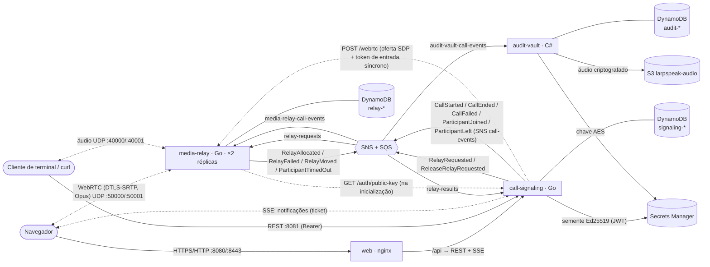

# Arquitetura

## Diagrama

Todos os serviços AWS são emulados localmente pelo MiniStack (`ministackorg/ministack:1.5.40`).

## Serviços

| Serviço | Linguagem | Possui | Consome | Publica |
|---|---|---|---|---|
| call-signaling | Go | `signaling-calls`, `signaling-users`, `signaling-outbox`, `signaling-processed`, `signaling-accounts`, `signaling-refresh`; segredo `larpspeak/jwt-key` | `relay-results` | `relay-requests`, SNS `call-events` |
| media-relay | Go | `relay-sessions`, `relay-nodes`, `relay-outbox`, `relay-processed` | `relay-requests`, `media-relay-call-events` | `relay-results` |
| audit-vault | C# | `audit-records`, `audit-processed`, S3 `larpspeak-audio`, segredo `larpspeak/audio-key` | `audit-vault-call-events` | — |
| web (cliente) | TypeScript | — (nginx sem estado) | — | — |

O `web` é o cliente: serve a interface e repassa `/api` ao call-signaling na mesma origem. Não é
microsserviço, então a conta continua 3 serviços / 2 linguagens.

Toda fila tem uma `-dlq` com `maxReceiveCount=5`. Os recursos são criados por `infra/init/init.sh`.

## Serviços de nuvem e justificativas

| Categoria | Serviço | Por que este e não uma alternativa |
|---|---|---|
| Mensageria | SNS + SQS | O SNS distribui um fato para várias filas (evento com vários interessados); o SQS oferece consumidores concorrentes, reentrega por visibility timeout e DLQ nativa. Gerenciado: não há contêiner de broker para operar (ao contrário de RabbitMQ/Kafka). |
| Banco de dados | DynamoDB | Escritas condicionais dão contagem atômica de vagas (R2) sem locks; `TransactWriteItems` grava o efeito e o `messageId` processado atomicamente (R1). Um conjunto de tabelas por serviço. |
| Armazenamento de objetos | S3 | Áudio é dado binário grande; o S3 é o lugar natural e mantém os itens do DynamoDB pequenos. |
| Segredos | Secrets Manager | Chaves nunca ficam no código nem em arquivos de ambiente: a semente Ed25519 que assina os tokens (lida só pelo call-signaling) e a chave AES do áudio. O mesmo código funciona na AWS real. |

## Como cada requisito é atendido

| # | Requisito | Mecanismo | Onde |
|---|---|---|---|
| R1 | At-least-once + idempotência | O consumidor grava o efeito + `processed/{messageId}` (condição `attribute_not_exists`) num único `TransactWriteItems`; duplicada → `ConditionalCheckFailed` → confirma e ignora | call-signaling `internal/adapter/dynamo/store.go` (`commit`, `markProcessed`); media-relay `internal/adapter/dynamo/sessions.go` (`commit`); audit-vault (a fazer) |
| R2 | Controle de concorrência | `UpdateItem SET taken = taken + 1` com `#s = :active AND taken < #cap AND NOT contains(participants, :uid)` no item da chamada | call-signaling `internal/adapter/dynamo/store.go` (`join`) |
| R3 | API assíncrona | `POST /calls` (com `Authorization: Bearer`) → `202 {callId, statusUrl}`; `GET /calls/{id}` | call-signaling `internal/adapter/httpapi/handlers.go` (`handleCreate`) |
| R4 | Consumidores concorrentes | media-relay com `replicas: 2` na fila `relay-requests`; a ordem por chamada é garantida por idempotência + checagem de estado, não pela ordem da fila | `docker-compose.yml` |
| R5 | Dependência instável | `RELAY_LATENCY_MS`, `RELAY_FAILURE_RATE` no media-relay | media-relay `internal/app/relay.go` (`allocate`) |
| R6 | Reconexão | O laço de consumo tenta de novo com backoff exponencial; o outbox mantém itens não enviados até publicar; a leitura do segredo e a busca da chave pública também tentam de novo até o MiniStack/call-signaling responder; no desligamento o consumidor termina o long poll em andamento | `internal/adapter/messaging/bus.go` nos dois serviços Go; `adapter/secrets` (call-signaling); `adapter/pubkey` (media-relay); audit-vault (a fazer) |

## Cenários de falha (demonstração)

| # | Como provocar | Resultado esperado |
|---|---|---|
| F1 | `RELAY_FAILURE_RATE=1.0` | Vagas liberadas, quem ligou notificado, `CallFailed` |
| F2 | `docker kill` numa réplica do media-relay durante o processamento | A mensagem reaparece após o visibility timeout e a outra réplica aplica o efeito uma única vez |
| F3 | Publicar o mesmo `messageId` 5× | Um único efeito (tabela de processadas) |
| F4 | Publicar payload inválido | 5 recebimentos e depois `-dlq`; as demais mensagens seguem |
| F5 | 100 entradas simultâneas, 10 vagas | Exatamente 10 sucessos |
| F6 | `docker compose pause ministack` por 30 s (pausar, não parar: o estado do MiniStack fica em memória) | Serviços registram tentativas, reconectam e o outbox drena |
| F7 | `RELAY_LATENCY_MS` > `RELAY_TIMEOUT_MS` | A saga compensa; `RelayAllocated` atrasado → `ReleaseRelayRequested` |
| F8 | `docker compose up --scale media-relay=3` | Carga dividida, sem efeito duplicado |

Os scripts `scripts/demo/f1.sh` a `f8.sh` (`make test_case1` a `make test_case8`) fazem login como
usuários de teste e provocam cada cenário.

## Decisões

- **3 serviços / 2 linguagens**, conforme a correção do professor ao enunciado; a notificação fica no call-signaling. O cliente web (TypeScript) não é microsserviço.
- **Outbox no DynamoDB:** mudança de estado + item de outbox gravados numa única transação; uma goroutine publica e apaga.
- **Nenhum código compartilhado entre serviços**; os contratos em `contracts/` são a única superfície comum. A verificação de token do media-relay é uma cópia, de propósito.
- **Autenticação real no call-signaling:** senhas com PBKDF2-SHA256 (600 mil iterações, sal por conta); tokens JWT EdDSA (Ed25519) separados por tipo (`access` 5 min, `sse` 60 s, `join` 60 s). **Só o call-signaling cria tokens:** ele é o único que lê a semente no Secrets Manager; o media-relay só tem a chave pública e apenas verifica. O token de renovação é opaco, guardado como hash, trocado a cada uso e enviado num cookie httpOnly SameSite=Strict; reuso fora da janela de 5 s revoga o login inteiro. Alternativa rejeitada: HMAC com chave compartilhada (os dois serviços poderiam criar tokens).
- **Áudio do navegador por WebRTC no próprio media-relay** (SFU com pion, Opus repassado sem decodificar), reaproveitando alocação, posse da chamada, failover e timeout de participante. Alternativa rejeitada: um serviço-ponte separado (duplicaria o failover).
- **Primeira chamada síncrona entre serviços:** a oferta SDP é pedido/resposta por natureza, então o call-signaling a repassa por HTTP ao pod dono da chamada (endereço vindo de `signalAddr`, campo opcional em `RelayAllocated`/`RelayMoved` v1). Nenhuma transição da saga depende dela; falha vira 409/503 e o cliente tenta de novo.
- **Mesma origem via nginx:** o `web` serve a interface e repassa `/api`, sem CORS e com o cookie SameSite=Strict funcionando. HTTPS opcional (`make certs`) é necessário para o microfone em outras máquinas.
- **Desligamento gracioso dos consumidores:** ao receber SIGTERM o consumidor não cancela o long poll em andamento (a mensagem já entregue ficaria invisível por 30 s e a saga expiraria); termina o lote atual e só então sai (`stop_grace_period: 20s`).
