# Larpspeak: como funciona, do enunciado ao pacote de áudio

Explicação didática e completa do projeto, para estudar e apresentar. Cada decisão aparece com **o que**, **por que**,
**alternativa descartada** e **onde está no código**.

- **Fonte de verdade:** o código. Toda afirmação aponta `arquivo:linha`. Quando o `ARCHITECTURE.md` diverge, vale o código, e o texto avisa.
- **Base:** o enunciado do trabalho final (R1–R6, F1–F8 e regras gerais). Exceção do responsável: o mínimo é 3 serviços e 2 linguagens; o "4 / 3" do texto é erro de digitação.
- **Caminhos abreviados:** `CS/` = `services/call-signaling/`, `MR/` = `services/media-relay/`, `AV/` = `services/audit-vault/`.
- Identificadores, tipos de mensagem, comandos, variáveis de ambiente e linhas de log ficam em inglês, como no código.
- Roteiro prático da demo na LAN: `presentation/DEMO-LAN.md`. Referência técnica completa: `ARCHITECTURE.md`.

## Sumário

**Parte 1: o problema e a arquitetura**
1. O problema e o enunciado
2. Visão geral da arquitetura
3. Por que duas linguagens: Go e C#
4. Nuvem: por que AWS (SNS, SQS, DynamoDB, S3, Secrets Manager) e por que MiniStack
5. Mensageria e contratos

**Parte 2: o áudio**
6. Áudio em tempo real: conceitos
7. WebRTC e Opus no Larpspeak
8. Gravação das chamadas

**Parte 3: Go e os serviços por dentro**
9. Go no Larpspeak: concorrência na prática
10. Arquitetura hexagonal (portas e adaptadores)
11. Os serviços por dentro

**Parte 4: confiabilidade, concorrência, requisitos, falhas e segurança**
12. Confiabilidade: os padrões que seguram o sistema
13. A saga da chamada e a concorrência
14. Requisitos R1–R6, um por um
15. Cenários de falha F1–F8 e falha surpresa
16. Segurança e limitações conhecidas

---

# Parte 1 — O problema e a arquitetura

## 1. O problema e o enunciado

### 1.1 O que o trabalho pede, em uma frase

O enunciado (`.ai/assignment/trabalho-final.txt`) resume o trabalho assim:

> "Cada grupo vai projetar e construir um sistema distribuído sobre um tema próprio, com pelo menos três
> microsserviços escritos em no mínimo duas linguagens diferentes, que se comunicam por mensageria assíncrona e
> consomem serviços de nuvem."

E deixa claro onde está a nota:

> "A regra de negócio pode ser simples: a nota está nas decisões de arquitetura e no comportamento do sistema quando
> a rede, o broker ou um serviço falham."

Esta frase guia o resto do documento. O Larpspeak não tenta ser um Discord completo. Ele tem uma regra de negócio
pequena (criar uma chamada, entrar, falar, sair). O esforço está em fazer essa regra continuar correta quando
mensagens se repetem, chegam fora de ordem, um contêiner morre ou o broker some por 30 segundos.

### 1.2 Os requisitos do enunciado, organizados

O enunciado tem cinco blocos de exigências. A tabela resume cada um.

| Bloco | O que exige | Onde o Larpspeak responde |
|---|---|---|
| **Tema** | Fluxo principal com (a) transação distribuída com compensação, (b) dependência lenta ou instável, (c) evento com vários interessados | Seção 1.4 |
| **Arquitetura** | Mínimo de 3 microsserviços coordenados por eventos; diagrama com serviços, bancos, mensageria e nuvem; justificar cada serviço de nuvem | Seções 2 e 4 |
| **Nuvem** | Pelo menos 3 categorias (mensageria obrigatória) entre mensageria, banco, cache, objetos, computação, segredos | Seção 4 (usa 4 categorias) |
| **Regras gerais** | Linguagens diferentes; banco por serviço; broker justificado; contratos explícitos em `contracts/` com envelope comum; Dockerfile + health check por serviço; tudo sobe com `docker compose up` | Seções 2, 3, 4 e 5 |
| **Requisitos de SD** | R1–R6 (tabela abaixo) | Mapa na seção 1.6 |
| **Cenários de falha** | F1–F8, provocados ao vivo; mais uma "falha surpresa" escolhida pelo professor | Mapa na seção 1.6; detalhes na seção 15 |
| **Entregas** | Apresentação/defesa em 26/11/2026; código em Git público até 03/12/2026 | — |

**Nota sobre a contagem de serviços e linguagens.** O texto do enunciado se contradiz: o parágrafo de abertura fala em
"três microsserviços" e "duas linguagens", e a seção de Arquitetura repete "no mínimo três microsserviços", mas a lista
de Regras diz "Três linguagens, no mínimo". O responsável pelo projeto leu o "4 / 3" como erro de digitação. O mínimo
adotado é **3 serviços e 2 linguagens**. A decisão está registrada como D17 em `ARCHITECTURE.md` §13. Vale citar isso
na apresentação antes que o professor pergunte.

Os seis requisitos de sistemas distribuídos, nas palavras do enunciado:

| # | Requisito | O que precisa ser mostrado (citação) |
|---|---|---|
| R1 | Entrega at-least-once com idempotência | "Consumidores registram o messageId processado na mesma transação do efeito; mensagem repetida não gera efeito duplicado" |
| R2 | Controle de concorrência | "Zero venda dupla do recurso escasso sob carga." |
| R3 | API assíncrona | "A entrada responde 202 Accepted com um id; o cliente consulta o status depois" |
| R4 | Consumidores concorrentes | "Pelo menos um serviço roda com 2 ou mais réplicas na mesma fila, sem efeito duplicado; a apresentação discute ordenação" |
| R5 | Dependência instável simulada | "Latência e taxa de falha configuráveis por variável de ambiente" |
| R6 | Reconexão | "Os serviços sobrevivem à queda do broker e voltam a consumir sem reinício manual" |

E os oito cenários de falha:

| # | Cenário | Resultado esperado (resumo do enunciado) |
|---|---|---|
| F1 | Compensação (falha da dependência em 100%) | Passos anteriores desfeitos, recurso liberado, cliente notificado |
| F2 | `docker kill` no consumidor durante o processamento | Mensagem reentregue, efeito aplicado uma única vez |
| F3 | Mesma mensagem (mesmo `messageId`) 5 vezes | Um único efeito |
| F4 | Payload inválido | N tentativas, depois DLQ; as demais seguem |
| F5 | 100 requisições para 10 unidades | Exatamente 10 sucessos |
| F6 | Broker parado por 30 s | Reconexão sozinha, outbox drena, nada perdido |
| F7 | Latência da dependência maior que o timeout | Compensação correta do resultado atrasado |
| F8 | 3 réplicas de um consumidor | Carga dividida, sem efeito duplicado |

O enunciado também lista bônus (OpenTelemetry, IaC com Terraform/Bicep/Pulumi/CDK, autoescala, CQRS, versionamento de
eventos). Seja honesto na apresentação: o código atual **não reivindica nenhum bônus de forma completa**. Não há
OpenTelemetry nem autoescala. A infraestrutura é criada por um script de AWS CLI (`infra/init/init.sh`), não por uma
das ferramentas de IaC citadas. A API de leitura do audit-vault é separada da escrita, mas o projeto não a apresenta
como CQRS. Os schemas ganharam um campo opcional (`signalAddr`), mas não há duas versões de um evento convivendo.

### 1.3 O tema: chamadas de voz em grupo

O Larpspeak é um **backend de chamadas de voz em grupo**, no estilo de um canal de voz do Discord. Um usuário cria
uma chamada, convida outros, cada um entra e todos falam ao mesmo tempo.

O fluxo principal tem três passos. Cada passo é uma rota HTTP do call-signaling
(`services/call-signaling/internal/adapter/httpapi/handlers.go:26-35`):

1. **Criar**: `POST /calls`. A resposta é `202 Accepted` com `{callId, status: "PENDING", statusUrl}`
   (`handlers.go:82`). A chamada ainda não existe de fato: falta um servidor de áudio (o "relay") para ela.
   O cliente acompanha o resultado por `GET /calls/{id}` ou por notificação SSE (`call_active` ou `call_failed`).
2. **Entrar**: `POST /calls/{id}/join`. A resposta é `200` com o endereço do relay, ou `409` se a sala está cheia,
   inativa ou o usuário já está nela (`handlers.go:84-107`).
3. **Falar**: o navegador negocia uma conexão WebRTC (`POST /calls/{id}/webrtc`) e passa a enviar áudio direto para o
   pod do media-relay que hospeda a chamada. O áudio **não** passa pelo broker nem pelo call-signaling (ver seções 6 e 7).

Sair é `POST /calls/{id}/leave` (`202`). Quando sai o último participante, a chamada termina.

### 1.4 Os três elementos obrigatórios do fluxo principal

O enunciado só aceita um tema se o fluxo principal tiver três elementos. No Larpspeak:

| Elemento exigido | Onde aparece | Como funciona |
|---|---|---|
| **Transação distribuída com compensação** | Criação da chamada, entre call-signaling e media-relay | O call-signaling grava a chamada `PENDING`, reserva o criador e pede um relay (`RelayRequested`). Se o media-relay responde `RelayFailed`, ou não responde em `RELAY_TIMEOUT_MS`, a chamada vira `FAILED`, as vagas e a reserva do usuário são liberadas e o cliente recebe `call_failed`. Se a alocação chega depois do prazo, o relay é devolvido com `ReleaseRelayRequested`. Detalhes na seção 13 |
| **Dependência lenta ou instável** | Alocação do relay no media-relay | `RELAY_LATENCY_MS` atrasa a alocação; `RELAY_FAILURE_RATE` (0 a 1) sorteia falhas (`services/media-relay/internal/config/config.go:62-67`, `internal/app/relay.go:183-189`) |
| **Evento com vários interessados** | Tópico SNS `call-events` | `CallStarted`, `ParticipantJoined`, `ParticipantLeft`, `CallEnded` e `CallFailed` são publicados uma vez e consumidos pelo media-relay e pelo audit-vault (seção 5.5) |

Uma observação útil para a defesa: no mundo real, "alocar um servidor de mídia" é de fato um passo lento e falível
(é preciso achar capacidade, abrir portas, às vezes subir uma máquina). A dependência instável não é artificial no
domínio, só a forma de simulá-la é.

### 1.5 Por que chamadas de voz são um bom caso de sistemas distribuídos

Voz tem propriedades que obrigam a tomar decisões de arquitetura reais:

- **Dois tipos de tráfego com exigências opostas.** O tráfego de controle (criar, entrar, sair) precisa ser
  **correto**: uma vaga não pode ser vendida duas vezes. O tráfego de mídia (pacotes de áudio a cada 20 ms) precisa ser
  **rápido**: um pacote atrasado é inútil, e é melhor perdê-lo do que esperar. Isso leva à separação entre *plano de
  controle* (mensageria, transações) e *plano de dados* (UDP direto ao relay). Nenhuma fila fica no caminho da voz.
- **Recurso escasso de verdade.** A sala tem capacidade (`MAX_PARTICIPANTS`, padrão 10). Cem pessoas clicando "entrar"
  ao mesmo tempo é exatamente o cenário F5 ("100 requisições simultâneas para 10 unidades").
- **Estado com dono.** Todos os participantes de uma chamada precisam falar com o **mesmo** relay, porque é ele que
  mistura e repassa o áudio. Isso cria afinidade (uma chamada pertence a um pod) e obriga a pensar em failover quando
  esse pod morre (seções 7.9 e 11.2.5).
- **Falhas perceptíveis.** Se o sistema erra, alguém fica falando sozinho, ou fica preso numa chamada que já acabou.
  Os cenários de falha têm efeito visível na demonstração, não só em logs.
- **Um interessado "lento" natural.** A auditoria e a gravação não podem atrasar a chamada. Elas recebem fatos de forma
  assíncrona, no próprio ritmo, por filas próprias. É o caso de uso clássico de fan-out.

### 1.6 Mapa rápido: requisito → mecanismo → seção

| Item | Mecanismo no Larpspeak | Seção deste documento |
|---|---|---|
| R1 | Marcador `messageId` + efeito + outbox na mesma `TransactWriteItems` | 12.2, 12.3, 14 |
| R2 | Escrita condicional `taken < capacity` no DynamoDB | 13.6, 14 |
| R3 | `POST /calls` → `202` + `GET /calls/{id}` + SSE | 11.1.1, 14 |
| R4 | media-relay ×2 e audit-vault ×2 nas mesmas filas; ordenação discutida | 2.6, 5.8, 11.3.7, 14 |
| R5 | `RELAY_LATENCY_MS`, `RELAY_FAILURE_RATE` | 1.4, 11.2.2, 14 |
| R6 | Laço de consumo com backoff, SDK sem retry próprio, timeout de 15 s | 12.5, 14 |
| F1–F8 | `make test_case1` … `make test_case8` | 2.8, 15 |

---

## 2. Visão geral da arquitetura

### 2.1 Dois conceitos antes do diagrama

**Microsserviço.** Um processo independente, com seu próprio código, seu próprio banco e seu próprio ciclo de deploy.
A palavra-chave é *independente*: se um microsserviço cai, os outros continuam fazendo o que não depende dele. No
Larpspeak isso é levado a sério ao ponto de **não haver código compartilhado** entre serviços: a única coisa comum é a
pasta `contracts/` (decisão D16). O envelope de mensagem existe em três cópias
(`services/call-signaling/internal/domain/envelope.go`, `services/media-relay/internal/domain/envelope.go`,
`services/audit-vault/Envelope.cs`).

**Comunicação síncrona x assíncrona.**
- *Síncrona* é um telefonema: quem chama espera a resposta, e se o outro lado não atende, a chamada falha. HTTP é
  síncrono.
- *Assíncrona* é uma caixa postal: quem envia deixa a mensagem e segue a vida; o destinatário lê quando puder. Se o
  destinatário está fora do ar, a mensagem espera. Filas (SQS) e tópicos (SNS) são assíncronos.

A regra do Larpspeak: **entre serviços, tudo é assíncrono, com duas exceções justificadas** (seção 2.5).

### 2.2 Os componentes

| Componente | Linguagem / imagem | Papel | Réplicas (padrão) |
|---|---|---|---|
| **call-signaling** | Go 1.27 | API HTTP, contas e tokens, ciclo de vida da chamada (a saga), notificações SSE | 1 |
| **media-relay** | Go 1.27 | Aloca o relay (a dependência instável), encaminha áudio (SFU WebRTC e UDP legado), detecta quem caiu, failover entre pods, recorta a gravação | `${MEDIA_RELAY_REPLICAS:-2}` |
| **audit-vault** | C# / .NET 10 | Trilha de auditoria só de acréscimo; gravações cifradas no S3; API de leitura protegida | `${AUDIT_VAULT_REPLICAS:-2}` |
| web | nginx 1.29 + React 19 (TypeScript) | Interface do navegador e proxy de `/api/` para o call-signaling. Sem regra de negócio | 1 |
| ministack | `ministackorg/ministack:1.5.40` | Emula SNS, SQS, DynamoDB, S3 e Secrets Manager na porta 4566 | 1 |
| infra-init | `amazon/aws-cli:2.39.0` | Roda `infra/init/init.sh` uma vez e termina | 1 (executa e sai) |

Os três **clientes**:

| Cliente | Onde | Protocolo de áudio | Uso |
|---|---|---|---|
| Navegador | `web/` | WebRTC (Opus, criptografado por DTLS-SRTP) na porta `WEBRTC_UDP_PORT` | Uso normal e demo da apresentação |
| `voice-client` | `tools/voice-client/main.go` | UDP "legado", PCM, na porta `UDP_PORT`; precisa do `sox` | Terminal; `make call`, `make join`, `make listen` |
| `webrtc-probe` | `tools/webrtc-probe/main.go` | WebRTC com pion; envia Opus real sem navegador | Testes ponta a ponta do audit-vault (`make test_audit`) |

O `webrtc-probe` existe porque os cenários do audit-vault precisam de chamadas com áudio de verdade, e um navegador
não é automatizável num script de shell. Ele "envia a mesma oferta WebRTC que o cliente web envia"
(`tools/webrtc-probe/main.go:1-7`).

### 2.3 Diagrama do sistema

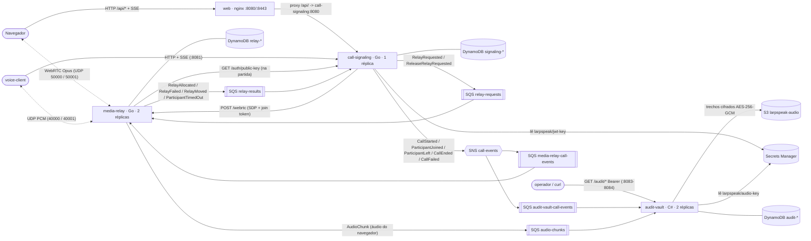

Como ler: linhas cheias são tráfego de controle; linhas pontilhadas são o plano de dados (áudio). Cada serviço tem o
próprio grupo de tabelas, e só ele toca nelas.

### 2.4 Quem fala com quem, e como

| De → Para | Meio | Síncrono? | O que passa | Código |
|---|---|---|---|---|
| Navegador → web → call-signaling | HTTP (proxy nginx `/api/`) | sim | Comandos do usuário; SSE de volta | `web/nginx/default.conf.template` |
| voice-client → call-signaling | HTTP direto na porta 8081 | sim | Igual ao navegador, sem nginx | `tools/voice-client/main.go` |
| call-signaling → media-relay | fila SQS `relay-requests` | não | `RelayRequested`, `ReleaseRelayRequested` | `services/call-signaling/internal/app/saga.go:49`, `:142` |
| media-relay → call-signaling | fila SQS `relay-results` | não | `RelayAllocated`, `RelayFailed`, `RelayMoved`, `ParticipantTimedOut` | `services/media-relay/internal/app/relay.go:189`, `:202`, `:369`; `failover.go:212` |
| call-signaling → todos os interessados | tópico SNS `call-events` → uma fila por consumidor | não | Fatos do ciclo de vida da chamada | `services/call-signaling/internal/adapter/messaging/bus.go:140-151` |
| media-relay → audit-vault | fila SQS `audio-chunks` | não | `AudioChunk` (gravação) | `services/media-relay/internal/app/recorder.go:172` |
| call-signaling → media-relay | HTTP `POST http://<relaySignal>/webrtc` | **sim** | Oferta SDP do navegador + token `join` | `services/call-signaling/internal/adapter/relayhttp/client.go:23` |
| media-relay → call-signaling | HTTP `GET /auth/public-key` | **sim**, só na partida | Chave pública Ed25519 para validar tokens | `services/media-relay/internal/adapter/pubkey/pubkey.go` |
| Clientes ↔ media-relay | UDP (WebRTC ou PCM) | — | Áudio | ver seções 6–8 |

Dois fatos que o diagrama fixa e que valem como pergunta de prova:

- **Só o call-signaling publica no SNS.** O media-relay não importa o cliente SNS: seu `go.mod` só tem
  `service/dynamodb` e `service/sqs`, e o `Bus` dele só faz `SendMessage`
  (`services/media-relay/internal/adapter/messaging/bus.go:143`).
- **O audit-vault não chama nenhum serviço.** Ele só consome filas e responde à própria API de leitura
  (`services/audit-vault/Program.cs:45`, `:64`, `:68`). Se ele cair, ninguém mais percebe; os eventos acumulam na
  fila dele.

### 2.5 As duas chamadas síncronas, e por que só elas

**O que.** call-signaling → media-relay `POST /webrtc` e media-relay → call-signaling `GET /auth/public-key`.

**Por que (decisão D11).**
- A negociação WebRTC é pedido-resposta com uma pessoa esperando: o navegador manda uma *oferta SDP* (a descrição de
  como quer receber áudio) e só consegue conectar quando recebe a *resposta SDP*. Colocar isso numa fila exigiria
  correlacionar a resposta e esperar o long poll, com latência perceptível na hora de entrar.
- A oferta precisa ir para **o pod dono da chamada** (todos os participantes no mesmo SFU). O call-signaling guarda
  esse endereço (`relaySignal`) quando recebe `RelayAllocated`. Um balanceador comum na frente dos relays mandaria o
  pedido para um pod qualquer.
- A chave pública é lida uma vez, na partida, e sem ela o relay não aceita ofertas (responde `503`, e o navegador tenta
  de novo; `relayhttp/client.go:36-39`).

**Alternativa descartada.** SDP por fila (latência e correlação de resposta) ou balanceador na frente dos relays
(mandaria o áudio para o pod errado).

**Como a dependência síncrona é contida.** O cliente HTTP tem timeout de 5 s (`services/call-signaling/main.go:70`).
Um pod fora do ar vira `ErrRelayNotReady` (`relayhttp/client.go:29`), o navegador recebe `409 relay not ready, retry`
e repete com backoff enquanto o failover move a chamada.

### 2.6 Implantação com `docker-compose.yml`

O enunciado exige que "o sistema inteiro sobe localmente com um docker compose up". O arquivo
`docker-compose.yml` faz isso com três ideias.

**1. Âncoras YAML para não repetir configuração.**
- `x-aws` (`docker-compose.yml:2-6`): `AWS_ENDPOINT_URL: http://ministack:4566`, região e credenciais de teste. Todo
  serviço que fala com a AWS herda esse bloco.
- `x-after-init` (`docker-compose.yml:8-13`): `stop_grace_period: 20s`, `restart: unless-stopped` e
  `depends_on: infra-init: condition: service_completed_successfully`.

**2. Ordem de subida garantida.**

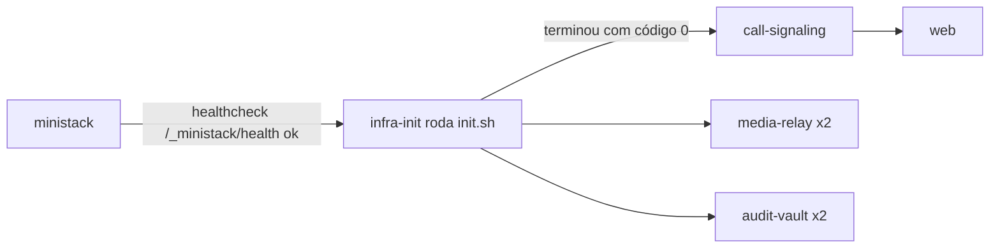

O `infra-init` só começa quando o MiniStack está saudável (`docker-compose.yml:30-32`). Os serviços só começam
quando o `infra-init` terminou com sucesso. Assim nenhum serviço tenta ler uma fila que ainda não existe. Mesmo assim,
os serviços aguentam um MiniStack lento: resolvem URLs de fila sob demanda e repetem com backoff (seção 12.5).

**3. Réplicas e portas.**

| Serviço | Réplicas | Portas no host | Observação |
|---|---|---|---|
| ministack | 1 | 4566 | Estado só em memória, sem volume |
| call-signaling | 1 | 8081→8080 | Uma réplica porque o hub SSE fica em memória (D15; seção 11) |
| web | 1 | 8080→80, 8443→443 | HTTPS só se existir `web/certs` (`make certs`) |
| media-relay | `${MEDIA_RELAY_REPLICAS:-2}` | nenhuma | Réplicas sem porta publicada: só servem dentro da rede Docker |
| audit-vault | `${AUDIT_VAULT_REPLICAS:-2}` | 8083-8084→8080 | Uma porta por réplica; acima de 2 réplicas é preciso ampliar a faixa (`docker-compose.yml:100`) |

**Por que `stop_grace_period: 20s`?** O consumidor faz *long poll* de 10 s no SQS (explicado na seção 4.2). Ao
receber `SIGTERM`, ele termina o poll em andamento e processa o lote antes de sair. 20 s cobre esse poll com folga.
Se o Docker matasse o processo no meio, as mensagens já recebidas ficariam invisíveis por 30 s antes de voltar.

**Dockerfile e `/health` por serviço** (exigência do enunciado):

| Serviço | Dockerfile | Health check |
|---|---|---|
| call-signaling | `services/call-signaling/Dockerfile` | `HEALTHCHECK` com `wget` em `/health` a cada 10 s (`Dockerfile:9`) |
| media-relay | `services/media-relay/Dockerfile` | Igual; a resposta inclui `replica` (o hostname) |
| audit-vault | `services/audit-vault/Dockerfile` | `bash /dev/tcp`, porque a imagem `aspnet` não tem `curl`/`wget` (`Dockerfile:12-13`); rota em `AuditApi.cs:12` |
| web | `web/Dockerfile` | `wget` em `/health`, definido no compose (`docker-compose.yml:65-69`) |

### 2.7 Modo voz: `compose.voice.yml` e `RELAY_HOST`

No compose padrão, os relays não publicam portas. Isso basta para os testes internos, mas um navegador em outra
máquina precisa alcançar o relay por UDP. O arquivo `compose.voice.yml` é sobreposto ao principal:

- `media-relay` passa a ter **1 réplica** com as portas `40000/udp` (voz legada) e `50000/udp` (WebRTC) publicadas
  (`compose.voice.yml:6-11`).
- `media-relay-2` é uma **segunda instância** que herda tudo do `media-relay` (`extends`), com as portas `40001/udp` e
  `50001/udp` (`compose.voice.yml:13-23`).

**Por que duas instâncias nomeadas em vez de `replicas: 2`?** Duas réplicas do mesmo serviço não podem publicar a
mesma porta do host. Cada relay precisa de uma porta UDP própria e conhecida, porque o cliente envia áudio direto a
ela. Com dois relays alcançáveis, uma chamada sobrevive à morte de um deles (o failover move a chamada para o outro).

**O que é `RELAY_HOST`.** É o endereço que o relay **anuncia** aos clientes como destino do áudio. Dentro do Docker, o
pod só conhece o IP do contêiner, que outra máquina da rede não alcança. Por isso `advertisedHost` usa `RELAY_HOST`
quando definido e, senão, o IP do contêiner (`services/media-relay/main.go:118-124`). O SFU WebRTC também recebe
`RELAY_HOST` para montar seus candidatos ICE (`main.go:88`). No modo voz a variável é obrigatória: `${RELAY_HOST:?...}`
faz o compose recusar a subida sem ela (`compose.voice.yml:11`, `:21`).

### 2.8 Os comandos do `Makefile`

O `Makefile` é o roteiro operacional da apresentação. Ele sempre usa os dois arquivos de compose
(`COMPOSE := docker compose -f docker-compose.yml -f compose.voice.yml`, `Makefile:8`) e descobre `RELAY_HOST` sozinho
pelo IP da interface `en0` (macOS) ou por `hostname -I` (Linux) (`Makefile:5-6`).

| Comando | O que faz |
|---|---|
| `make build` | Compila as imagens e o `bin/voice-client` (com Go local ou dentro de um contêiner `golang:1.27`) |
| `make start` | Sobe tudo em segundo plano. **Não reconstrói**: depois de mudar código, rode `make build` |
| `make stop` / `make clean` | Derruba (o MiniStack zera, pois guarda tudo em memória) / derruba e apaga imagens e `bin/` |
| `make certs` | Gera certificado local com `mkcert` para HTTPS em `https://$RELAY_HOST:8443` (o navegador só libera microfone em HTTPS fora do `localhost`) |
| `make logs [SERVICE=...]`, `make ps` | Logs e estado dos contêineres |
| `make call ME=ana [INVITE=bob] [MAX=5]` | Cria uma chamada pelo `voice-client` |
| `make join ME=bob CALL=<id>`, `make listen ME=carl` | Entra numa chamada / espera um convite |
| `make mute`, `make deafen` | Envia `SIGUSR1`/`SIGUSR2` ao `voice-client` do usuário |
| `make invite`, `make leave`, `make status` | `curl` autenticado nas rotas do call-signaling |
| `make recording [CALL=<id>]` | Prova que a gravação está cifrada no S3 e abre o áudio de cada participante |
| `make kill_relay [CALL=<id>]` | Mata o pod dono da chamada e mostra o failover |
| `make test` | Testes unitários Go (3 módulos) e C# (com SDK local ou em contêiner `dotnet/sdk:10.0`) |
| `make test_case1` … `make test_case8` | Roda `scripts/demo/fN.sh` e, se existir, `scripts/demo/audit-fN.sh` (`Makefile:112-115`) |
| `make test_audit` | Suíte ponta a ponta do audit-vault com chamadas WebRTC reais (gravação, trilha, F2, F3, F4, F6, F8) |

### 2.9 Organização do repositório

```
contracts/          envelope.schema.json + events/*.v1.schema.json (12 tipos)   -> seção 5
infra/init/init.sh  cria filas, DLQs, tópico, tabelas, bucket e segredos        -> seção 4
services/
  call-signaling/   Go: main.go + internal/{domain,app,adapter,config}
  media-relay/      Go: mesma estrutura (portas e adaptadores)
  audit-vault/      C#: Program.cs + classes por responsabilidade
  audit-vault.Tests/ xUnit
web/                React + TypeScript (Vite), servido por nginx
tools/              voice-client (terminal), webrtc-probe (testes)
scripts/demo/       um script por cenário F1-F8 e demos do audit-vault
docker-compose.yml, compose.voice.yml, Makefile
```

A arquitetura hexagonal (portas e adaptadores) dos serviços Go é tema da seção 10.

---

## 3. Por que duas linguagens: Go e C#

### 3.1 A divisão

| Serviço | Linguagem | Caráter do trabalho |
|---|---|---|
| call-signaling | Go | Muitas conexões HTTP e SSE abertas ao mesmo tempo; saga; laços de fundo |
| media-relay | Go | Tempo real: pacotes UDP a cada 20 ms por participante; WebRTC |
| audit-vault | C# / .NET 10 | Processamento de mensagens, criptografia, armazenamento; sem exigência de latência |

A regra que guiou a divisão: **Go no caminho de tempo real; C# fora dele**. A auditoria pode atrasar alguns segundos
sem que ninguém perceba. A voz não pode atrasar 100 ms.

**Alternativa descartada (D17).** Separar as notificações SSE num quarto serviço, numa terceira linguagem. Isso
atenderia a leitura literal "três linguagens" e resolveria o limite de 1 réplica do call-signaling, mas acrescentaria
um serviço e um caminho de mensagens a mais. O responsável optou por 3 serviços e 2 linguagens.

### 3.2 O que Go oferece, e onde o projeto usa

Cada afirmação abaixo aponta para o uso real no código.

| Recurso de Go | Por que importa aqui | Onde está |
|---|---|---|
| **Goroutines** (funções concorrentes muito baratas) | Cada serviço roda vários laços independentes no mesmo processo: consumidores de fila, outbox, varredores, failover, servidor UDP | `services/media-relay/main.go:74-80`: `go messaging.RelayOutbox(...)`, `consumers.Go(...)` ×2, `go r.Sweep(ctx)`, `go r.Failover(ctx)`, `go udp.Serve(...)` |
| **`sync.WaitGroup.Go`** | Lança uma goroutine e a registra para o `Wait` final; o `main` espera os consumidores terminarem o último poll | `services/call-signaling/main.go:74-75`, `:88` |
| **Canais e `select`** | Passar trechos de áudio para o gravador **sem nunca bloquear** o caminho da voz: se o canal está cheio, o trecho é descartado | `services/media-relay/internal/app/recorder.go:162-167` (`select { case r.out <- ...: default: ... }`) |
| **`context`** (cancelamento propagado) | Um `SIGTERM` vira um contexto cancelado que todos os laços observam; `WithoutCancel` deixa o poll em andamento terminar; `WithTimeout` limita cada requisição HTTP a 3 s | `signal.NotifyContext` em `call-signaling/main.go:44`; `context.WithoutCancel` em `messaging/bus.go:74`; `context.WithTimeout(r.Context(), 3*time.Second)` em `handlers.go:73` |
| **`net/http` da biblioteca padrão** | O roteador padrão aceita método e parâmetros de caminho (`"POST /calls/{id}/join"`), então não há framework web | `handlers.go:26-35`, `auth.go:19-37` |
| **SSE com a biblioteca padrão** | `http.Flusher` + `text/event-stream`, sem dependência | `services/call-signaling/internal/adapter/sse/hub.go:38`, `:59` |
| **Criptografia e ids na biblioteca padrão** | `crypto/ed25519` para assinar tokens; o pacote `uuid` da biblioteca padrão (Go 1.27) para `messageId` | `call-signaling/main.go:10`, `:68`; `internal/domain/envelope.go:8`, `:27` |
| **Logs estruturados (`log/slog`)** | Logs em JSON com `correlationId`, filtráveis por chamada na demonstração | `call-signaling/main.go:38`; `messaging/bus.go:100-102` |
| **Binário estático e imagem pequena** | `CGO_ENABLED=0 go build` gera um executável sem dependências; a imagem final é `alpine:3.23` só com esse arquivo | `services/call-signaling/Dockerfile:4-7` (idem media-relay) |
| **Biblioteca pion (WebRTC em Go puro)** | Um SFU WebRTC dentro do próprio serviço, sem C nem processo externo, compatível com o binário estático | `services/media-relay/go.mod` (`github.com/pion/webrtc/v4 v4.2.26`); `internal/adapter/webrtc/sfu.go:17-19` |

**Sobre coleta de lixo.** O coletor de Go é concorrente e foi desenhado para pausas curtas, o que combina com tráfego
de tempo real. O projeto **não** ajusta o coletor (não há `GOGC`, `GOMEMLIMIT` nem `SetGCPercent` no código ou nos
Dockerfiles) e não mede pausas. Apresente isso como propriedade geral da linguagem, não como algo medido.

**Dependências externas dos serviços Go.** Só duas famílias: o AWS SDK v2 e a pion (só no media-relay). Todo o resto
é biblioteca padrão. Isso segue a regra do projeto "stdlib before dependencies".

A concorrência em Go (goroutines, canais, cancelamento, parada graciosa) é aprofundada na **seção 9**.

**Alternativa descartada para o tempo real.** Node.js tem um laço de eventos de uma thread só: um trecho de CPU (por
exemplo, cifrar ou reempacotar áudio) atrasa todos os pacotes. Java/C# têm runtime maior e imagem maior para o mesmo
efeito. Rust daria mais controle, com custo alto de desenvolvimento para o prazo.

### 3.3 O que C# / .NET 10 oferece ao audit-vault

| Recurso do .NET | Por que importa aqui | Onde está |
|---|---|---|
| **Host genérico + `BackgroundService`** | Um consumidor de fila é um serviço de fundo com início, parada e cancelamento geridos pelo host | `services/audit-vault/QueueConsumer.cs:98-101` (`ConsumerService : BackgroundService`) |
| **`IHostedService` e injeção de dependências** | Um consumidor por fila, registrado com as dependências certas; o host espera os dois na parada | `QueueConsumer.cs:103-122` (`AddQueueConsumer<THandler>`); `Program.cs:45`, `:64` |
| **`HostOptions.ShutdownTimeout`** | Espera até 15 s o poll em andamento antes de sair | `Program.cs:23` |
| **AWS SDK para .NET** | DynamoDB, S3, SQS e Secrets Manager oficiais | `AuditVault.csproj` (`AWSSDK.DynamoDBv2`, `AWSSDK.S3`, `AWSSDK.SQS`, `AWSSDK.SecretsManager`) |
| **`System.Security.Cryptography`** | `AesGcm` (cifra autenticada), `RandomNumberGenerator` (nonce), `SHA256`, `CryptographicOperations.FixedTimeEquals` (comparação de token sem vazar tempo) | `AudioCrypto.cs:25-27`, `:39`; `AuditApi.cs:64-66`; `AuditModels.cs:30` |
| **Minimal APIs** | Rotas de leitura em poucas linhas, com DI nos parâmetros | `AuditApi.cs:12-44` (`app.MapGet(...)`) |
| **`System.Text.Json`** | Validação manual do envelope sem biblioteca extra | `Envelope.cs:19-52` |
| **xUnit** | Testes de unidade do vault: 54 métodos `[Fact]`/`[Theory]` em `AudioTests.cs`, `VaultTests.cs` e `ConsumerRegistrationTests.cs` | `services/audit-vault.Tests/` |

**Uma história real que vale contar.** O primeiro registro dos consumidores usava `AddHostedService`. Esse método usa
`TryAddEnumerable`, que **descarta em silêncio** um segundo serviço do mesmo tipo. Resultado: o consumidor de áudio
nunca rodava. A correção registra cada consumidor como `AddSingleton<IHostedService>` e há um teste para isso
(decisão D25; `QueueConsumer.cs:105-121`; `ConsumerRegistrationTests.cs`). É um bom exemplo de "conhecer o
framework" e de por que testes de registro existem.

**Build sem SDK local.** O .NET 10 só é compilado no Docker: imagem `mcr.microsoft.com/dotnet/sdk:10.0` para compilar e
`aspnet:10.0` para rodar (`services/audit-vault/Dockerfile:1-14`). O `make test` usa o SDK local se houver e, senão,
um contêiner (`Makefile:109-110`).

**Por que C# para este serviço em particular.**
- **O que:** o audit-vault guarda fatos, cifra áudio e expõe uma API de leitura.
- **Por que:** é trabalho de "back-office": muita E/S, criptografia e modelagem de dados, sem prazo de milissegundos.
  O .NET tem criptografia autenticada pronta, hosting de serviços de fundo maduro e tipagem forte para os modelos da
  trilha. E cumpre a exigência de segunda linguagem num serviço que tem vida própria (duas filas, uma API, um bucket).
- **Alternativa descartada:** escrever a auditoria em Go (violaria a regra de linguagens) ou em Python/Node (sem ganho
  técnico sobre C# para cifra e hosting; o responsável já tinha familiaridade com .NET).

### 3.4 O front-end não é um microsserviço

A pasta `web/` é uma aplicação React 19 + TypeScript (Vite, Tailwind), compilada em arquivos estáticos e servida por
`nginx:1.29.3-alpine` (`web/Dockerfile`, `web/package.json`). O nginx faz duas coisas:

- serve a SPA;
- faz proxy de `/api/` para `call-signaling:8080`, removendo o prefixo (`rewrite ^/api/(.*)$ /$1`), com
  `proxy_buffering off` para o SSE chegar na hora (`web/nginx/default.conf.template`).

Mesma origem para página e API significa: sem CORS, cookie de refresh `SameSite=Strict` funcionando, e `EventSource`
sem cabeçalhos extras (comentário em `web/Dockerfile:1-2`). O `resolver 127.0.0.11 valid=5s` faz o nginx resolver de
novo o nome do call-signaling, porque um contêiner recriado ganha outro IP.

O web **não tem regra de negócio, banco ou mensageria**. Por isso não conta como microsserviço nem como terceira
linguagem, e a apresentação deve dizer isso explicitamente.

---

## 4. Nuvem: por que AWS (SNS, SQS, DynamoDB, S3, Secrets Manager) e por que MiniStack

### 4.1 O que o enunciado exige e o que o Larpspeak usa

O enunciado pede "pelo menos três categorias da tabela [...] sendo mensageria obrigatória" e que "cada serviço de
nuvem escolhido tem uma justificativa na apresentação final: por que ele, e não uma alternativa". O Larpspeak usa
**quatro** categorias:

| Categoria | Serviço AWS | Quem usa |
|---|---|---|
| Mensageria | SQS + SNS | Todos |
| Banco de dados | DynamoDB | Todos, cada um com as próprias tabelas |
| Armazenamento de objetos | S3 | audit-vault |
| Segredos e configurações | Secrets Manager | call-signaling (chave JWT) e audit-vault (chave AES) |

Não usa cache (ElastiCache) nem computação gerenciada (ECS/Lambda): os serviços rodam como contêineres do compose.

### 4.2 SQS: a fila

**Conceito.** Uma fila é uma caixa de mensagens entre um produtor e um consumidor. O produtor coloca a mensagem e
segue; o consumidor tira quando puder. Se o consumidor está fora do ar, as mensagens esperam. Com vários consumidores
na mesma fila, cada mensagem vai para **um** deles: é o padrão de *consumidores concorrentes* (R4).

Quatro mecanismos do SQS sustentam o Larpspeak. Vale explicá-los com calma porque aparecem em quase todos os cenários
de falha:

1. **Long poll** (`WaitTimeSeconds=10`). O consumidor pergunta "tem mensagem?" e o SQS segura a resposta até 10 s
   esperando chegar alguma. Menos requisições vazias, mensagens entregues assim que chegam
   (`messaging/bus.go:83-85`).
2. **Visibility timeout** (30 s, `infra/init/init.sh:11`). Quando o SQS entrega uma mensagem, ele não a apaga: ele a
   **esconde** por 30 s. Se o consumidor terminar e apagar (`DeleteMessage`), acabou. Se o consumidor morrer antes de
   apagar, a mensagem reaparece depois de 30 s para outro consumidor. É assim que F2 não perde mensagens.
3. **Entrega pelo menos uma vez.** Como consequência do item 2, a mesma mensagem pode ser entregue duas vezes (por
   exemplo, o consumidor aplicou o efeito e morreu antes de apagar). Por isso os consumidores precisam ser
   idempotentes (R1, seção 12).
4. **DLQ e `maxReceiveCount`.** Cada fila tem uma "fila de mensagens mortas" (`<nome>-dlq`). Depois de 5 entregas sem
   que ninguém apague a mensagem, o SQS a move para a DLQ (`init.sh:10-11`). Uma mensagem venenosa (F4) deixa de
   travar a fila após cerca de 5 × 30 s.

**Por que SQS.** Dá consumidores concorrentes, reentrega e DLQ **nativos**, sem broker para operar.
**Alternativa descartada.** RabbitMQ ou Kafka em contêiner próprio. O enunciado aceita, mas seria mais um componente
para configurar, monitorar e derrubar no F6, sem ganho para o volume do projeto. Kafka, em particular, traria ordem
por partição e retenção, coisas que o Larpspeak decidiu não precisar (seção 5.8).

### 4.3 SNS: o tópico

**Conceito.** Um tópico é um "alto-falante": o produtor publica uma vez e **todos** os assinantes recebem uma cópia.
Isso é *publish/subscribe*, o oposto da fila (onde só um recebe).

**No Larpspeak.** O tópico `call-events` tem duas assinaturas, cada uma entregando numa fila SQS diferente:
`media-relay-call-events` e `audit-vault-call-events` (`init.sh:29-36`). O padrão SNS → SQS se chama **fan-out**
(seção 5.5).

`RawMessageDelivery=true` (`init.sh:34`) faz o SNS entregar o envelope **exatamente como foi publicado**. Sem isso, o
SNS embrulharia a mensagem num JSON próprio (`{"Type":"Notification","Message":"..."}`) e os consumidores precisariam
de outro parser para as filas que vêm do tópico.

**Por que SNS + uma fila por consumidor (D1).** Cada consumidor tem sua própria fila, com seu próprio ritmo, DLQ e
réplicas. Se o audit-vault cair, os eventos esperam na fila dele e o media-relay segue normalmente. Adicionar um
terceiro interessado é só criar uma fila e assinar o tópico; o produtor não muda.
**Alternativa descartada.** O produtor enviar diretamente para cada fila: ele passaria a conhecer todos os
consumidores, e um novo interessado exigiria mudar o call-signaling.

### 4.4 DynamoDB: o banco

**Conceito.** DynamoDB é um banco chave-valor gerenciado. Cada item é encontrado pela chave de partição. Duas
operações dele são o coração do projeto:

- **Escrita condicional**: "grave isto *somente se* esta condição for verdadeira", avaliada de forma atômica no
  servidor. Exemplo: "some 1 em `taken` somente se `taken < capacity`". Dois pedidos concorrentes não conseguem
  ambos passar pela condição (R2, seção 13.6).
- **`TransactWriteItems`**: até 100 escritas em itens e tabelas diferentes que acontecem **todas ou nenhuma**. É o que
  permite gravar o efeito, o marcador de idempotência e a mensagem de saída (outbox) juntos (R1, seção 12).

**No Larpspeak.** 12 tabelas, todas com só a chave de partição `pk` (string) e cobrança `PAY_PER_REQUEST`
(`init.sh:15-20`, `:39-40`):

| Serviço | Tabelas |
|---|---|
| call-signaling | `signaling-calls`, `signaling-users`, `signaling-outbox`, `signaling-processed`, `signaling-accounts`, `signaling-refresh` |
| media-relay | `relay-sessions`, `relay-nodes`, `relay-outbox`, `relay-processed` |
| audit-vault | `audit-records`, `audit-processed` |

**Por que DynamoDB.** Escrita condicional e transação resolvem concorrência e idempotência **sem lock** e sem um
servidor de banco para manter. A tabela `relay-nodes` ainda serve de registro para a eleição de líder do failover
(seção 11.2.5), porque uma escrita condicional é linearizável.
**Alternativa descartada.** Banco relacional (RDS/Postgres). Funcionaria com `SELECT ... FOR UPDATE` e transações,
mas exigiria um servidor, migrações e pool de conexões, e não traria nada que as escritas condicionais já não dão
para este modelo de dados (sempre acesso por chave, sem junções).

**Limite que vale conhecer.** Item máximo de 400 KB. Isso decide onde o áudio fica (próximo item).

### 4.5 S3: o armazenamento de objetos

**Conceito.** Um "disco" de objetos: grava e lê arquivos inteiros por chave, sem limite prático de tamanho, barato
por GB.

**No Larpspeak.** O bucket `larpspeak-audio` guarda trechos de áudio cifrados, com chave
`audio/{callId}/{userId}/{startMs:D13}-{messageId}.bin` (ver seção 8.5). O `init.sh` ainda liga criptografia padrão
(SSE AES256) e bloqueia acesso público (`init.sh:49-56`); se o emulador não tiver essas APIs, só registra um aviso.

**Por que S3.** Gravações são binárias e crescem com a duração. Mantê-las fora do DynamoDB deixa os itens da trilha
pequenos.
**Alternativa descartada.** Guardar o áudio no DynamoDB: esbarraria no limite de 400 KB por item e encareceria cada
leitura da trilha.

### 4.6 Secrets Manager: os segredos

**Conceito.** Um cofre de segredos com API: o serviço pede o segredo pelo nome na hora em que precisa.

**No Larpspeak.** Dois segredos de 32 bytes aleatórios em base64, criados pelo `init.sh:57-63`:

| Segredo | Quem lê | Para quê |
|---|---|---|
| `larpspeak/jwt-key` | só o call-signaling | Semente Ed25519 para assinar tokens (`call-signaling/main.go:62-68`). O media-relay recebe só a chave pública |
| `larpspeak/audio-key` | só o audit-vault | Chave AES-256-GCM das gravações (`AudioStorage.cs:74`, `SecretsManagerKeyProvider`) |

O nome do segredo vem de variável de ambiente (`JWT_KEY_SECRET`, `AUDIO_KEY_SECRET`); o valor, nunca. O
call-signaling tenta ler a chave com backoff até conseguir, para subir mesmo se o MiniStack ainda não estiver pronto
(`services/call-signaling/internal/adapter/secrets/secrets.go:15-17`).

**Por que Secrets Manager.** O segredo não aparece no código, no compose nem em `docker inspect`, e o mesmo código lê
o cofre real na AWS.
**Alternativa descartada.** Variável de ambiente com o valor do segredo: vazaria em `docker inspect`, nos logs de
deploy e no próprio `docker-compose.yml` versionado.

### 4.7 MiniStack: a AWS no notebook

**O que é.** Um emulador de código aberto da AWS que roda num único contêiner, na porta 4566, sem conta nem chave. O
enunciado o oferece como "Opção B", com o mesmo peso da nuvem pública.

**Por que MiniStack.**
- Mesma nota que a nuvem real, sem custo e sem risco de fatura esquecida (o enunciado avisa: "custo inesperado é
  responsabilidade do grupo").
- O F6 exige parar o broker por 30 s. Com MiniStack, é `docker compose pause ministack`. Na AWS real, não há como
  "desligar o SQS".
- Qualquer pessoa recria o ambiente do zero com um comando.

**Versão fixa.** `ministackorg/ministack:1.5.40` (`docker-compose.yml:17`). Uma versão fixa evita que uma atualização
do emulador mude comportamento na véspera da apresentação.

**Limitação importante.** O MiniStack guarda tudo **em memória**, sem volume. `docker compose down` (ou `make stop`)
apaga tabelas, filas, gravações e as duas chaves. Pausar (F6) preserva o estado; reiniciar não.

**O mesmo código roda na AWS real.** O enunciado exige que "endpoints, credenciais e nomes de filas vêm de variáveis
de ambiente, nunca fixos no código, para que o mesmo código rode nos dois ambientes". No Larpspeak:

- **Go:** `awsconfig.LoadDefaultConfig` lê `AWS_ENDPOINT_URL`, `AWS_REGION` e as credenciais do ambiente
  (`call-signaling/main.go:47-50`). Sem `AWS_ENDPOINT_URL`, o SDK usa os endpoints reais.
- **C#:** `ServiceURL = cfg.EndpointUrl`, lido de `AWS_ENDPOINT_URL`; se a variável não existir, fica nulo e o SDK usa
  a região real (`Program.cs:29-36`, `VaultConfig.cs:31-32`).
- **Ajuste necessário na AWS real:** o compose monta `CALL_EVENTS_TOPIC_ARN` com a conta fictícia `000000000000`
  (`docker-compose.yml:43`). É uma variável de ambiente, então basta outro valor; o código não muda.

### 4.8 `infra/init/init.sh`: infraestrutura criada por script

O enunciado diz: "Filas, tópicos, tabelas e buckets são criados por um script de inicialização, nunca à mão". O
`init.sh` cria **tudo** e é **idempotente**, isto é, rodar duas vezes deixa o mesmo resultado que rodar uma
(comentário em `init.sh:2`).

Como cada recurso garante a idempotência:

| Recurso | Como | Linhas |
|---|---|---|
| Fila + DLQ | Função `queue()`: cria `<nome>-dlq`, lê o ARN dela e cria `<nome>` com `VisibilityTimeout=30` e `RedrivePolicy` (`maxReceiveCount=5`). `create-queue` com os mesmos atributos devolve a fila existente | `init.sh:6-13`, `:23-27` |
| Tópico | `sns create-topic` devolve o tópico existente se o nome já existe | `init.sh:29` |
| Assinaturas | `sns subscribe` com o mesmo destino devolve a assinatura existente | `init.sh:30-36` |
| Tabelas | Função `table()`: `describe-table` primeiro; só cria se falhar | `init.sh:15-20`, `:39-40` |
| Bucket | `head-bucket` primeiro; só cria se falhar | `init.sh:43` |
| Segredos | `describe-secret` primeiro; só cria se falhar. Isso também impede que um segundo `up` troque a chave e deixe as gravações antigas ilegíveis | `init.sh:57-63` |

As 5 filas e suas DLQs:

| Fila | Produtor → consumidor | DLQ |
|---|---|---|
| `relay-requests` | call-signaling → media-relay | `relay-requests-dlq` |
| `relay-results` | media-relay → call-signaling | `relay-results-dlq` |
| `media-relay-call-events` | SNS `call-events` → media-relay | `media-relay-call-events-dlq` |
| `audit-vault-call-events` | SNS `call-events` → audit-vault | `audit-vault-call-events-dlq` |
| `audio-chunks` | media-relay → audit-vault | `audio-chunks-dlq` |

**Por que um script de CLI e não Terraform (D26).** Um único arquivo bash, com a imagem oficial `amazon/aws-cli`,
recria tudo em segundos e roda automaticamente antes dos serviços. Terraform/CDK seriam mais ferramental para o mesmo
resultado. O preço é não pontuar no bônus de IaC, que pede essas ferramentas.

**Retenção não configurada.** O `init.sh` não define `MessageRetentionPeriod`, então vale o padrão do SQS. Para um
audit-vault parado por pouco tempo, isso é irrelevante; registre como limitação se perguntarem.

### 4.9 Configuração só por variáveis de ambiente, e banco por serviço

Cada serviço lê **todos** os nomes de recursos do ambiente e recusa subir se faltar algum:

- call-signaling: `config.Load` com a função `need(...)` para `CALL_EVENTS_TOPIC_ARN`, `RELAY_REQUESTS_QUEUE`,
  `RELAY_RESULTS_QUEUE`, as seis tabelas e `JWT_KEY_SECRET`; sai com `bad config` e a lista do que faltou
  (`services/call-signaling/internal/config/config.go:30-55`, `main.go:39-43`).
- media-relay: o mesmo padrão (`services/media-relay/internal/config/config.go:30-54`). `AUDIO_CHUNKS_QUEUE` é
  opcional: sem ela, a gravação fica desligada (`config.go:49-50`).
- audit-vault: `VaultConfig.Load` com `Need(...)`. Falta de variável vira código de saída 1 em vez de exceção solta
  (`VaultConfig.cs:18-42`, `Program.cs:11-19`). `AUDIT_API_TOKEN` é obrigatório: a API de leitura nunca roda aberta
  (D21).

**"Nenhum serviço lê ou escreve no banco de outro".** O enunciado exige banco por serviço. No Larpspeak a garantia é
**estrutural**: cada serviço recebe do compose só os nomes das próprias tabelas. O call-signaling não tem nenhuma
variável que aponte para `relay-sessions`, logo o código dele não tem como acessá-la. Os prefixos (`signaling-`,
`relay-`, `audit-`) deixam a posse visível no console. Os adaptadores sempre usam o nome vindo da configuração, por
exemplo `TableName: &s.Cfg.CallsTable` (`services/call-signaling/internal/adapter/dynamo/store.go`).

**Limitação honesta.** No MiniStack todos os serviços usam a mesma credencial `test/test` (`docker-compose.yml:5-6`).
A separação é garantida pela configuração, não por permissão. Na AWS real, uma política IAM por serviço transformaria
essa convenção em bloqueio de fato.

---

## 5. Mensageria e contratos

### 5.1 Vocabulário

- **Mensagem**: um pacote de dados que um serviço envia a outro por um intermediário.
- **Broker**: o intermediário (aqui, SQS e SNS). Ele guarda a mensagem até alguém consumi-la.
- **Comando**: um pedido para **um** destinatário fazer algo. Pode ser recusado. Nome no imperativo ou como pedido:
  `RelayRequested`, `ReleaseRelayRequested`.
- **Resposta**: o resultado de um comando, que só interessa a quem pediu: `RelayAllocated`, `RelayFailed`.
- **Fato (evento)**: algo que **já aconteceu** e não pode ser recusado, de interesse de quem quiser ouvir. Nome no
  passado: `CallStarted`, `ParticipantLeft`, `CallEnded`.
- **Ponto a ponto x publish/subscribe**: fila (um consumidor recebe) x tópico (todos os assinantes recebem).

A distinção comando/fato não é só de nome. Ela decide o canal (próxima seção).

### 5.2 O envelope comum

O enunciado exige: "Toda mensagem usa o mesmo envelope: messageId, correlationId, type, version, occurredAt,
payload". O contrato está em `contracts/envelope.schema.json` (JSON Schema 2020-12):

| Campo | Tipo | Para que serve |
|---|---|---|
| `messageId` | string, `format: uuid` | Identidade **desta** mensagem. É a chave da deduplicação: o consumidor grava esse id como "processado" (R1) |
| `correlationId` | string | Identidade do **fluxo de negócio** a que a mensagem pertence. No Larpspeak é sempre o `callId` ("callId of the saga this message belongs to") |
| `type` | string | Qual mensagem é (`CallStarted`, ...). O consumidor escolhe o tratamento por ele |
| `version` | inteiro ≥ 1 | Versão do schema do payload. Hoje sempre `1` |
| `occurredAt` | string, `format: date-time` | Quando o fato aconteceu, no relógio do produtor (UTC) |
| `payload` | objeto | Os dados do tipo |

`"additionalProperties": false` proíbe campos extras no envelope. Um exemplo real:

```json
{
  "messageId": "0b8e5c1e-7c55-4a8e-9a57-2f0c1f4f9d1a",
  "correlationId": "c-4f2a...",
  "type": "ParticipantJoined",
  "version": 1,
  "occurredAt": "2026-11-26T19:03:12.481Z",
  "payload": { "callId": "c-4f2a...", "userId": "bob" }
}
```

**Como é criado.** Nos dois serviços Go, `NewEnvelope` gera o `messageId` com `uuid.New()` da biblioteca padrão, fixa
`version: 1` e `occurredAt` em UTC (`services/call-signaling/internal/domain/envelope.go:21-34`; mesma função no
media-relay). Cada mensagem nasce com um id novo; uma **republicação** da mesma linha do outbox mantém o id, e é isso
que permite ao consumidor reconhecê-la (seção 12.3).

**Como é validado.**
- Go: `ParseEnvelope` exige JSON válido, `messageId`/`correlationId`/`type` não vazios, `version ≥ 1`, `occurredAt`
  presente e `payload` objeto (`envelope.go:38-52`).
- C#: `Envelope.TryParse` aplica as mesmas regras (`services/audit-vault/Envelope.cs:19-52`). Para áudio,
  `AudioChunk.TryParse` valida também o payload.

**O que acontece com uma mensagem inválida.** Envelope inválido = **mensagem venenosa**. O consumidor registra
`poison message left for DLQ` e **não apaga** (`messaging/bus.go:93-96`; `MessageProcessor.cs:19-23`). Após 5
recebimentos, o SQS a move para a DLQ (F4). Um envelope válido com payload ruim (por exemplo, sem `callId`) faz o
handler devolver erro (`bad <type> payload`, `relay.go:79-81`); o laço registra
`handling failed, will be redelivered` e o resultado final é o mesmo: DLQ após 5 tentativas.

**Limitação.** Os serviços Go não validam o payload contra os schemas de `contracts/events/`; checam só os campos de
que precisam. Os schemas são o contrato documentado, não um validador em tempo de execução (exceto o `AudioChunk` no
C#).

**Por que JSON Schema (D3).** Legível, versionável no Git e suficiente para mensagens pequenas.
**Alternativa descartada.** Protobuf (precisa gerar código em duas linguagens) ou AsyncAPI (mais ferramental). O
enunciado aceita as três.

### 5.3 Os schemas por tipo

Há 12 arquivos em `contracts/events/`, um por tipo, todos `<Tipo>.v1.schema.json`. Cada um:
- herda o envelope com `"allOf": [{ "$ref": "../envelope.schema.json" }]`;
- fixa `"type": { "const": "<Tipo>" }` e `"version": { "const": 1 }`;
- descreve o `payload` com os campos obrigatórios;
- traz, na `description`, se é comando, resposta ou fato e qual o canal.

Dois detalhes que mostram cuidado com contratos:

- **`AudioChunk` é mais restrito.** `callId`, `userId` e `messageId` têm `pattern: ^[A-Za-z0-9_-]{1,64}$`, porque
  viram parte da chave S3; `frames` tem no máximo 5000 itens e cada `data` no máximo 2668 caracteres base64
  (`contracts/events/AudioChunk.v1.schema.json`). Um id com `/` ou `..` não consegue escapar da pasta da chamada.
- **Evolução compatível.** `RelayAllocated` e `RelayMoved` ganharam o campo **opcional** `signalAddr` (endereço HTTP do
  pod dono), com a nota "added 2026-11-18, backward compatible". Um consumidor antigo que ignora o campo continua
  funcionando. Isso é a forma mais simples de versionamento (adicionar campo opcional sem mudar `version`), mas não é
  o bônus do enunciado, que pede duas versões convivendo.

### 5.4 Comandos em filas, fatos no tópico (D1, D2)

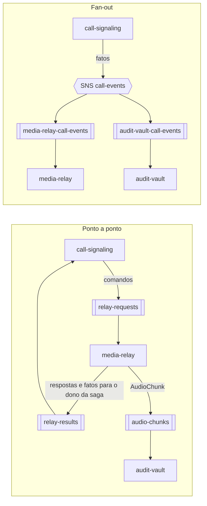

**O que.** Comandos e respostas entre call-signaling e media-relay andam em duas filas ponto a ponto. Fatos de
interesse geral andam no tópico SNS com fan-out.

**Por que.**
- Um comando tem **um** executor. `RelayRequested` não pode ser processado por dois sistemas diferentes; numa fila, com
  várias réplicas do media-relay, ele vai para uma réplica só.
- Uma resposta só interessa a quem pediu (o dono da saga, o call-signaling).
- Um fato interessa a quem quiser. O produtor não deve saber quem escuta.

**Alternativa descartada.** Tudo no SNS com filtro por tipo de mensagem em cada assinatura: mais configuração para o
mesmo efeito.

**Dois casos de fronteira que valem conhecer.**
- `RelayMoved` e `ParticipantTimedOut` são **fatos**, mas vão pela fila `relay-results`, porque o único interessado é o
  call-signaling (dono do estado da chamada). Consequência: o audit-vault **não** recebe `ParticipantTimedOut`. A queda
  aparece na trilha como o `ParticipantLeft` que o call-signaling publica depois de remover o participante
  (`saga.go:109` e `:260`).
- `AudioChunk` é um fato com um único consumidor e volume alto. Vai por fila própria (`audio-chunks`) para não poluir
  `call-events` e não forçar o media-relay a receber o próprio áudio de volta.

### 5.5 Fan-out na prática

Quando o call-signaling publica `CallEnded` no tópico:

1. O SNS copia a mensagem para `media-relay-call-events` e `audit-vault-call-events`.
2. Uma réplica do media-relay pega a cópia dela e libera a sessão (`release("call ended")`, `relay.go:99-100`).
3. Uma réplica do audit-vault pega a cópia dela e acrescenta o evento na trilha (`MessageProcessor.cs:26`).
4. Cada fila tem os próprios recebimentos, visibility timeout e DLQ. Uma falha num consumidor não afeta o outro.

Como as assinaturas não têm filtro, **as duas filas recebem todos os tipos** publicados no tópico. Cada consumidor
decide o que fazer:
- o media-relay trata `CallEnded`, `CallFailed`, `ParticipantJoined`, `ParticipantLeft` e ignora o resto, incluindo
  `CallStarted` (`return nil // CallStarted: nothing to do here`, `relay.go:96-108`);
- o audit-vault grava qualquer tipo com envelope válido. Isso é proposital (a trilha registra tudo), e também uma
  limitação listada em `ARCHITECTURE.md` §14: um tipo desconhecido publicado no tópico entraria na trilha.

**Analogia.** O tópico é o mural de avisos do condomínio. Cada morador (consumidor) tem a própria caixa de correio
(fila) onde o síndico deixa uma cópia de cada aviso. Quem viajou encontra os avisos na caixa ao voltar; o síndico não
precisa saber quem leu.

### 5.6 Catálogo completo das 12 mensagens

| Tipo | Natureza | Canal | Produtor (código) | Consumidor → efeito (código) |
|---|---|---|---|---|
| `RelayRequested` | comando | SQS `relay-requests` | call-signaling, `saga.go:49` (`Start`, via outbox, no `POST /calls`) | media-relay `relay.go:83` → `allocate`: espera `RELAY_LATENCY_MS`, sorteia `RELAY_FAILURE_RATE`, cria a sessão |
| `ReleaseRelayRequested` | comando (compensação) | SQS `relay-requests` | call-signaling `saga.go:142`, quando chega um `RelayAllocated` atrasado | media-relay `relay.go:85` → `release("late allocation")`. Libera pelo `callId`; o `relayId` do payload não é usado |
| `RelayAllocated` | resposta | SQS `relay-results` | media-relay `relay.go:202`, via outbox | call-signaling `saga.go:121` → chamada `ACTIVE` (se ainda `PENDING`); ou `saga.go:140` → chamada já encerrada, devolve o relay |
| `RelayFailed` | resposta | SQS `relay-results` | media-relay `relay.go:189` (falha simulada) | call-signaling `saga.go:95` → compensação: `FAILED`, libera vagas e usuário |
| `RelayMoved` | fato | SQS `relay-results` | media-relay `failover.go:212` (líder moveu a chamada de um pod morto) | call-signaling `saga.go:98` → atualiza host/porta/`relaySignal`, avisa por SSE `relay_moved` |
| `ParticipantTimedOut` | fato | SQS `relay-results` | media-relay `relay.go:369` (`Sweep`: sem pacotes por `PARTICIPANT_TIMEOUT_MS`) | call-signaling `saga.go:109` → saída normal do participante |
| `CallStarted` | fato | SNS `call-events` | call-signaling `saga.go:123` | audit-vault: trilha. media-relay: ignora |
| `ParticipantJoined` | fato | SNS `call-events` | call-signaling `saga.go:175` | media-relay → `member ADD` na sessão (`relay.go:103-104`); audit-vault: trilha |
| `ParticipantLeft` | fato | SNS `call-events` | call-signaling `saga.go:260` | media-relay → `member DELETE` (`relay.go:105-106`); audit-vault: trilha |
| `CallEnded` | fato | SNS `call-events` | call-signaling `saga.go:266` (saiu o último) | media-relay → `release("call ended")`; audit-vault: trilha |
| `CallFailed` | fato | SNS `call-events` | call-signaling `saga.go:160` | media-relay → `release("call failed")`; audit-vault: trilha |
| `AudioChunk` | fato | SQS `audio-chunks` | media-relay `recorder.go:172`, envio **direto** (`Bus.Send`, `messaging/bus.go:149`), sem outbox | audit-vault `AudioProcessor` → cifra e grava no S3 |

Todos os produtores do call-signaling e quase todos do media-relay passam pelo **outbox transacional**: a mensagem é
gravada no DynamoDB na mesma transação da mudança de estado e publicada depois por uma goroutine (`RelayOutbox`,
`messaging/bus.go:114-138`). A exceção é o `AudioChunk`, enviado direto para nunca atrasar o áudio; por isso a
gravação é "melhor esforço" (D20). O outbox e a idempotência são assunto da **seção 12**; a gravação, da **seção 8**.

Um ciclo de vida típico, de ponta a ponta:

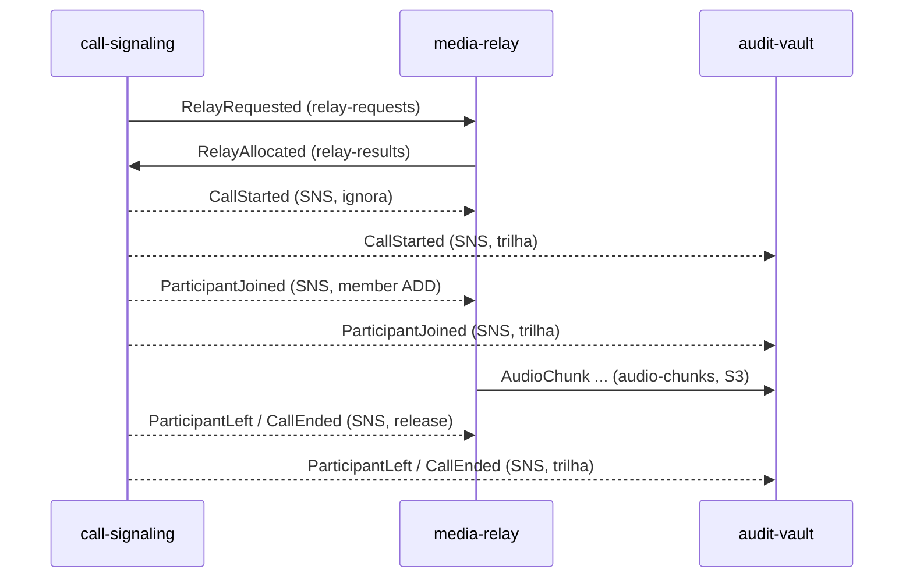

### 5.7 `messageId` x `correlationId`

Os dois campos parecem parecidos e têm funções opostas.

| | `messageId` | `correlationId` |
|---|---|---|
| Identifica | uma mensagem | um fluxo de negócio (a chamada) |
| Muda entre mensagens? | sim, cada mensagem tem um novo | não: todas as mensagens de uma chamada compartilham o mesmo |
| Muda numa reentrega? | não: a mesma mensagem reentregue tem o mesmo id | não |
| Uso | deduplicar (tabelas `*-processed`) | rastrear: juntar nos logs tudo o que aconteceu com uma chamada |

No Larpspeak, `correlationId` é sempre o `callId` (os produtores passam `c.ID` ou `callID` como segundo argumento de
`message(...)`, por exemplo `saga.go:49` e `relay.go:112`). Os logs dos três serviços repetem o campo
(`messaging/bus.go:100-102`; `MessageProcessor.cs:27`). Na demonstração, um
`docker compose logs | grep <callId>` mostra a história inteira de uma chamada atravessando os três serviços.
É um rastreio "pobre" em comparação com OpenTelemetry (sem spans nem tempos), mas suficiente para provar os cenários.

### 5.8 Ordenação: o sistema não depende da ordem de entrega

O enunciado pede que "a apresentação discute ordenação" (R4). A resposta do Larpspeak é: **nenhum canal garante ordem,
e o sistema foi desenhado para não precisar dela.**

**Por que não há ordem.** Três fontes de desordem, todas reais no código:
1. As filas são SQS **padrão**, não FIFO (`init.sh:10`, sem `FifoQueue`). O SQS padrão não garante ordem e pode
   reentregar.
2. Com 2 ou mais réplicas, duas mensagens da mesma chamada podem ser processadas **em paralelo** por pods diferentes.
3. O outbox varre a tabela e publica os pendentes **em qualquer ordem** (`messaging/bus.go:117-135`). Uma reentrega
   (visibility timeout de 30 s) chega bem depois das mensagens seguintes.

**Como o sistema convive com isso.** Em vez de ordenar mensagens, **cada efeito confere o estado atual antes de ser
aplicado**, numa escrita condicional. Uma mensagem "fora de hora" encontra um estado em que ela não se aplica e vira
no-op (ou compensação). Exemplos:

| Onde | Condição | Mensagem fora de ordem e o que acontece |
|---|---|---|
| call-signaling, saga | `Activate` e `Fail` só com `status = PENDING`; `MoveRelay` só com `ACTIVE` (`saga.go:95-140`; `transition` exige `status = :from`, `store.go:343-368`) | `RelayAllocated` depois do timeout encontra `FAILED`: não reativa; devolve o relay com `ReleaseRelayRequested` (13.4) |
| call-signaling, vagas | `Join` exige `taken < capacity`; `Leave` fixa o `taken` lido (`taken = :n`, `store.go:284-319`) | Duas saídas simultâneas não deixam contagem errada nem dois `CallEnded` |
| media-relay, sessão | `Release` e `Member` só com `state = ALLOCATED` (`sessions.go:81-105`) | `ParticipantJoined` depois de `CallEnded` é reconhecido sem efeito (`relay.go:124-126`) |
| media-relay, failover | `Move` exige `owner = pod morto` e o *fence* do `term` do líder (`nodes.go:118-130`) | Um líder antigo não sobrescreve a decisão do novo |
| audit-vault, trilha | Guarda na ordem de chegada; `CallTrail.Build` reordena por `occurredAt` e `receivedAt` a cada leitura (`AV/AuditModels.cs:51-53`) | `CallEnded` gravado antes de `ParticipantLeft` dá o mesmo estado final |
| audit-vault, áudio | Chave S3 começa por `startMs` com 13 dígitos (`AV/AudioChunks.cs:104-107`) | Trechos gravados fora de ordem são exportados na ordem do tempo |

**Alternativa descartada: SQS FIFO.**
- O FIFO ordena por `MessageGroupId`. Usando o `callId` como grupo, todas as mensagens de uma chamada seriam
  processadas em série, por uma réplica de cada vez: perde-se parte do paralelismo de R4.
- A deduplicação do FIFO tem janela de 5 minutos e não cobre reprocessamento tardio; os consumidores continuariam
  precisando do marcador `messageId` (D4).
- O fan-out exigiria SNS FIFO, com mais restrições.
- E o outbox continuaria publicando fora de ordem, então a garantia teria de começar no produtor.

Com condições de estado, a correção não depende do broker. É a mesma propriedade que sustenta R1: o sistema é
correto **apesar** de duplicatas e desordem, não porque elas não acontecem.

**O caso que as condições não cobrem.** `ParticipantJoined` e `ParticipantLeft` **do mesmo usuário** trocados de ordem
no media-relay: `DELETE` e depois `ADD` deixam o usuário em `relay-sessions.participants` mesmo fora da chamada. O
call-signaling continua correto (não repassa ofertas WebRTC de quem não é participante), então o efeito prático é
pequeno. Está listado como limitação em `ARCHITECTURE.md` §14 e é uma boa resposta pronta se o professor perguntar
"onde a desordem ainda machuca?".

---

# Parte 2 — O áudio

Esta parte explica como a voz sai do microfone de uma pessoa e chega ao fone das outras, e como ela é gravada.
Primeiro vêm os conceitos (seção 6), depois a aplicação no Larpspeak (seção 7) e, por fim, a gravação (seção 8).

Uma observação: o áudio **não** é o centro da nota do enunciado. O enunciado avalia R1–R6 e F1–F8, que
tratam de mensageria, idempotência e falhas. Mesmo assim, o áudio é o "produto" e encosta em vários requisitos:

| Ponto do áudio | Requisito que toca | Onde é explicado |
|---|---|---|
| Alocação do relay com latência/falha simulada | R5, F1, F7 | 11.2.2, 13 e 15 |
| Presença por tráfego de mídia → `ParticipantTimedOut` | fluxo principal, falha surpresa | 7.8 |
| Failover do pod de áudio → `relay_moved` | falha surpresa ("derrubar um serviço") | 7.9 |
| `AudioChunk` → audit-vault (fila `audio-chunks`) | R1, R4, F2, F3, F4, F6, F8 | 8 |
| Bucket S3 + Secrets Manager | categorias de nuvem obrigatórias | 8.4, 4.5, 4.6 |

---

## 6. Áudio em tempo real: conceitos

### 6.1 O que uma conversa por voz exige

Uma chamada de voz é diferente de baixar um arquivo. No arquivo, importa receber **tudo, certo**, e o tempo é
secundário. Na voz, importa receber **a tempo**. Um pedaço de som que chega atrasado não serve para nada: o momento em
que ele deveria tocar já passou.

**Orçamento de latência.** A recomendação clássica (ITU-T G.114) é manter o atraso de boca a ouvido abaixo de
~150 ms. Acima de ~300 ms a conversa fica truncada: as pessoas começam a falar ao mesmo tempo. Esse orçamento é
dividido entre:

| Etapa | Ordem de grandeza |
|---|---|
| Captura de um quadro de áudio (frame) | 20 ms (tamanho do quadro) |
| Codificação (Opus) | poucos ms + ~6,5 ms de lookahead |
| Rede (ida até o servidor e do servidor até o outro) | 1–100 ms, conforme a distância |
| Buffer de jitter no receptor | 20–80 ms, adaptativo |
| Decodificação e saída na placa de som | poucos ms |

**Jitter.** Os pacotes saem a cada 20 ms, mas não chegam a cada 20 ms. Um chega com 18 ms, outro com 35 ms, outro com
5 ms. Essa variação do atraso é o *jitter*. Se o receptor tocasse cada pacote assim que chega, o som sairia picotado.

**Perda.** Em redes reais, 1–3 % dos pacotes somem (Wi-Fi, fila cheia num roteador). Na voz, perder um pacote de 20 ms
é tolerável se alguém "disfarçar" o buraco.

**Fora de ordem.** O pacote 41 pode chegar antes do 40.

### 6.2 Por que UDP, e não TCP

Analogia: o TCP é um carteiro que, se perder uma carta, **para a entrega de todas as seguintes** até a carta perdida
ser reenviada. Isso se chama *head-of-line blocking*. Para um arquivo, é o comportamento certo. Para voz, é o pior
possível: perder um pacote de 20 ms congela o áudio por um RTT inteiro (às vezes centenas de ms), e quando a
retransmissão chega ela já está atrasada.

O UDP entrega cada datagrama de forma independente, sem retransmissão e sem ordem. O aplicativo decide o que fazer com
perdas e atrasos. Para voz, a decisão certa é: **não esperar**; disfarçar o buraco e seguir.

| | TCP | UDP |
|---|---|---|
| Garante entrega | sim (retransmite) | não |
| Garante ordem | sim (bloqueia até reordenar) | não |
| Perda de 1 pacote | congela o fluxo por ~1 RTT | só aquele pacote falta |
| Controle de congestionamento | embutido, reduz a taxa | fica a cargo do aplicativo |
| Uso em voz | ruim | padrão |

### 6.3 RTP e RTCP

UDP só entrega bytes. Para tocar voz, o receptor precisa saber **de quem** é o pacote, **qual é a ordem** e **em que
instante** o som foi capturado. Isso é o papel do **RTP** (Real-time Transport Protocol, RFC 3550), um cabeçalho de 12
bytes na frente de cada pacote de áudio:

| Campo | Para que serve |
|---|---|
| `SSRC` (32 bits) | identifica a **fonte** do fluxo. Cada fluxo tem o seu. É por ele que o receptor separa os fluxos |
| `sequence number` (16 bits) | +1 a cada pacote. Detecta perda e reordenação. Dá a volta em 65535 → 0 |
| `timestamp` (32 bits) | instante de captura, no **relógio do codec**. Para Opus, 48 000 tiques por segundo: um quadro de 20 ms avança 960 |
| `payload type` (7 bits) | qual codec está no payload (no Larpspeak, 111 = Opus) |
| `marker` | início de uma fala, entre outros usos |

O **RTCP** (RTP Control Protocol) é o canal de controle que anda ao lado. Emissor e receptor trocam relatórios
periódicos: quantos pacotes chegaram, quantos se perderam, o jitter medido, o RTT. O emissor usa isso para ajustar a
taxa de bits (controle de congestionamento). O Larpspeak usa o RTCP também como **sinal de vida** do participante
(seção 7.8).

### 6.4 Buffer de jitter

O buffer de jitter (*jitter buffer*) é uma pequena fila no receptor. Ele segura os pacotes alguns ms, os reordena pelo
`sequence number` e os toca no ritmo do `timestamp`. É um amortecedor:
- buffer maior: absorve mais jitter, mas acrescenta atraso;
- buffer menor: menos atraso, mas mais "buracos".

Os navegadores usam um buffer **adaptativo** (o NetEq do WebRTC), que cresce e encolhe conforme o jitter medido. Ponto
importante para a seção 7.6: o buffer guarda estado **por SSRC**. Ele espera que, dentro do mesmo SSRC, `seq` e
`timestamp` andem de forma contínua. Um salto grande e aleatório nesses campos é tratado como pacote velho ou
inválido e é descartado.

### 6.5 Codecs

Áudio cru (PCM) de voz em 48 kHz, 16 bits, mono, ocupa 768 kbit/s. Um **codec** comprime isso. Comparação:

| Codec | Taxa típica | Qualidade de voz | Observação |
|---|---|---|---|
| PCM cru | 256 kbit/s (16 kHz) a 768 kbit/s (48 kHz) | perfeita | sem compressão; usado só no `voice-client` legado |
| G.711 (telefonia) | 64 kbit/s | banda estreita (8 kHz), som de telefone | simples, antigo |
| **Opus** | 6–510 kbit/s, voz boa em ~24–40 kbit/s | banda larga até 48 kHz | obrigatório no WebRTC, livre de royalties |

---

## 7. WebRTC e Opus no Larpspeak

### 7.1 Visão geral dos dois caminhos de áudio

O media-relay tem **dois** caminhos de áudio, cada um no seu socket UDP (`services/media-relay/main.go:54` e
`main.go:82-92`):

| Caminho | Porta (env) | Quem usa | Formato | Gravado? |
|---|---|---|---|---|
| WebRTC (SFU) | `WEBRTC_UDP_PORT` (50000) | navegador (`web/src/voice.ts`), `tools/webrtc-probe` | RTP/Opus cifrado (SRTP) | sim |
| UDP legado | `UDP_PORT` (40000) | `tools/voice-client` | texto + PCM 16 kHz | não |

O comentário em `main.go:82` explica por que são portas separadas: os pacotes DTLS e STUN do WebRTC seriam ambíguos
no socket do protocolo legado.

O caminho principal é o WebRTC. O resto desta seção trata dele; o legado está em 7.10.

### 7.2 Por que WebRTC

**O quê.** O navegador fala com o servidor por WebRTC, e o servidor é um SFU escrito em Go com a biblioteca pion
(`github.com/pion/webrtc/v4 v4.2.26`, `services/media-relay/go.mod:13`).

**Por quê.** O WebRTC é a única forma de um navegador mandar áudio por UDP. Ele traz pronto:

| Peça | O que faz | Por que importa aqui |
|---|---|---|
| `getUserMedia` | acesso ao microfone com cancelamento de eco, supressão de ruído e ganho automático | o projeto não implementa DSP |
| ICE | descobre o par de endereços IP:porta que funciona entre os dois lados | o navegador chega ao pod certo |
| DTLS-SRTP | criptografia **obrigatória** do áudio | ninguém na rede escuta a chamada; não é opcional no WebRTC |
| RTP/RTCP | sequência, timestamp, relatórios de perda/jitter/RTT | o navegador adapta a taxa sozinho; a UI mostra estatísticas |
| Opus | codec de voz | ver 7.4 |
| DataChannel | canal de dados na mesma conexão | o servidor diz qual faixa é de qual usuário (7.6) |

**Alternativas descartadas.**

| Alternativa | Por que não |
|---|---|
| WebSocket com PCM cru | WebSocket é TCP: head-of-line blocking (6.2). PCM sem compressão gasta 10–30× mais banda. Sem criptografia de mídia, sem buffer de jitter, sem controle de congestionamento: tudo teria de ser escrito à mão |
| UDP próprio direto do navegador | **impossível**: navegadores não abrem socket UDP cru, por segurança. Só existe UDP via WebRTC (ou WebTransport, que é QUIC e não tem pilha de áudio pronta) |
| WebRTC ponto a ponto entre navegadores | ver topologias em 7.3; também tiraria do servidor a gravação e o failover |

### 7.3 Topologias: mesh, MCU e SFU

Com N pessoas numa chamada, existem três formas de ligar todo mundo.

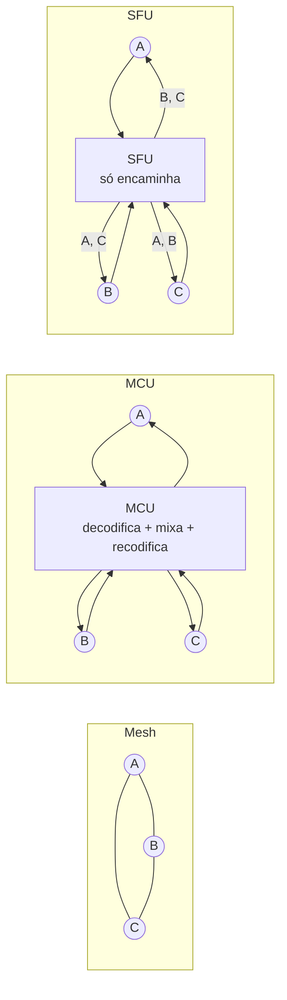

| | Mesh (P2P) | MCU | **SFU (escolhido)** |
|---|---|---|---|
| Uploads por cliente | N−1 | 1 | 1 |
| Downloads por cliente | N−1 | 1 (mixado) | N−1 |
| CPU no servidor | nenhuma | alta: decodifica, mixa e recodifica cada fluxo | baixa: só copia pacotes |
| Qualidade | original | perde uma geração de codificação | original |
| Gravação no servidor | impossível (servidor não vê o áudio) | possível | possível, sem decodificar |
| Failover do servidor | não se aplica | pesado (estado de mixagem) | simples: o cliente refaz a oferta |
| Problema | upload explode com N; NAT entre pares exige STUN/TURN | CPU e latência extra | download cresce com N |

**O quê.** O media-relay é um SFU (*Selective Forwarding Unit*): recebe o fluxo Opus de cada navegador e o copia,
**sem decodificar**, para os outros navegadores da mesma chamada (`sfu.go:1-4`).

**Por quê.**
- CPU quase zero por pacote: o pod só copia bytes. Um pod atende muitas chamadas.
- O servidor vê os pacotes, então pode **gravar** (seção 8) e decidir **quem pode falar** (`Touch`, 7.8).
- O cliente fala com um único endereço (o pod dono da chamada). Se o pod morre, outro assume e o cliente só refaz a
  oferta (7.9).
- Com chamadas pequenas (capacidade típica de até ~10), o download N−1 de áudio é irrelevante: ~30 kbit/s × 9.

**Alternativa descartada.** Mesh: sem gravação, sem controle de presença no servidor, NAT entre pares. MCU: CPU,
latência e perda de qualidade, além de muito mais código (decodificar/mixar Opus).

**Onde está no código.** `services/media-relay/internal/adapter/webrtc/sfu.go` inteiro (324 linhas).

### 7.4 Opus: o que faz e o que não faz

**Configuração no Larpspeak** (`sfu.go:90-97`):
- `MimeType: audio/opus`, `ClockRate: 48000`, `Channels: 2`, `PayloadType: 111`;
- `SDPFmtpLine: "minptime=10;useinbandfec=1"`;
- é o **único** codec registrado no `MediaEngine`: o navegador não tem como negociar outro.

`Channels: 2` não quer dizer estéreo. A RFC 7587 exige anunciar Opus sempre como `opus/48000/2`; o conteúdo real é
mono, e o próprio pacote diz isso no byte TOC (o `OggOpus.cs:18` lê esse bit).

**O que o Opus faz:**

| Recurso | Explicação | No Larpspeak |
|---|---|---|
| Taxa variável | gasta menos bits no silêncio e em sons simples | padrão do navegador; a UI mostra `sendKbps` (`voice.ts:252-256`) |
| 48 kHz, banda larga | voz "de rádio FM", não "de telefone" | `ClockRate: 48000` |
| Quadros de 20 ms | cada pacote RTP carrega 20 ms = 960 tiques | o `slot.rewrite` usa exatamente 960 (`sfu.go:78-80`) |
| FEC em banda (`useinbandfec=1`) | cada pacote leva uma cópia de baixa qualidade do quadro anterior; se um pacote se perde, o seguinte o reconstrói | ativado no fmtp (`sfu.go:93`) |
| PLC (*packet loss concealment*) | se falta um quadro e não há FEC, o decodificador "inventa" um som plausível em vez de silêncio | feito pelo decodificador do navegador |
| DTX (*discontinuous transmission*) | para de mandar pacotes no silêncio | **não é usado**: o fmtp não tem `usedtx=1`. Isso é desejável aqui, porque a presença depende de pacotes chegando (7.8) |

**O que o Opus NÃO faz** (e quem faz):

| Coisa | Quem faz no Larpspeak |
|---|---|
| Criptografia | SRTP, com chaves negociadas por DTLS (WebRTC, obrigatório) |
| Cancelamento de eco | o navegador, por `getUserMedia({ echoCancellation })` (`voice.ts:176`), configurável pelo usuário |
| Supressão de ruído | idem, `noiseSuppression` (`voice.ts:177`), configurável |
| Ganho automático | idem, `autoGainControl: true` fixo (`voice.ts:178`) |
| Retransmissão | ninguém. Em voz, retransmitir chega tarde (6.2); o FEC e o PLC cobrem as perdas |
| Reordenar e alisar o jitter | o buffer de jitter do navegador (6.4) |
| Separar falantes | o RTP (SSRC) e, no Larpspeak, os "slots" + DataChannel `meta` (7.6) |

**Por que Opus.** É obrigatório em todo navegador com WebRTC (RFC 7874), é livre de royalties e dá a melhor qualidade de
voz por bit entre os codecs disponíveis. **Alternativa descartada:** PCM (banda 10–30× maior) e G.711 (8 kHz, som de
telefone, 64 kbit/s). Como o SFU não decodifica, o servidor nem precisa de biblioteca Opus: ele só copia bytes.

### 7.5 O aperto de mão completo (handshake)

Antes de explicar o diagrama, três conceitos.

**SDP (oferta e resposta).** É um texto que descreve a sessão de mídia: quais faixas de áudio (*m-lines*), em que
direção (`sendrecv`, `recvonly`), quais codecs, as chaves de verificação DTLS e os **candidatos ICE** (endereços onde
cada lado pode receber). Um lado manda a **oferta**, o outro devolve a **resposta**.

**Transceiver.** No navegador, cada m-line é um `RTCRtpTransceiver`: um par emissor+receptor com um `mid`
(identificador da m-line). `sendrecv` envia e recebe; `recvonly` só recebe.

**ICE, STUN, TURN e trickle.**
- ICE testa pares de candidatos (IP:porta) até achar um que funcione.
- STUN serve para um cliente descobrir seu IP público atrás de NAT.
- TURN é um servidor que repassa a mídia quando nada mais funciona.
- *Trickle ICE* é mandar os candidatos aos poucos, em mensagens separadas, conforme são descobertos.

#### Passo a passo

1. **Microfone.** `openMic` chama `getUserMedia` com os filtros do usuário (`voice.ts:172-182`).
2. **PeerConnection e transceivers** (`voice.ts:96-100`):
   - `new RTCPeerConnection({ iceServers: [] })`: **sem STUN nem TURN**;
   - 1 transceiver `sendrecv` com a faixa do microfone;
   - `max(capacity, 10) − 2` transceivers `recvonly`;
   - total de m-lines de áudio: `max(capacity, 10) − 1`, uma para cada **outro** participante possível
     (o `sendrecv` também recebe um). `MIN_SLOTS = 10` (`voice.ts:31`) garante que uma chamada direta que vira grupo
     não precisa renegociar.
3. **DataChannel `meta`** criado pelo navegador (`voice.ts:101-105`).
4. **Oferta sem trickle.** `createOffer` + `setLocalDescription` e espera a coleta de candidatos terminar
   (`iceGathered`, `voice.ts:267-280`, limite de 2 s). A oferta sai com todos os candidatos dentro.
5. **Envio ao call-signaling.** `POST /calls/{id}/webrtc {sdp}` (`voice.ts:119-121`). O handler está em
   `services/call-signaling/internal/adapter/httpapi/handlers.go:176-201`.
6. **Checagens no call-signaling** (`saga.go:320-332`, `Service.Offer`): a chamada está `ACTIVE`, o usuário é
   participante e já se sabe qual pod é o dono (`RelaySignal`, endereço HTTP do pod, que veio no `RelayAllocated`).
   Sem dono ainda → `ErrRelayNotReady` ("relay not ready, retry", `domain/call.go:30`) → HTTP 409.
7. **Token `join`.** O `relayhttp.Client` cria um token `join` assinado com **EdDSA (Ed25519)** com validade de
   **1 minuto** (`call-signaling/main.go:71`) e faz `POST http://<relaySignal>/webrtc
   {callId, userId, sdp, joinToken}` (`relayhttp/client.go:21-43`).
8. **No media-relay** (`health.go:26-57`):
   - corpo até 128 KiB;
   - 503 se a chave pública ainda não foi baixada de `GET /auth/public-key` (`adapter/pubkey/pubkey.go:28-33`);
   - 403 se `VerifyJoin` falha: assinatura, `alg = EdDSA`, `typ = join`, `cid = callId`, validade e `sub = userId`
     (`domain/token.go:27-48`, `health.go:37-41`).
9. **`Admit`** (`relay.go:296-326`): o pod é o dono da sessão (`Owner == r.ID`, estado `ALLOCATED`) e o usuário está em
   `participants`? Lê o DynamoDB na hora, porque a oferta pode chegar antes do evento `ParticipantJoined`. Não é o dono
   → 404; não é participante (ainda) → 409.
10. **pion monta a resposta** (`sfu.go:118-207`):
    - aplica a oferta (`SetRemoteDescription`);
    - cria um track de saída `slotN` para cada m-line de áudio oferecida (`sfu.go:150-175`);
    - `CreateAnswer` + `SetLocalDescription` e espera a coleta ICE (até 3 s; na prática instantânea, `sfu.go:180-190`);
    - se o mesmo usuário já tinha um peer (recarregou a página, failover), o antigo é fechado (`sfu.go:192-204`).
11. **Resposta volta** pelo mesmo caminho HTTP. O navegador aplica com `setRemoteDescription` (`voice.ts:123`).
12. **ICE → DTLS → SRTP.** O navegador testa o candidato `RELAY_HOST:WEBRTC_UDP_PORT`, faz o handshake DTLS (troca de
    chaves) e passa a mandar SRTP. A partir daqui o áudio vai **direto** do navegador para o pod, sem passar por nginx
    nem pelo call-signaling.

#### Tratamento de erro e repetição

Os erros 404/409/503 do relay viram, no call-signaling, `ErrRelayNotReady` → 409 "relay not ready, retry"
(`relayhttp/client.go:36-39`). O navegador repete com backoff de 1 s dobrando até 8 s (`voice.ts:116-134`). Um 409
**sem** "retry" (chamada não ativa, não é participante) é fatal: `onFatal` (`voice.ts:127-129`). O motivo das
repetições: entrar na chamada é assíncrono (evento `ParticipantJoined` pelo SNS); o relay pode ainda não saber do
participante por alguns ms.

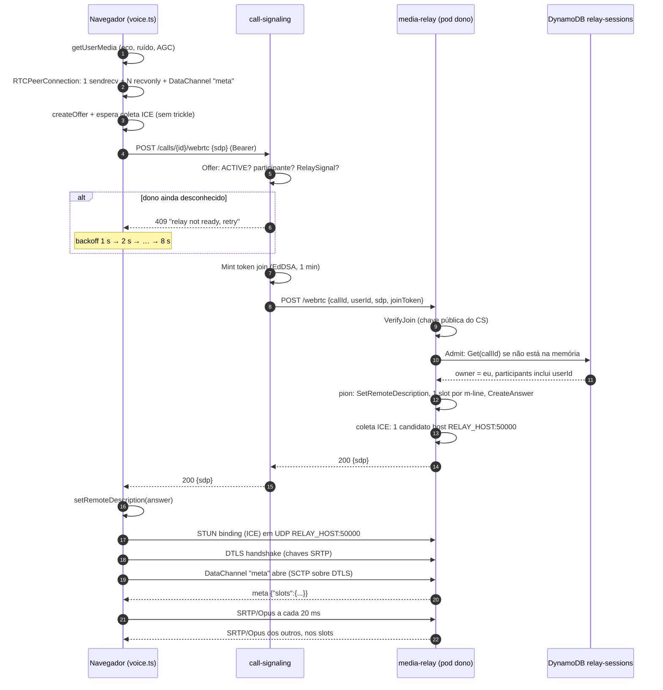

#### Decisões do handshake

**D11 — Sinalização por HTTP síncrono até o pod dono.** A oferta vai `navegador → call-signaling → pod dono` por
HTTP, não por fila, porque SDP é pedido-resposta com o navegador esperando e todos os participantes precisam do mesmo
SFU. O porquê completo e as alternativas descartadas estão na seção 2.5. Código: `call-signaling/internal/app/saga.go:320-332`,
`adapter/relayhttp/client.go`, `media-relay/internal/adapter/httpapi/health.go:26-57`.

**Token `join` EdDSA.** O pod de mídia só aceita a oferta com um token curto (1 min, `cid = callId`) assinado pelo
call-signaling. O media-relay tem só a **chave pública**: verifica, mas nunca emite; nem quem está na rede interna fala
numa chamada sem passar pelo call-signaling. Verificação em `media-relay/internal/domain/token.go:12-48` (cópia só de
verificação, duplicada de propósito). Detalhes de D14 e do escopo do token: ver seção 16.1.

**Uma porta UDP, NAT 1:1, sem STUN/TURN, sem trickle.**
- **O quê** (`sfu.go:102-107`):
  - `SetICEUDPMux`: todos os peers do pod compartilham **um único** socket UDP (`WEBRTC_UDP_PORT`, padrão 50000,
    `config.go:59-61`);
  - `SetNetworkTypes(UDP4)`: só IPv4/UDP;
  - `SetNAT1To1IPs([RELAY_HOST], host)`: o candidato anunciado é o IP `RELAY_HOST`, não o IP interno do contêiner;
  - navegador com `iceServers: []` (`voice.ts:96`); sem trickle dos dois lados.
- **Por quê:**
  - um contêiner Docker publica portas uma a uma. Uma porta por pod (`compose.voice.yml`: 50000 e 50001) é viável;
    uma porta por peer não;
  - o servidor tem endereço conhecido (`RELAY_HOST`): o navegador não precisa descobrir nada. STUN/TURN só seriam
    necessários para atravessar NAT entre dois clientes (mesh) ou redes restritivas;
  - sem trickle, a sinalização é um único pedido-resposta HTTP. Como só há candidatos `host`, a coleta é instantânea
    e o trickle não ganharia nada.
- **Alternativa descartada:** faixa de portas por peer (muitas portas publicadas), servidor TURN (mais um serviço),
  trickle ICE (precisaria de um canal bidirecional de sinalização, como WebSocket).
- **Limitação honesta:** funciona em rede local ou com IP público direto. Um cliente atrás de firewall que bloqueia
  UDP não conecta (não há fallback TCP/TURN). No `docker compose up` puro, o media-relay **não publica portas**
  (`docker-compose.yml:71-94`); o áudio do navegador exige o modo voz (`make start`, que usa `compose.voice.yml` e
  exporta `RELAY_HOST`, `Makefile:5-8`).

### 7.6 O caminho do pacote dentro do SFU

#### Slots: fan-out sem renegociar

O problema: quando alguém entra na chamada, todos os outros precisam de uma faixa nova para ouvi-lo. A forma
"canônica" é renegociar (nova oferta/resposta). Isso exigiria um canal servidor→navegador para SDP e lógica de
renegociação dos dois lados.

A solução do Larpspeak (`sfu.go:35-41`): o navegador já oferece de antemão uma m-line para cada outro participante
possível. O servidor liga cada m-line a um track de saída fixo, o **slot** (`sfu.go:150-175`). Quando alguém começa a
mandar áudio, ganha o primeiro slot livre em cada outro peer. Analogia: uma mesa de som com N canais já cabeados; o
técnico só troca a etiqueta de quem está em cada canal.

| Estrutura | Campos | Onde |
|---|---|---|
| `SFU` | `calls map[callId]map[userId]*peer`, protegido por `mu` | `sfu.go:42-50` |
| `peer` | `pc`, `slots []*slot`, `meta *DataChannel` | `sfu.go:52-57` |
| `slot` | `tr` (transceiver), `track`, `owner` (`""` = livre), linha do tempo RTP | `sfu.go:59-73` |

#### A goroutine de subida (uplink)

Para cada faixa recebida, o pion chama `OnTrack` → `s.uplink` (`sfu.go:140`). O `uplink` (`sfu.go:209-267`) roda numa
goroutine própria por peer (detalhes de concorrência na seção 9.3):

1. Uma goroutine auxiliar lê o RTCP do receptor e chama `Touch` a cada relatório (`sfu.go:213-220`).
2. Laço: `remote.ReadRTP()` lê um pacote já decifrado (`sfu.go:222`).
3. `Touch(call, user)` (`sfu.go:226-230`). Se o usuário não pode mais falar (saiu, chamada terminou, chamada mudou de
   pod), o peer é fechado.
4. Sob o lock `s.mu` (`sfu.go:237-257`):
   - confere que este peer ainda é o atual do usuário (`sfu.go:238`); se foi trocado por uma oferta nova, encerra;
   - para cada **outro** peer da chamada: procura o slot deste falante (`slotFor`); se não há, pega um livre
     (`freeSlot`), marca o dono e manda o novo mapa pelo `meta` (`sendMeta`);
   - calcula `seq`/`ts` de saída com `slot.rewrite` (ver abaixo).
5. Fora do lock: entrega uma cópia ao gravador, se ligado (`sfu.go:258-260`).
6. Escreve uma cópia do **cabeçalho** em cada slot, com o **payload compartilhado** (`sfu.go:261-265`). `WriteRTP` troca
   o SSRC e o payload type pelos do track de saída.

O pacote Opus nunca é decodificado. O lock só cobre a escolha de slots; o envio de rede acontece fora dele.

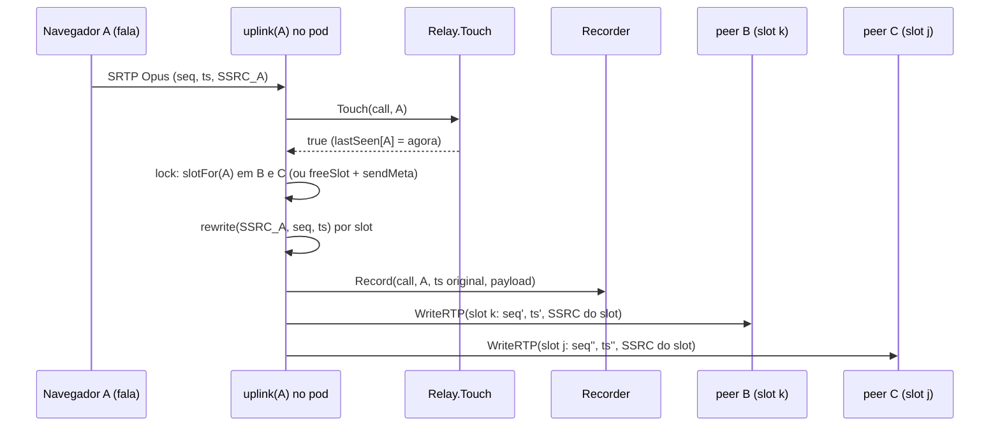

#### DataChannel `meta`: quem está em cada slot

O navegador recebe áudio numa m-line (`mid`), mas não sabe de quem é. O servidor manda pelo DataChannel `meta` o mapa
`{"slots":{"<mid>":"<userId>"}}` (`sendMeta`, `sfu.go:303-316`). Ele é enviado:
- quando o canal abre (`sfu.go:133-138`);
- quando um falante ganha um slot (`sfu.go:251-252`);
- quando um peer sai e libera slots (`drop`, `sfu.go:280-285`).

No navegador, `meta.onmessage` guarda o mapa em `this.slots` (`voice.ts:102-105`).

**Por quê DataChannel.** Fica na mesma conexão, cifrado e na mesma ordem das mudanças. **Alternativa:** mandar o mapa
por SSE do call-signaling (mas o call-signaling não sabe a atribuição de slots, que é decidida no pod) ou deduzir pelo
`msid` do SDP (exigiria renegociar).

#### Tocar o áudio no navegador

- `pc.ontrack` → `addRemote(mid, track)` (`voice.ts:106`, `voice.ts:191-200`).
- Cada slot vira um `<audio>` próprio com `srcObject = new MediaStream([track])`. Cada slot tem stream próprio
  (`sfu.go:160-161`: `"slot"+i` como id do track e do stream), então o navegador cria um elemento por slot. A
  **mixagem** de vários falantes é feita pelo próprio navegador ao tocar vários `<audio>` ao mesmo tempo.
- Saída escolhida pelo usuário com `setSinkId` (`voice.ts:202-204`).
- **Autoplay.** Navegadores bloqueiam som antes de um gesto do usuário. Se `el.play()` falha, `onBlockedAutoplay`
  mostra o botão "ativar áudio" (`voice.ts:197`, `Call.tsx:102`, `Call.tsx:265-270`); o clique chama `resumeAudio`
  (`voice.ts:167-170`).
- Comentário importante em `voice.ts:194`: o Chrome só alimenta o WebAudio (medidor de nível) com uma faixa remota que
  também está tocando num elemento. Por isso o `<audio>` existe mesmo com o analisador.

#### Indicadores de fala

- A cada 50 ms (`voice.ts:72`), `levels()` (`voice.ts:206-232`) lê o RMS do microfone e de cada `<audio>` remoto com
  um `AnalyserNode` (`fftSize = 1024`).
- O `mid` vira `userId` pelo mapa `meta` (`voice.ts:223`).
- `Speaking` (`speaking.ts:4-17`): acende quando o RMS passa de `0.02` e só apaga após `300 ms` de silêncio
  (*hangover*), para o anel não piscar entre palavras.
- O próprio usuário só "fala" se a faixa está habilitada (`voice.ts:219-220`).

`frequency.ts` é só cosmético: transforma o `callId` numa "frequência de rádio" (FNV-1a, `frequency.ts:3-8`), exibida
na tela (`Call.tsx:189`). Não tem papel no áudio.

#### A correção `slot.rewrite`: linha do tempo RTP contínua por slot

**O problema (bug real, corrigido).** Sintoma: alguém sai e volta (ou recarrega a página) e os outros passam a ouvir
**silêncio** dessa pessoa até recarregar.

Causa:
1. O slot de saída tem um SSRC **fixo** (do track `slotN`). O navegador que escuta vê sempre o mesmo SSRC naquele
   `mid`.
2. O `WriteRTP` do pion troca só o SSRC e o payload type. `seq` e `timestamp` passam como vieram da fonte.
3. Uma nova fonte (outro falante no slot, ou o mesmo usuário com uma PeerConnection nova) começa com `seq` e
   `timestamp` **aleatórios**, como manda o RTP.
4. O buffer de jitter do ouvinte vê, no mesmo SSRC, um salto enorme de `seq`/`ts` e descarta os pacotes como
   inválidos (6.4).

**A correção** (`sfu.go:64-85`). Cada slot guarda o último `seq`/`ts` que mandou e um deslocamento:

```go
func (sl *slot) rewrite(ssrc uint32, seq uint16, ts uint32) (uint16, uint32) {
	if sl.sent && ssrc != sl.src { // continue at last+1 and one 20 ms Opus frame (960 @ 48 kHz) later
		sl.seqOff = sl.seq + 1 - seq
		sl.tsOff = sl.ts + 960 - ts
	}
	sl.src, sl.sent = ssrc, true
	sl.seq, sl.ts = seq+sl.seqOff, ts+sl.tsOff
	return sl.seq, sl.ts
}
```

Quando o SSRC de origem muda, o novo fluxo continua em `último seq + 1` e `último ts + 960` (um quadro Opus de
20 ms). Para o ouvinte, parece o mesmo fluxo que seguiu. A aritmética em `uint16`/`uint32` dá a volta naturalmente.

- **Por quê aqui:** a solução fica num lugar só, sem renegociar e sem trocar o SSRC do slot.
- **Alternativa descartada:** criar um track novo (SSRC novo) a cada troca de fonte, o que exige renegociação; ou
  pedir ao ouvinte que recarregue.
- **Testes:** `sfu_slot_test.go:5-19` (primeira fonte intacta; segunda continua em 103 e `5000+3·960`) e
  `sfu_slot_test.go:21-30` (volta de `65535` → `0` e de `2³²−960` → `0`).
- **Gravação não é afetada:** o gravador recebe o timestamp **original** (`sfu.go:259`).

Limitação: o salto de 960 supõe quadros de 20 ms. Um intervalo real de silêncio entre a saída e a volta é "comprimido"
para 20 ms; isso é inaudível, porque o buffer de jitter só toca o que chega.

### 7.7 Mudo, ensurdecer, push-to-talk e sair

**Mudo** (`voice.ts:137`, `voice.ts:146-151`):
- `applyTrack` faz `track.enabled = false`;
- uma faixa desabilitada **continua mandando** pacotes Opus de silêncio (quadros de poucos bytes, como o `{0xF8, 0xFF, 0xFE}` usado pelo `webrtc-probe`). O comentário em
  `voice.ts:146-147` registra isso: "Disabled tracks still send silent Opus: the relay counts packets, not voice";
- o estado vai ao call-signaling por `POST /calls/{id}/state {muted, deafened}` (`Call.tsx:141-147`), que avisa os
  outros por SSE `participant_state` só para a interface (ícone de mudo). O servidor de mídia **não** corta nada: o
  mudo é local.

**Ensurdecer** (`voice.ts:140-144`): silencia todos os `<audio>` remotos e também o microfone (ensurdecer implica
mudo, `voice.ts:149`).

**Push-to-talk:** o microfone só fica ativo com a tecla pressionada (`voice.ts:138-139`, `voice.ts:149`).

**Por que mudo por `enabled` e não por `removeTrack`.** Continuar mandando silêncio mantém a presença viva (7.8) e
evita renegociar. **Alternativa:** parar de enviar (pareceria uma queda) ou `replaceTrack(null)` (mesmo problema).

**Trocar de microfone** usa `sender.replaceTrack` sem renegociar (`voice.ts:153-165`).

**Sair** (`Call.tsx:156-160`): `voice.stop()` fecha a PeerConnection e para o microfone (`voice.ts:76-84`); depois
`POST /calls/{id}/leave`. No servidor:
- `OnConnectionStateChange` com `failed`/`closed` chama `drop` (`sfu.go:141-145`);
- `drop` (`sfu.go:269-290`) tira o peer do mapa, manda o gravador fechar o trecho (`Flush`), libera o slot que ele
  ocupava em cada outro peer e manda o novo `meta`;
- o `ParticipantLeft` (via SNS) tira o usuário de `participants` (`relay.go:116-141`); qualquer pacote atrasado dele é
  recusado por `Touch`.

### 7.8 Presença pelo tráfego de mídia (D13)

**O problema.** Como saber que alguém "caiu" (fechou a aba à força, perdeu a rede, o app travou) se ninguém chamou
`/leave`?

**O quê.**
- Cada pacote RTP e cada relatório RTCP chamam `Touch` (`sfu.go:213-226`), que atualiza `lastSeen[user]`
  (`relay.go:282-294`). O caminho UDP legado faz o mesmo em `Forward` (`relay.go:270-271`).
- `Sweep` roda a cada 2 s (`relay.go:334-366`). Para cada participante sem pacotes há mais de
  `PARTICIPANT_TIMEOUT_MS` (padrão 15000, `config.go:68`, `docker-compose.yml:81`), emite `ParticipantTimedOut
  {callId, userId}` pelo outbox (`reportTimeout`, `relay.go:368-378`). Log: `participant timed out: no packets`.
- Se a emissão falha, o usuário volta a ser elegível e a próxima rodada tenta de novo (`relay.go:352-360`).
- O call-signaling trata como uma saída normal (`saga.go`, caso `ParticipantTimedOut`): SSE `left_call` com motivo
  "connection lost". Se era o último, a chamada termina (`CallEnded`).

**Por quê.** O próprio áudio já é um batimento cardíaco a cada 20 ms. Não há protocolo extra de heartbeat. Mudo não é
queda, porque o mudo continua mandando silêncio (7.7). Como o DTX está desligado (7.4), silêncio real também gera
pacotes.

**Alternativa descartada:** heartbeat HTTP do navegador ao call-signaling (mais tráfego, e um navegador pode estar com
HTTP ok e áudio quebrado) ou depender do SSE desconectar (o SSE pode reconectar sozinho e esconder a queda).

**Ligação com o enunciado.** É uma "falha surpresa" fácil de demonstrar: fechar a aba à força ou desligar o Wi-Fi de
um participante; após ~15 s os logs mostram `participant timed out` e os outros veem a saída. Os detalhes de outbox e
entrega estão nas seções 12.3 e 12.4.

### 7.9 Failover do relay, do ponto de vista do áudio

O algoritmo de eleição de líder, lease e fencing (D12) é assunto da seção 11.2.5. Aqui interessa o que o **áudio** sente.

1. O pod dono morre. Os navegadores param de receber áudio; a PeerConnection vai para `disconnected` e depois
   `failed`. A tela mostra "rerouting" (`Call.tsx:91-94`).
2. O líder move a chamada para o pod vivo com menos sessões e emite `RelayMoved` (`failover.go:189-229`). Esse
   critério de "menos sessões" só existe no failover; na alocação inicial, o dono é a réplica que puxou o
   `RelayRequested` da fila (11.2.2). Avisa o novo
   dono por `POST /adopt?callId=` (melhor esforço, `health.go:63-66`).
3. O call-signaling grava o novo endereço (`MoveRelay`) e manda SSE `relay_moved` a cada participante
   (`saga.go:98-106`).
4. O navegador, ao receber `relay_moved`, chama `voice.connect('relay moved')` (`Call.tsx:132`): **nova
   PeerConnection e nova oferta**, que agora vai ao novo dono. Mesmo sem o SSE, `connectionState === 'failed'` dispara
   o mesmo `connect` (`voice.ts:111`).
5. No novo pod, `Admit` lê o DynamoDB e passa a aceitar (`relay.go:296-326`). Enquanto a sessão ainda não aponta para
   ele, responde 404 → "relay not ready, retry" → o navegador repete com backoff.
6. Ofertas repetidas do mesmo usuário substituem o peer antigo (`sfu.go:115-117`, `sfu.go:192-204`): nunca há áudio
   duplicado.

A `generation` em `voice.ts:53`, `voice.ts:88`, `voice.ts:108`, `voice.ts:117` descarta respostas de tentativas antigas
que chegam atrasadas.

**Custo honesto:** a fala some por alguns segundos (detecção de ~3 s + nova negociação). Não há redundância de mídia
entre pods. Para demonstrar: `make kill_relay` (`scripts/demo/kill-call-relay.sh`).

### 7.10 Caminho UDP legado e `tools/voice-client`

**O quê.** Um protocolo próprio, mínimo, em UDP puro (`adapter/udp/server.go:13-31`):
- cada pacote começa com `"<callId> <userId> <seq>\n"` em texto, seguido do payload
  (`domain/packet.go:5-13` lê só os dois primeiros campos);
- o relay aprende o endereço de quem manda e reenvia o pacote **intacto** a todos os outros participantes cujo
  endereço já conhece (`Relay.Forward`, `relay.go:253-280`);
- pacote de quem não é participante é descartado; se a chamada é desconhecida, dispara uma busca em segundo plano
  (`PickUp`), útil depois de um failover.

O cliente `tools/voice-client` (terminal, usa `sox` para microfone/alto-falante):
- PCM 16 kHz, mono, 16 bits, quadros de 20 ms (320 amostras, `jitter.go:9-14`);
- **redundância**: cada pacote leva o quadro atual **e o anterior** (`main.go:211-231`), então uma perda isolada é
  reconstruída pelo pacote seguinte. É a mesma ideia do FEC do Opus, feita à mão;
- buffer de jitter próprio por falante: espera 3 quadros (60 ms) antes de tocar, pula à frente acima de 15 quadros, e
  disfarça até 3 perdas seguidas repetindo o último quadro com fade (`jitter.go:15-19`);
- mixer que soma todos os falantes a cada 20 ms;
- `-loss 0.1` simula 10 % de perda para ouvir a recuperação.

**Por que existe.** Foi o primeiro caminho de áudio, antes do navegador. Continua útil para demonstrar no terminal e
mostra, de forma explícita, os conceitos que o WebRTC esconde (jitter buffer, redundância, concealment). Usa o mesmo
`Relay` (presença, failover, dono da chamada) que o WebRTC.

**Limitações:** sem criptografia, sem compressão (~512 kbit/s por fluxo com a redundância), sem cancelamento de eco
(o próprio arquivo pede fones) e **não é gravado** (só o SFU chama o gravador).

### 7.11 `tools/webrtc-probe`: navegador sem tela para testes

**O quê** (`tools/webrtc-probe/main.go:1-7`): um cliente Go com pion que faz login, cria ou entra numa chamada e manda
**a mesma oferta do navegador**: 1 `sendrecv` + `slots − 2` `recvonly` + DataChannel `meta` (`main.go:95-112`, mesma
constante `minSlots = 10`). Depois envia Opus real a cada 20 ms e conta quantos pacotes RTP recebeu dos outros
(`main.go:114-160`).

O pacote enviado é `{0xF8, 0xFF, 0xFE}` (`main.go:28-30`): um quadro Opus CELT válido de 20 ms, o mesmo "ruído de
conforto" que um navegador manda com a faixa mudada.

**Por que existe.** Os scripts de QA (`scripts/demo/audit-lib.sh:3-15`, `scripts/demo/surprise-kill-call-signaling.sh`)
precisam de chamadas WebRTC reais, repetíveis e sem humanos, para provar a gravação e a trilha de auditoria. Abrir dois
navegadores não é automatizável de forma confiável.

---

## 8. Gravação das chamadas

### 8.1 Visão geral

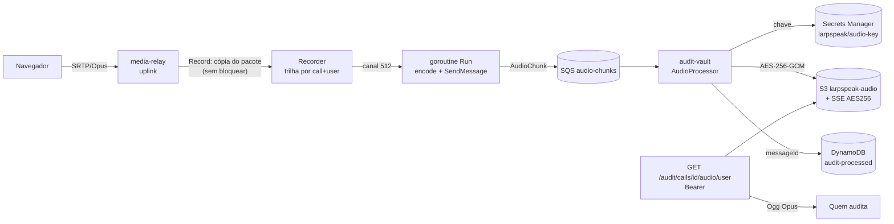

A gravação atravessa dois serviços em duas linguagens (Go → C#), passa pela mensageria e usa três serviços de nuvem
(SQS, S3, Secrets Manager), além do DynamoDB para a idempotência.

### 8.2 O gravador no media-relay (D20)

**Liga e desliga.** O gravador só existe se `AUDIO_CHUNKS_QUEUE` estiver definido (`config.go:49-50`,
`main.go:93-100`). No compose ele está ligado: `AUDIO_CHUNKS_QUEUE: audio-chunks`, `AUDIO_CHUNK_MS: 5000`
(`docker-compose.yml:92-93`). Log de partida: `call recording on`.

**Regra principal: gravar nunca pode atrasar a voz.** O comentário em `recorder.go:49-53` e a interface em
`sfu.go:28-33` ("Record must not block: it runs on the audio path") deixam isso explícito.

Como isso é garantido:

| Etapa | O que faz | Onde | Custo no caminho da voz |
|---|---|---|---|
| `Record` | copia o payload (`bytes.Clone`) e o anexa à trilha `{call, user}` na memória | `recorder.go:89-118` | um lock curto + um append |
| Corte | fecha a trilha quando atinge `AUDIO_CHUNK_MS` ou 96 KiB de payload | `recorder.go:110-113`, `recorder.go:78-79` | nenhum extra |
| `enqueue` | entrega o trecho a um canal com **512** posições, com `select … default` | `recorder.go:152-168`, `recorder.go:81` | nunca bloqueia |
| `Run` | outra goroutine monta o envelope, serializa JSON (base64) e publica | `recorder.go:183-234`, `encode` em `recorder.go:170-181` | fora do caminho |

**Outros cortes:**
- `Flush` quando o peer sai (`drop`, `sfu.go:277-279`) ou é substituído por uma oferta nova (`sfu.go:201-203`: nova
  linha do tempo RTP, então o trecho é cortado ali);
- um ticker de 1 s corta trilhas que ficaram `AUDIO_CHUNK_MS` sem pacotes (`flushIdle`, `recorder.go:135-150`,
  `recorder.go:191-204`), rede de segurança para peers que sumiram.

**Limite de 96 KiB.** Base64 aumenta 4/3: 96 KiB viram ~128 KiB, abaixo do limite de 256 KiB de uma mensagem SQS
(`recorder.go:78`).

**Canal cheio → descarta.** Se o broker está fora e o canal de 512 enche, o trecho **que está entrando** é descartado,
contado em `Dropped()` e logado (`audio chunk dropped: publish queue full`, `recorder.go:164-166`). O teste
`TestRecordNeverBlocksWhenTheQueueIsFull` (`recorder_test.go:171-190`) grava 600 trechos sem ninguém consumir e
confere que nada bloqueou e que exatamente `600 − 512 = 88` foram descartados.

> O comentário do `Recorder` (`recorder.go:49-53`) dizia "the oldest news is dropped", ao contrário do código. Foi
> corrigido para dizer o que o código faz: com a fila cheia, o trecho que está entrando (o mais novo) é descartado.

**Publicação com repetição (R6).** `send` tenta até 6 vezes, com espera de 250 ms dobrando até 5 s
(`recorder.go:266-285`, `recorder.go:79`). Log: `audio chunk publish failed, retrying`. Após 6 falhas com o serviço
rodando, o trecho só vai para o log (`audio chunk not published`), não para `Dropped`.

**Desligamento gracioso** (`recorder.go:217-231`, `drain` em `recorder.go:236-264`): deixa de aceitar pacotes, corta
todas as trilhas, reenvia o que falta com prazo único de 5 s (`DrainTimeout`), e conta o resto em `Dropped`. O
`main.go:98` registra o `Run` no `WaitGroup` dos consumidores, então o processo espera o dreno antes de sair.

**D20 — Gravação é melhor esforço.**
- **O quê:** a gravação pode perder trechos (canal cheio, broker fora por muito tempo, prazo de desligamento).
- **Por quê:** a chamada é o produto; a gravação é secundária. Bloquear o envio travaria o `uplink` e congelaria a voz
  de todos os ouvintes.
- **Alternativa descartada:** outbox transacional como nos outros eventos (escrever ~50 pacotes/s/usuário no DynamoDB
  é caro e o item tem limite de 400 KB); fila local em disco (mais peças); bloquear o envio (prejudica a chamada).
- **Onde:** `recorder.go:49-83`, `recorder.go:152-168`.

**Payload do `AudioChunk`** (`recorder.go:21-33`, contrato `contracts/events/AudioChunk.v1.schema.json`):

```json
{ "callId": "...", "userId": "...", "startMs": 1764100000000, "durationMs": 4980,
  "frames": [ { "ts": 123456, "data": "<base64 de um pacote Opus>" }, ... ] }
```

- `startMs`: relógio do pod no primeiro quadro; ordena os trechos de um participante;
- `ts`: timestamp RTP **original** (não o reescrito pelo slot);
- `data`: o pacote Opus exatamente como o navegador mandou;
- todo o envelope segue `contracts/envelope.schema.json` (`messageId`, `correlationId = callId`, `type = AudioChunk`,
  `version = 1`, `occurredAt`, `payload`).

O que é gravado: **todo** pacote de quem passou pelo `Touch`, mudo ou não (`sfu.go:258`). Um participante mudo gera
trechos de silêncio (quadros Opus muito pequenos).

### 8.3 No audit-vault: validar, cifrar, guardar (C#)

O consumidor (`AudioProcessor.HandleAsync`, `AudioProcessor.cs:15-52`) roda no mesmo laço genérico de fila do
audit-vault, com 2 réplicas competindo pela fila (R4, `docker-compose.yml:98`). O laço, a DLQ e a reconexão estão nas
seções 11.3.3, 12.4 e 12.5.

Passos:
1. **Validação** (`AudioChunks.cs:19-49`). Qualquer falha → `Outcome.Poison` → fica para a DLQ após N tentativas (F4):
   - `type == AudioChunk`;
   - `messageId`, `callId` e `userId` só com `[A-Za-z0-9_-]{1,64}` (`AudioChunks.cs:54-55`), porque viram parte da
     chave S3 (sem `/` nem `..`, defesa contra *path traversal*);
   - `callId == correlationId`;
   - `startMs`, `durationMs` ≥ 0; 1 a 5000 quadros; cada quadro com 1 a 2000 bytes em base64 válido.
2. **Duplicata?** `SeenAsync(messageId)` com leitura consistente na tabela `audit-processed`
   (`AudioStorage.cs:93-101`). Se já foi processada → `Duplicate` (log `duplicate ignored`).
3. **Chave** do Secrets Manager (`SecretsManagerKeyProvider`, `AudioStorage.cs:74-89`): lida na primeira vez,
   conferida (32 bytes em base64) e guardada em memória. Se o Secrets Manager está fora na partida, só a mensagem
   falha e é reentregue (R6).
4. **Serialização binária** dos quadros (`ChunkCodec.Serialize`, `AudioChunks.cs:58-75`):
   `count u32 | { ts u32 | len u16 | bytes }*`, big endian.
5. **Cifra** com AES-256-GCM (8.4).
6. **PUT no S3** com chave determinística (8.5).
7. **Marca** o `messageId` em `audit-processed` com `attribute_not_exists(pk)` (`AudioStorage.cs:103-119`); se outra
   réplica marcou antes, ignora.
8. Log `audio stored messageId=… frames=… bytes=…`.

### 8.4 Criptografia: AES-256-GCM com AAD (D23)

**Conceitos.**
- **AES-256** é uma cifra simétrica: a mesma chave de 32 bytes cifra e decifra.
- **GCM** (*Galois/Counter Mode*) é um modo **autenticado**: além de cifrar, gera uma **tag** de 16 bytes. Qualquer
  bit alterado no texto cifrado faz a decifragem falhar.
- **Nonce** de 12 bytes: número usado uma única vez com aquela chave. Repetir um nonce com a mesma chave quebra o GCM;
  por isso ele é **aleatório por trecho** (`RandomNumberGenerator.Fill`, `AudioCrypto.cs:25`).
- **AAD** (*associated authenticated data*): dados que **não são cifrados nem guardados**, mas entram no cálculo da
  tag. Para decifrar, é preciso fornecer a mesma AAD.

**Formato do objeto no S3** (`AudioCrypto.cs:6-12`):

```
"LSA1" (4 bytes, versão do formato) | nonce (12) | tag (16) | ciphertext
```

**AAD** = `callId \n userId \n startMs` (`AudioCrypto.cs:44-45`). Ela não é guardada no objeto; é **reconstruída a
partir da chave S3** na leitura (`AudioProcessor.cs:77`). Consequência: se alguém copia um trecho de Ana para a pasta
de Bruno, ou para outra chamada, ou muda o horário no nome, a tag não confere e o trecho **não abre**. O
`call-recording.sh` (passo 5) demonstra exatamente isso.

**Chave** (`infra/init/init.sh:57-58`): 32 bytes aleatórios em base64, segredo `larpspeak/audio-key` no Secrets
Manager, criado só se não existe (idempotente). O nome vem da env `AUDIO_KEY_SECRET` (`docker-compose.yml:110`).

**SSE no bucket** (`init.sh:49-56`): o bucket `larpspeak-audio` tem criptografia padrão do lado do servidor (`AES256`)
e acesso público bloqueado. Se o emulador não suportar essas APIs, só gera um aviso: a proteção real é a da aplicação.

**D23.**
- **O quê:** cada trecho é cifrado **antes** de chegar ao S3, com chave fora do bucket; SSE como segunda camada.
- **Por quê:**
  - o SSE do S3 sozinho decifra automaticamente para quem tem permissão de leitura no bucket: não protege contra quem
    lê o bucket;
  - a AAD dá **integridade de contexto**: um trecho não pode ser movido para outra chamada, usuário ou horário;
  - separar chave (Secrets Manager) e dado (S3) exige comprometer dois serviços.
- **Alternativa descartada:** só SSE-S3/SSE-KMS (não protege contra leitura do bucket, não amarra contexto).
- **Onde:** `services/audit-vault/AudioCrypto.cs`, `AudioProcessor.cs:37-38`.

**Limitação:** chave única e sem rotação. Trocá-la torna as gravações antigas ilegíveis (não há id de chave no
formato `LSA1`).

### 8.5 Chave S3 determinística e idempotência (D19)

**Chave do objeto** (`AudioKeys.For`, `AudioChunks.cs:98-107`):

```
audio/{callId}/{userId}/{startMs:D13}-{messageId}.bin
```

- `startMs` com 13 dígitos e zeros à esquerda: uma listagem simples já vem em ordem de tempo;
- `messageId` torna a chave **determinística**: a mesma mensagem sempre gera a mesma chave.

**O problema de idempotência.** A regra do projeto (R1, `AGENTS.md`) é "efeito + `messageId` processado na mesma
`TransactWriteItems`". Mas o efeito aqui é um PUT no **S3**, que não participa de transação do DynamoDB.

**D19 — Exceção de idempotência no áudio.**
- **O quê:** consulta o marcador → PUT com chave determinística → grava o marcador (`AudioProcessor.cs:32-41`).
- **Por quê:** se a réplica morre entre o PUT e o marcador (F2), a mensagem volta (visibilidade do SQS) e é
  processada de novo: o PUT **sobrescreve o mesmo objeto**. Continua existindo um único objeto por mensagem. O
  conteúdo cifrado muda (nonce novo), mas o áudio é o mesmo. Duas réplicas correndo na mesma mensagem (F8) também
  escrevem o mesmo objeto. `MarkAsync` devolve `false` para a réplica que perdeu a corrida do marcador, e ela registra
  `duplicate ignored` em vez de `audio stored` (`AudioProcessor.cs`, teste `Losing_the_mark_race_is_a_duplicate`).
- **Alternativa descartada:** guardar os bytes do áudio dentro da transação do DynamoDB (limite de 400 KB por item,
  e DynamoDB não é lugar de blob); outbox de chaves S3 (mais peças).
- **Onde:** `AudioProcessor.cs:9-14` (comentário que explica a decisão), `AudioChunks.cs:104-107`.
- **Status:** decidida e aprovada pelo responsável em 2026-11-26 (`ARCHITECTURE.md` §13).

O F3 (mesma mensagem 5 vezes) resulta em 1 objeto e 4 `duplicate ignored`. Os roteiros `scripts/demo/audit-f2.sh`,
`audit-f3.sh`, `audit-f4.sh`, `audit-f6.sh` e `audit-f8.sh` provam isso; a explicação está na seção 15.

### 8.6 Exportação em Ogg Opus sem decodificar (D24)

**O problema.** No S3 há pacotes Opus soltos. Nenhum player toca isso. É preciso um **contêiner**.

**Conceito: Ogg Opus (RFC 7845).** Ogg é um formato de contêiner em **páginas**. Cada página tem cabeçalho `OggS`,
número de sequência, CRC-32 e uma **granule position** (para Opus: o total de amostras a 48 kHz até o fim da página).
Um arquivo Ogg Opus tem:
1. página `OpusHead`: versão, canais, **pre-skip**, taxa original;
2. página `OpusTags`: fornecedor e comentários;
3. páginas de áudio com os pacotes Opus.

**Pre-skip.** O codificador Opus tem um atraso interno (*lookahead*). As primeiras amostras decodificadas são lixo de
aquecimento. O `pre-skip` diz ao player quantas descartar. O Larpspeak usa 312 (`OggOpus.cs:13`), o valor do
codificador de referência (libopus, 6,5 ms).

**Como o `OggOpus.Write` monta o arquivo** (`OggOpus.cs:15-55`):
- descarta pacotes malformados (`Samples == 0`);
- detecta mono/estéreo pelo bit `0x04` do byte TOC do primeiro pacote (`OggOpus.cs:18`);
- escreve `OpusHead` (pre-skip 312, 48000 Hz) e `OpusTags` (fornecedor `larpspeak-audit-vault`);
- agrupa até 50 pacotes ou 255 segmentos por página;
- calcula a granule somando as amostras de cada pacote, lidas do **byte TOC** (`Samples`, `OggOpus.cs:57-82`,
  RFC 6716 §3.1): configuração (SILK, híbrido ou CELT; 2,5 a 60 ms) × número de quadros no pacote;
- marca a última página com fim de fluxo (`0x04`);
- calcula o CRC do Ogg (polinômio `0x04C11DB7`, `OggOpus.cs:107-127`).

`AudioExporter.ExportOggAsync` (`AudioProcessor.cs:66-83`) lista os trechos do participante em ordem, abre cada um com
a AAD reconstruída da chave S3, junta os quadros e gera o `.ogg`. Se **qualquer** trecho falha na autenticação, nada
é entregue (500 `recording failed authentication`, `AuditApi.cs:49-53`).

**D24.**
- **O quê:** guardar os pacotes Opus como chegaram e montar o Ogg na exportação.
- **Por quê:** zero CPU de codec, nenhuma perda de qualidade, nenhuma biblioteca nativa (libopus) no contêiner .NET.
  O contêiner Ogg cabe em ~130 linhas de C#.
- **Alternativa descartada:** decodificar e recodificar (CPU e perda) ou gravar PCM/WAV (10–30× maior).
- **Onde:** `services/audit-vault/OggOpus.cs`.

**Limitações:**
- silêncios entre trechos (participante desconectado) **não são preenchidos**: os pacotes tocam colados. O timestamp
  RTP é guardado (`ts`), mas o exportador usa só a contagem de amostras do TOC;
- o pre-skip de 312 vale para o início do fluxo do navegador; um trecho que começa no meio de uma fala é tocado sem
  esse ajuste fino (inaudível na prática);
- cada participante é um arquivo separado; não há mixagem da chamada inteira.

### 8.7 API de leitura com token Bearer (D21)

Rotas (`AuditApi.cs:32-57`), na mesma proteção do resto de `/audit/*`:

| Rota | Retorno |
|---|---|
| `GET /audit/calls/{callId}/audio` | lista de trilhas: `userId`, `chunks`, `bytes`, `startedAt`, `lastChunkAt`, `url` |
| `GET /audit/calls/{callId}/audio/{userId}` | arquivo `audio/ogg` (`{callId}-{userId}.opus`) |

- Ids validados pelo mesmo padrão seguro (`AudioChunk.IsSafeId`) antes de tocar no S3 (`AuditApi.cs:37`, `:46`).
- `GET /health` fica aberto, sem token (exigência do enunciado).

**D21 — Token obrigatório (fail closed), em resumo.** Sem `AUDIT_API_TOKEN`, o audit-vault nem sobe
(`VaultConfig.cs:36-40`), porque a API entrega áudio **decifrado**. O token é comparado em tempo constante
(SHA-256 + `FixedTimeEquals`, `AuditApi.cs:60-67`). É um token estático único, não autorização por usuário. Detalhes,
alternativa descartada e a ressalva do valor padrão no compose: ver seção 16.5.

### 8.8 Como provar a gravação na apresentação

Pré-requisito: sistema no modo voz (`make start`) e uma chamada com pelo menos dois navegadores falando por ~10 s
(trechos fecham a cada 5 s).

```bash
make recording            # ou: make recording CALL=<callId>
# equivalente a: scripts/demo/call-recording.sh [callId]
```

O que o script mostra (`scripts/demo/call-recording.sh`):

| Passo | O que prova |
|---|---|
| 1 | os trechos estão em `s3://larpspeak-audio/audio/<callId>/<userId>/`, quantos por participante |
| 2 | o objeto começa com `LSA1` e não é áudio tocável (`xxd`, `file`) |
| 3 | a chave está no Secrets Manager (`larpspeak/audio-key`) e não há nada no bucket fora de `audio/` |
| 4 | sem token, `GET /audit/calls/<id>/audio` responde 401 |
| 5 | um trecho de um participante copiado para a pasta de outro faz a exportação falhar (AAD); removida a cópia, volta a funcionar |
| 6 | exporta um `.ogg` por participante (`OggS`), salva em `/tmp/larpspeak-recordings/<callId>/` e abre no Chrome |

Sem navegadores, a suíte automatizada usa o `webrtc-probe`: `make test_audit` roda `audit-recording.sh`, `audit-trail.sh`
e os cenários F2, F3, F4, F6 e F8 do audit-vault (`Makefile:117-119`).

Logs úteis durante a demonstração:

| Serviço | Linha |
|---|---|
| media-relay | `call recording on`, `webrtc peer connected`, `webrtc peer closed`, `audio chunk publish failed, retrying`, `audio chunk dropped: publish queue full` |
| audit-vault | `audio stored messageId=…`, `duplicate ignored`, `poison audio message left for DLQ` |

### 8.9 Resumo das limitações do áudio

| Limitação | Consequência | Onde |
|---|---|---|
| Sem STUN/TURN, sem fallback TCP | só funciona com rota UDP direta até `RELAY_HOST` | `sfu.go:102-107`, `voice.ts:96` |
| Sem portas publicadas no compose padrão | navegador só conecta no modo voz (`make start`) | `docker-compose.yml:71-94`, `compose.voice.yml` |
| Failover não é transparente | alguns segundos sem áudio durante a troca de pod | 7.9 |
| Gravação é melhor esforço | trechos podem ser perdidos (contados em `Dropped`) | `recorder.go:152-168` |
| Só o WebRTC é gravado | o `voice-client` não aparece nas gravações | `sfu.go:258-260` |
| Ogg sem preenchimento de silêncio | a gravação "pula" períodos sem áudio | `OggOpus.cs:6-10` |
| Chave AES única, sem rotação | trocar a chave perde as gravações antigas | `init.sh:57-58` |

---

# Parte 3 — Go e os serviços por dentro

## 9. Go no Larpspeak: concorrência na prática

Os dois serviços do caminho de tempo real (`call-signaling` e `media-relay`) são escritos em Go. Esta seção ensina,
do zero, as ferramentas de concorrência que o código usa de verdade e depois cataloga **cada** goroutine que existe
nos dois serviços: o que faz, por que precisa rodar em paralelo, como para e que estado compartilhado ela toca.

### 9.1 Os conceitos, do zero

#### Goroutine

Uma **goroutine** é uma função que roda de forma concorrente com o resto do programa. Ela começa com a palavra `go`:

```go
go messaging.RelayOutbox(ctx, st, b, cfg.TopicArn) // CS/main.go:73
```

A linha acima não espera `RelayOutbox` terminar: ela "dispara" a função e segue para a próxima linha. Uma goroutine
custa poucos KB de pilha (que cresce sob demanda), então um programa Go pode ter milhares delas. Compare com threads
do sistema operacional, que reservam ~1–8 MB de pilha cada uma.

**Analogia:** uma goroutine é como um garçom num restaurante. Contratar um garçom é barato; o restaurante (o runtime)
decide em qual cozinheiro (thread) o pedido vai ser preparado.

#### O escalonador M:N

O runtime de Go distribui **M goroutines sobre N threads do SO**. Ele usa três entidades:

| Sigla | Nome | O que é |
|---|---|---|
| G | goroutine | a tarefa: pilha + ponteiro de instrução |
| M | machine | uma thread real do sistema operacional |
| P | processor | uma "vaga de execução"; existem `GOMAXPROCS` delas (por padrão, o número de CPUs) |

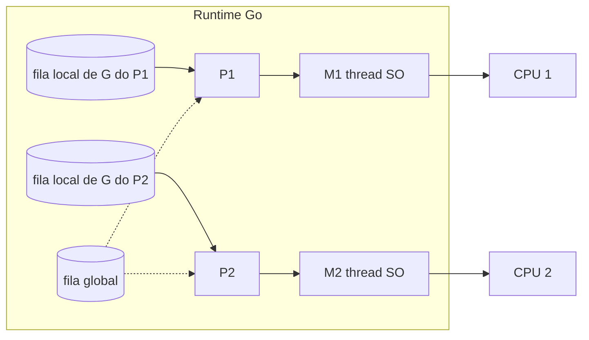

Quando uma goroutine **bloqueia em rede** (um long poll do SQS de 10 s, por exemplo), o runtime a estaciona no
*netpoller* e usa a thread para outra goroutine. Quando ela **bloqueia numa syscall** demorada, o P é passado para
outra thread. Resultado: dezenas de goroutines esperando rede não consomem CPU nem threads.

**Por que isso importa para um servidor de voz:** o `media-relay` precisa, ao mesmo tempo, (a) ler pacotes de áudio a
cada 20 ms de cada participante, (b) esperar até 10 s por mensagens do SQS, (c) renovar o lease do líder a cada 1 s e
(d) responder HTTP. Em um modelo de uma thread só, qualquer espera de rede congelaria o áudio. Em Go, cada uma dessas
atividades é uma goroutine bloqueada no seu próprio ponto, e o escalonador cuida do resto.

#### Channel

Um **channel** é um cano tipado por onde goroutines trocam valores. `make(chan T, n)` cria um canal com **buffer** de
`n` posições: enviar só bloqueia quando o buffer está cheio; receber só bloqueia quando está vazio.

```go
ch := make(chan []byte, 16)          // CS/internal/adapter/sse/hub.go:43
out: make(chan cutChunk, 512),       // MR/internal/app/recorder.go:81
```

O lema de Go é "não comunique compartilhando memória; compartilhe memória comunicando". O Larpspeak usa os dois
estilos: canais onde há um produtor e um consumidor claros (SSE, gravação) e mutex onde vários leitores/escritores
mexem num mapa (sessões vivas, peers WebRTC).

#### `select`

`select` espera em vários canais ao mesmo tempo e executa o primeiro que ficar pronto. Com um ramo `default`, ele
**não bloqueia**: se nenhum canal está pronto, cai no `default` na hora. Esse é o truque usado para "enviar se der,
senão descartar":

```go
select {
case ch <- frame:
default: // slow client: drop rather than block the saga
}
```
(`CS/internal/adapter/sse/hub.go:29-32`; o mesmo padrão em `MR/internal/app/recorder.go:162-167`)

#### `sync.Mutex` e `sync/atomic`

Um **mutex** (exclusão mútua) garante que só uma goroutine por vez entre num trecho de código. Sem ele, duas
goroutines escrevendo no mesmo `map` de Go fazem o programa abortar (`concurrent map writes`).

O código usa **apenas `sync.Mutex`** (nenhum `RWMutex` existe nos serviços Go; conferido por busca). Onde só um valor
simples é compartilhado, usa tipos de `sync/atomic`, que leem e escrevem sem trava:

| Tipo atômico | Onde | Para quê |
|---|---|---|
| `atomic.Bool` `PingsPaused` | `MR/internal/app/relay.go:57` | injeção de falha por `SIGUSR1` |
| `atomic.Int64` `unhealthyAt`, `term` | `MR/internal/app/relay.go:63-64` | saúde do enlace e term do líder, lidos por 3 goroutines |
| `atomic.Pointer[suspect]` `inherited` | `MR/internal/app/relay.go:65` | entrega do "suspeito" da goroutine `elect` para o laço de vigilância |
| `atomic.Int64` `dropped` | `MR/internal/app/recorder.go:71` | contador de trechos de áudio perdidos |
| `atomic.Pointer[ed25519.PublicKey]` | `MR/internal/adapter/pubkey/pubkey.go:18` | chave pública carregada em segundo plano |

Regra de ouro que o código segue: **nunca fazer I/O de rede segurando o mutex do caminho de áudio**. Exemplo: `refresh`
solta o `r.mu` antes de ler o DynamoDB e pega de novo depois (`MR/internal/app/relay.go:144-174`). O `uplink` do SFU
monta a lista de envios sob o mutex e escreve os pacotes **depois** de soltar (`MR/internal/adapter/webrtc/sfu.go:237-265`).

Uma exceção consciente: `Bus.queueURL` segura o mutex durante `GetQueueUrl` (`CS/internal/adapter/messaging/bus.go:40-52`).
Isso só acontece até a URL ser guardada no cache (uma vez por fila), então não afeta o regime normal.

#### `context.Context` e cancelamento

Um `context.Context` carrega um sinal de "pare" que atravessa chamadas de função. Os dois `main.go` criam o contexto
raiz ligado aos sinais do sistema:

```go
ctx, stop := signal.NotifyContext(context.Background(), syscall.SIGINT, syscall.SIGTERM) // CS/main.go:44, MR/main.go:43
```

Quando o Docker manda `SIGTERM` (`docker compose stop`), `ctx.Done()` fecha e todos os laços `for ctx.Err() == nil`
saem na próxima volta. Três variações aparecem no código:

| Variação | Onde | Por quê |
|---|---|---|
| `context.WithTimeout(r.Context(), 3*time.Second)` | todos os handlers HTTP (`CS/.../httpapi/handlers.go:73,91,115,143,216`) | um pedido HTTP nunca espera o DynamoDB para sempre |
| `context.WithoutCancel(ctx)` | `Bus.Consume` (`CS/.../messaging/bus.go:73-74`, `MR/.../messaging/bus.go:70-72`) | o poll em andamento **não** é abortado na parada (ver 9.4) |
| `context.WithoutCancel(req.Context())` | `/adopt` (`MR/.../httpapi/health.go:64`) | a goroutine `PickUp` sobrevive ao fim do pedido HTTP que a criou |

#### `sync.WaitGroup` (e por que não `errgroup`)

Um `WaitGroup` conta goroutines em andamento; `Wait()` bloqueia até todas terminarem. O código usa o método
`WaitGroup.Go` (Go 1.25+), que faz `Add(1)`, dispara a goroutine e chama `Done()` no fim:

```go
var consumers sync.WaitGroup
consumers.Go(func() { b.Consume(ctx, cfg.RelayResults, svc.OnRelayResult) }) // CS/main.go:74-75
...
consumers.Wait() // CS/main.go:88
```

`errgroup` (do módulo `golang.org/x/sync`) **não é usado**: ele cancelaria todas as goroutines no primeiro erro, mas
aqui nenhum laço devolve erro (todos tentam de novo para sempre, R6). Um `WaitGroup` da biblioteca padrão basta.

### 9.2 Catálogo de goroutines do call-signaling

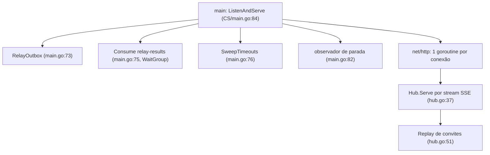

| # | Goroutine | O que faz | Por que concorrente | Como para | Estado compartilhado e proteção |
|---|---|---|---|---|---|
| 1 | `main` → `srv.ListenAndServe()` (`CS/main.go:84`) | atende a API HTTP | é o laço principal | retorna `http.ErrServerClosed` quando `Shutdown` é chamado | — |
| 2 | conexões HTTP (implícitas no `net/http`) | cada pedido roda na **sua** goroutine | é o modelo do `net/http` | fim do pedido; timeout de 3 s nos handlers | registro da chamada no DynamoDB, protegido por **escrita condicional** (R2, ver 11.1.5) |
| 3 | `messaging.RelayOutbox` (`CS/main.go:73`; `bus.go:114-138`) | lê o outbox, publica no SNS/SQS, apaga a linha | publicação não pode atrasar a transação de negócio | `for ctx.Err() == nil`; **não é aguardada** pelo `main` | tabela `signaling-outbox`; uma réplica só, então sem disputa. Republicar após crash é seguro: consumidores deduplicam (ver seção 12.3) |
| 4 | `Bus.Consume` de `relay-results` (`CS/main.go:75`; `bus.go:72-110`) | long poll de 10 s, chama `svc.OnRelayResult`, apaga | a espera de 10 s não pode travar o resto | entre polls, pelo `stop.Err()`; o poll em curso termina (`WithoutCancel`); **aguardada** por `consumers.Wait()` | chamadas no DynamoDB, protegidas por marcador `processed` + condição de estado na mesma transação |
| 5 | `svc.SweepTimeouts` (`CS/main.go:76`; `saga.go:376-397`) | a cada 1 s, procura chamadas `PENDING` mais velhas que `RELAY_TIMEOUT_MS` e compensa | o timeout precisa disparar mesmo sem nenhuma mensagem chegar (F7) | `for ctx.Err() == nil`; não aguardada | corre contra o consumidor (#4) recebendo `RelayFailed`/`RelayAllocated`. Quem ganha é decidido pela condição `status = PENDING` em `Fail`/`Activate`; o perdedor recebe `ErrStateChanged` e o sweeper ignora (`saga.go:392`) |
| 6 | observador de parada (`CS/main.go:82`) | espera `ctx.Done()` e chama `srv.Shutdown` | `ListenAndServe` bloqueia o `main` | termina após chamar `Shutdown` | — |
| 7 | `Hub.Serve` por stream SSE (`CS/.../sse/hub.go:37-81`) | mantém o `text/event-stream` aberto; `select` entre contexto, `ping` de 20 s e o canal | um stream fica aberto por horas | `r.Context().Done()` (cliente fechou) ou erro de escrita; ao sair, remove o canal do mapa (`hub.go:53-57`) | mapa `subs` usuário → conjunto de canais, protegido por `h.mu` (`hub.go:16`); cada canal com **buffer 16** |
| 8 | `go h.Replay(...)` (`hub.go:50-52`) | reenvia convites pendentes a quem acabou de conectar | ler o DynamoDB não deve atrasar o `: connected` | termina sozinho; usa o contexto do pedido | só chama `Notify`, que pega o mutex |

**Detalhe do hub SSE (D15).** `Notify` (`hub.go:23-34`) segura o mutex e faz um envio **não bloqueante** em cada canal
do usuário. Se o navegador está lento e o buffer de 16 enche, a notificação é **descartada**. Por quê: `Notify` é
chamado de dentro da saga (`saga.go:134-137`, por exemplo); bloquear ali travaria o consumidor SQS por causa de um
cliente lento. O custo é honesto: uma notificação pode se perder. A mitigação parcial é o `Replay` de convites na
reconexão e o fato de o cliente poder consultar `GET /calls/{id}` (R3).

### 9.3 Catálogo de goroutines do media-relay

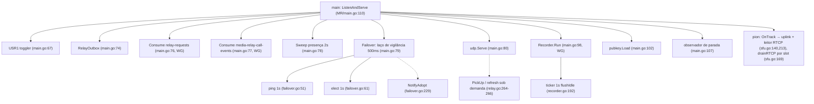

| # | Goroutine | O que faz | Por que concorrente | Como para | Estado compartilhado e proteção |
|---|---|---|---|---|---|
| 1 | toggler `SIGUSR1` (`MR/main.go:65-72`) | a cada `docker kill -s USR1`, inverte `PingsPaused` | sinais chegam a qualquer momento | nunca (vive com o processo) | `atomic.Bool` |
| 2 | `RelayOutbox` (`MR/main.go:74`; `MR/.../messaging/bus.go:112-135`) | publica `relay-outbox` em filas SQS (este serviço só fala com filas, sem SNS) | mesmo motivo do CS | `ctx`; não aguardada | tabela `relay-outbox`; **várias réplicas leem o mesmo outbox**, então a mesma linha pode ser publicada duas vezes; o consumidor deduplica pelo `messageId` (R1) |
| 3 | `Consume` de `relay-requests` (`MR/main.go:76`) | aloca (`RelayRequested`) ou libera (`ReleaseRelayRequested`) relays | consumidores concorrentes entre réplicas (R4) | igual ao CS; aguardada | `relay-sessions` com marcador + `attribute_not_exists(pk)` (`MR/.../dynamo/sessions.go:61-70`) |
| 4 | `Consume` de `media-relay-call-events` (`MR/main.go:77`) | `Release` em `CallEnded`/`CallFailed`, `Member` em `ParticipantJoined`/`Left` | idem | aguardada | `relay-sessions` com condição `state = ALLOCATED`; mapa `live` em memória sob `r.mu` (`relay.go:130-138`) |
| 5 | `r.Sweep` (`MR/main.go:78`; `relay.go:334-366`) | a cada 2 s: reporta participantes sem pacotes há `PARTICIPANT_TIMEOUT_MS` e sincroniza participantes | o silêncio de um cliente não gera evento sozinho | `ctx`; não aguardada | copia a lista sob `r.mu`, solta, e só então escreve no DynamoDB; marca `reported` para não repetir; se o `Emit` falha, desmarca e tenta na rodada seguinte (`relay.go:352-361`) |
| 6 | `r.Failover` = laço de vigilância (`MR/main.go:79`; `failover.go:48-78`) | a cada 500 ms, se for líder, varre `relay-nodes` e move chamadas de pods mortos | independente de áudio e de fila | `ctx`; não aguardada | escritas no DynamoDB com **fencing** pelo `term` (ver 11.2.5) |
| 7 | ping / heartbeat (`failover.go:51-60`) | a cada 1 s, `PutItem` do próprio nó com `beat` + 1 | um laço ocupado não pode atrasar o batimento | `ctx` | só escreve a própria linha; lê `PingsPaused` atômico |
| 8 | `r.elect` (`failover.go:61`, `82-122`) | renova o lease (se líder) ou tenta reivindicá-lo | "a busy audio or watch loop never delays the renewal" (`failover.go:80-81`) | `ctx` | `term`, `unhealthyAt`, `inherited` atômicos; lease protegido por escrita condicional |
| 9 | `udp.Serve` (`MR/main.go:80`; `udp/server.go:15-31`) | lê datagramas do caminho UDP legado e reenvia | leitura bloqueante | **fechando o socket**: `conn.Close()` no observador de parada (`MR/main.go:107`) faz `ReadFromUDP` falhar | chama `r.Forward`, que usa `r.mu` |
| 10 | `go r.refresh` / `go r.PickUp` (`relay.go:263-267`) | pacote de chamada ou usuário desconhecido dispara uma leitura do DynamoDB em segundo plano | não bloquear o laço de áudio com I/O | termina sozinha | `PickUp` limita a 1 leitura/s por chamada com o mapa `lookups` sob `r.mu` (`failover.go:241-258`) |
| 11 | `Recorder.Run` (`MR/main.go:98`; `recorder.go:187-234`) | consome o canal de trechos (buffer **512**), monta o envelope `AudioChunk` e publica | publicar no SQS não pode atrasar o áudio | `ctx.Done()`: liga `stopping`, corta tudo, drena por até `DrainTimeout` = 5 s; **aguardada** pelo `WaitGroup` | canal + `rec.mu` + `dropped` atômico |
| 12 | ticker do recorder (`recorder.go:192-204`) | a cada 1 s corta trilhas ociosas (`flushIdle`) | "a publish stuck in retries does not hold back the safety net" (`recorder.go:185-186`) | `ctx.Done()`; `Run` espera por ela via `tickerDone` | `rec.mu` |
| 13 | `key.Load` (`MR/main.go:102`; `pubkey.go:30-45`) | busca `GET /auth/public-key` do CS com espera de 500 ms dobrando até 10 s | o relay pode alocar chamadas antes de o CS subir (R6) | sucesso ou `ctx` | `atomic.Pointer`; enquanto `nil`, `/webrtc` responde 503 |
| 14 | observador de parada (`MR/main.go:107`) | `srv.Shutdown` e `conn.Close()` | — | após executar | — |
| 15 | `go r.PickUp` em `/adopt` (`health.go:63-66`) | o líder avisa o novo dono; ele carrega a sessão já | responder 202 rápido | termina sozinha | `r.mu` |
| 16 | `go r.Prober.NotifyAdopt` (`failover.go:229`) | `POST /adopt` no novo dono, melhor esforço, timeout 500 ms | o líder não espera outro pod | termina sozinha | nenhum |
| 17 | `uplink` (callback `OnTrack`, `sfu.go:140`, `212-267`) | lê RTP de um navegador e copia para os outros peers da chamada | um laço bloqueante por participante | `ReadRTP` falha quando o peer fecha; ou o `Touch` recusa e fecha o peer | mapa `s.calls` e slots sob `s.mu`; escreve os pacotes depois de soltar o mutex |
| 18 | leitor RTCP do uplink (`sfu.go:213-220`) | cada RTCP também conta como sinal de vida (`Touch`) | leitura bloqueante separada | erro de leitura | `r.mu` via `Touch` |
| 19 | `drainRTCP` por slot (`sfu.go:169`, `318-324`) | lê o RTCP de cada `RTPSender` | os interceptors de NACK da pion só funcionam se alguém ler | erro de leitura | nenhum |
| — | goroutines internas da pion | ICE, DTLS, SRTP, interceptors | biblioteca | `pc.Close()` | internas |

**O canal de gravação (512) e a regra "áudio nunca espera".** `Record` só faz `append` em memória sob o mutex
(`recorder.go:90-118`). Quando um trecho fecha, `enqueue` tenta pôr no canal com `select`/`default`: se os 512
lugares estão ocupados (broker fora do ar por muito tempo), o trecho é **descartado e contado** em `dropped`, com log
`audio chunk dropped: publish queue full` (`recorder.go:162-167`). A codificação JSON acontece em `Run`, fora do
caminho de áudio (`recorder.go:152-153`). Detalhes do formato do áudio: ver seção 8.

### 9.4 Ligação no `main.go` e ordem de parada

O `main.go` de cada serviço é a **raiz de composição**: cria os clientes AWS, os adaptadores, injeta tudo no núcleo
(`app`) e dispara as goroutines. Nenhuma regra de negócio mora ali (`CS/main.go:1-5`, `MR/main.go:1-6`).

**Partida do call-signaling** (`CS/main.go:37-90`):
1. log JSON com `slog` e campo fixo `service` (`:38`); configuração por variáveis de ambiente, sai com código 1 se
   faltar alguma (`:39-43`);
2. contexto de sinais (`:44`);
3. cliente AWS com `http.Client{Timeout: 15s}` e `RetryMaxAttempts(1)` (`:49-50`): o SDK não tenta de novo; os laços
   tentam, com backoff, e registram cada tentativa (R6, D7);
4. adaptadores: `dynamo.Store`, `messaging.Bus`, `sse.Hub`; núcleo `app.Service` (`:55-59`);
5. semente Ed25519 do Secrets Manager, **bloqueando** até conseguir (`:62-67`); precisa ter 32 bytes;
6. `app.Auth` e o cliente `relayhttp` com a função `Mint` de tokens `join` de 1 min (`:68-71`);
7. goroutines de fundo (`:73-76`), rotas (`:78-79`), servidor (`:81-87`).

**Partida do media-relay** (`MR/main.go:35-116`): log com `service` e `replica` = hostname (`:37`); socket UDP legado
(`:54`); `app.Relay` com `ID` = hostname, `Host` anunciado e `ProbeAddr` = IP do contêiner (`:61-62`); toggler USR1
(`:65-72`); goroutines (`:74-80`); socket WebRTC e SFU (`:83-92`); gravador opcional (`:95-100`); chave pública
(`:101-102`); HTTP (`:104-113`).

**Parada graciosa.** A sequência quando o Docker manda `SIGTERM`:

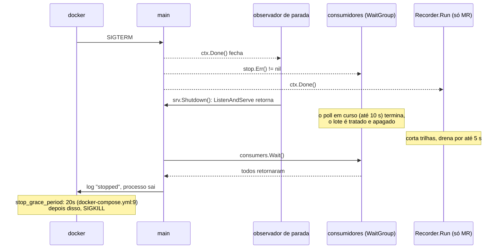

Por que **não** cancelar o poll em andamento (`bus.go:67-71`, comentário no código): o SQS pode já ter entregado
mensagens para aquele `ReceiveMessage`. Se o processo aborta, essas mensagens ficam **invisíveis** durante todo o
*visibility timeout* (30 s). Nesse tempo o sweeper da saga (3 s) desistiria de uma chamada saudável. Então o poll
termina, o lote é tratado e apagado, e só então o laço sai.

A conta do tempo: long poll de 10 s + tratamento do lote < 20 s de `stop_grace_period`. Mesmo no pior caso (broker
congelado), o cliente HTTP do SDK desiste em 15 s, ainda dentro dos 20 s. No audit-vault, o mesmo raciocínio usa
`HostOptions.ShutdownTimeout = 15s` (`AV/Program.cs:23`).

O que **não** é aguardado (limitação aceita, documentada em ARCHITECTURE §5.4):
- CS: `RelayOutbox`, `SweepTimeouts` e o próprio `srv.Shutdown`. Streams SSE abertos não terminam com `Shutdown`
  (ele não cancela pedidos ativos); eles são cortados quando o processo sai. O `EventSource` do navegador reconecta
  sozinho e recebe de novo os convites pendentes (`Replay`).
- MR: outbox, `Sweep`, failover, UDP e o socket WebRTC. Nada disso perde dados: o outbox continua no DynamoDB, e
  heartbeat/lease simplesmente param (é isso que o failover detecta).

### 9.5 Biblioteca padrão primeiro

O projeto segue "stdlib antes de dependência" (AGENTS.md, Ponytail). O que vem da biblioteca padrão:

| Necessidade | Pacote | Onde |
|---|---|---|
| Servidor HTTP e roteamento com método e `{id}` | `net/http` (`ServeMux` com padrões `"POST /calls/{id}/join"`) | `CS/.../httpapi/handlers.go:25-37` |
| Logs estruturados em JSON | `log/slog` com `NewJSONHandler` | `CS/main.go:38`, `MR/main.go:37` |
| Assinatura de tokens | `crypto/ed25519` | `CS/.../domain/token.go:38-68` |
| Hash de senha | `crypto/pbkdf2` + `crypto/sha256`, comparação com `crypto/subtle` | `CS/.../domain/account.go:53-60` |
| JSON | `encoding/json` | em todo lugar |
| IDs únicos | pacote `uuid` da **biblioteca padrão** (Go 1.27) | `import "uuid"` em `CS/.../domain/envelope.go:8`, `CS/.../httpapi/handlers.go:12`, `CS/.../app/auth.go:13`, `MR/.../app/relay.go:15` |
| SSE | só `net/http` + `http.Flusher` | `CS/.../sse/hub.go` |
| UDP | `net.ListenUDP` | `MR/main.go:54` |
| Sorteio de falha (R5) | `math/rand/v2` | `MR/.../app/relay.go:188` |

O import `"uuid"` sem domínio confirma o pacote da biblioteca padrão, como exige o AGENTS.md. O `github.com/google/uuid`
aparece em `MR/go.mod:31` só como dependência **indireta**, trazida pela pion; o código do projeto não o importa.

Dependências externas (`go.mod`):

| Módulo | Serviço | Por quê |
|---|---|---|
| `aws-sdk-go-v2` (`config`, `dynamodb`, `sqs`, `sns`, `secretsmanager`, `feature/dynamodb/attributevalue`) | CS e MR | falar com DynamoDB, SQS, SNS e Secrets Manager; não há como fazer isso razoavelmente só com stdlib (assinatura SigV4) |
| `github.com/pion/webrtc/v4`, `pion/rtp`, `pion/interceptor` | só MR | WebRTC completo (ICE, DTLS, SRTP) para áudio de navegador; ver seção 7 |

Os dois `go.mod` estão arrumados com `go mod tidy`: toda dependência importada direto pelo código (por exemplo
`service/secretsmanager` no call-signaling e `pion/rtp` no media-relay) aparece como direta, sem `// indirect`.

---

## 10. Arquitetura hexagonal (portas e adaptadores)

### 10.1 O conceito

A **arquitetura hexagonal** (Alistair Cockburn, também chamada "portas e adaptadores") separa o programa em:

- **núcleo**: as regras de negócio. Não sabe o que é DynamoDB, SQS ou HTTP;
- **portas**: interfaces que o núcleo declara para o que ele precisa do mundo ("preciso guardar uma chamada",
  "preciso avisar um usuário");
- **adaptadores**: implementações concretas dessas portas (DynamoDB, SNS, SSE...) e também os pontos de entrada
  (HTTP, consumidor de fila, socket UDP) que chamam o núcleo.

**Analogia:** o núcleo é um notebook com portas USB-C. Ele não sabe se do outro lado está um monitor Dell ou LG; só
conhece o formato da porta. Trocar o monitor (DynamoDB real → fake em memória) não exige abrir o notebook.

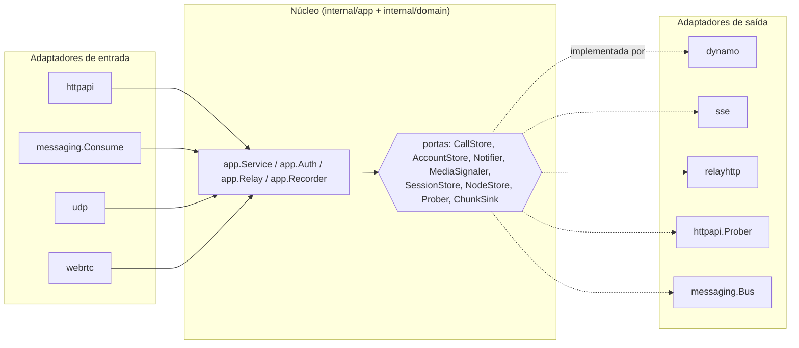

### 10.2 Layout de pastas

Os dois serviços Go têm a mesma forma:

```
services/<serviço>/
  main.go                 raiz de composição (liga as peças)
  internal/domain/        tipos, estados, erros sentinela, Envelope, tokens  (só stdlib)
  internal/app/           regras; ports.go declara as portas de saída        (domain, config, stdlib)
  internal/config/        leitura de variáveis de ambiente                    (stdlib)
  internal/adapter/*/     AWS, HTTP, SSE, UDP, WebRTC                         (app, domain, SDKs)
```

`internal/` é uma regra do compilador Go: nada fora do módulo pode importar esses pacotes. Isso reforça D16.

| Serviço | Adaptadores |
|---|---|
| call-signaling | `dynamo` (calls, users, outbox, processed, accounts, refresh), `messaging` (SQS/SNS), `httpapi` (API pública), `sse` (hub de notificações), `relayhttp` (oferta WebRTC até o relay), `secrets` (Secrets Manager) |
| media-relay | `dynamo` (sessions, nodes, outbox, processed), `messaging` (SQS), `httpapi` (`/health`, `/adopt`, `/webrtc` e o `Prober`), `udp`, `webrtc` (SFU pion), `pubkey` (busca a chave pública do CS) |

### 10.3 As portas, no código

**call-signaling** (`CS/internal/app/ports.go`):

| Porta | Linhas | Implementada por |
|---|---|---|
| `CallStore` | `:14-39` | `dynamo.Store` (`CS/.../dynamo/store.go`) |
| `MediaSignaler` | `:43-45` | `relayhttp.Client` (`CS/.../relayhttp/client.go:16-43`) |
| `Notifier` | `:48-50` | `sse.Hub` (`CS/.../sse/hub.go:23`) |
| `AccountStore` | `:53-63` | `dynamo.Store` (`CS/.../dynamo/accounts.go`) |

Os comentários das portas já descrevem o **contrato**, não a implementação. Exemplo: "`Join` takes a seat (R2).
ErrSeatLost: full, ended or already inside. ErrStateChanged: user claimed by another call." (`ports.go:33`). O
núcleo trabalha com esses erros sentinela de `domain` (`CS/.../domain/call.go:22-31`) e nunca com erros do SDK da AWS.

**media-relay** (`MR/internal/app/ports.go`): `SessionStore` (`:16-24`), `NodeStore` (`:28-37`), `Prober` (`:40-43`).
Mais uma porta mora junto de quem a usa: `ChunkSink` (`MR/.../app/recorder.go:17-19`), implementada por
`messaging.Bus.Send` (`MR/.../messaging/bus.go:147-151`).

Na direção contrária, o adaptador WebRTC declara o que **ele** precisa do núcleo: a interface `Gate` com `Admit` e
`Touch` (`MR/.../webrtc/sfu.go:23-26`), que `app.Relay` satisfaz (`relay.go:285-326`). Assim o SFU não conhece o
`app.Relay` inteiro.

Observação honesta: o outbox não passa por uma porta do `app`. O laço `RelayOutbox` vive no adaptador `messaging`, que
declara a própria interface `Outbox` (`CS/.../messaging/bus.go:34-37`), e o `dynamo.Store` a implementa. É uma ligação
adaptador → adaptador feita no `main.go:73`. É aceitável: o outbox é encanamento de mensageria, não regra de negócio.

### 10.4 Como o `main.go` liga tudo

Trecho do call-signaling (`CS/main.go:55-71`), comentado:

```go
st := &dynamo.Store{...}                 // adaptador de saída: CallStore + AccountStore + Outbox
b := messaging.New(sqs..., sns..., log)  // adaptador de mensageria
h := sse.New()                           // adaptador de saída: Notifier
svc := &app.Service{St: st, Hub: h, ...} // núcleo recebe as portas por injeção
h.Replay = svc.ReplayInvites             // o hub chama de volta o núcleo na reconexão
auth := &app.Auth{St: st, Key: ...}
svc.Media = &relayhttp.Client{...}       // adaptador de saída: MediaSignaler
```

Não há framework de injeção de dependência: são campos de struct preenchidos à mão. Em Go, uma struct satisfaz uma
interface só por ter os métodos (tipagem estrutural); não existe `implements`.

### 10.5 O ganho: testes de unidade com fakes

Como o núcleo só depende de interfaces, os testes trocam DynamoDB, SSE e Prober por fakes em memória. Exemplos reais:

| Arquivo | Fake | O que prova |
|---|---|---|
| `CS/internal/app/saga_test.go:19-25` | `fakeStore` (calls, users, `ops`, `errs`, `seen`) e `fakeHub` (`:140`) | `TestRelayFailedCompensatesOnce` (`:192`): a segunda entrega dá `ErrDuplicate`; `TestTimeoutSweepCompensates` (`:210`): só a chamada vencida falha; `TestLateAllocationIsReleased` (`:226`): F7 gera `ReleaseRelayRequested`; `TestJoinLostLastSeat` (`:249`) |
| `CS/internal/app/auth_test.go:16` | `fakeAccounts` | `TestAuthFlow`: login, rotação e reuso de refresh token |
| `MR/internal/app/relay_test.go:22-28` | `fakeStore` (implementa `SessionStore` **e** `NodeStore`) e `fakeProber` | `TestWatchNodes` (`:195`): pod silencioso sem `/health` é marcado morto; pod silencioso que responde `/health` **não**; enlace próprio instável não dá veredito. `TestRedistributeLeastConnections` (`:246`) |
| `MR/internal/app/recorder_test.go` | sink falso | `TestRecordNeverBlocksWhenTheQueueIsFull` (`:171`), `TestShutdownFlushesBufferedAudio` (`:192`), `TestIdleTracksAreCutWhileASendIsStuck` (`:249`) |
| `CS/internal/adapter/dynamo/store_test.go:21-51` | um **DynamoDB HTTP falso** (`httptest.NewServer`) | `TestItemOrder` e `TestErrorMapping`: a ordem dos itens da transação e o mapeamento "item 0 falhou → `ErrDuplicate`" |

O último caso é interessante: o adaptador também é testado, mas sem AWS. O teste sobe um servidor HTTP local que
responde como o DynamoDB e devolve `TransactionCanceledException` com os códigos por item.

Uma linha de teste típica, sem nenhuma infraestrutura:

```go
st := newFake(pending())
sg, hub := newService(st)
e := result(t, "RelayFailed", "m1", map[string]any{"callId": "c1", "reason": "boom"})
sg.OnRelayResult(ctx, e)                // compensa
sg.OnRelayResult(ctx, e)                // mesma mensagem: ErrDuplicate
```
(`CS/internal/app/saga_test.go:192-209`)

### 10.6 D16: nenhum código compartilhado entre serviços

- **O que:** só a pasta `contracts/` (JSON Schema) é comum. O envelope (`domain/envelope.go`) e a mensageria
  (`adapter/messaging/bus.go`) estão **copiados** nos dois módulos Go, com pequenas diferenças: o CS publica em SNS e
  SQS; o MR só em SQS e expõe `Send` para o gravador (`MR/.../messaging/bus.go:147-151`).
- **Por que:** cada serviço compila e é implantado sozinho (`go build .` no Dockerfile, `CS/Dockerfile`). Um serviço
  pode mudar sua mensageria sem forçar uma nova versão do outro. É a ideia de "microsserviço": acoplamento só pelo
  contrato.
- **Alternativa descartada:** um módulo Go compartilhado (`larpspeak/common`). Acoplaria builds e versões, e o C# do
  audit-vault nem poderia usá-lo.
- **Onde está:** `CS/internal/domain/envelope.go` e `MR/internal/domain/envelope.go`; `CS/go.mod:1` e `MR/go.mod:1` são
  módulos distintos.

---

## 11. Os serviços por dentro

### 11.1 call-signaling

É a porta de entrada do sistema: autenticação, API de chamadas (R3), saga de criação (orquestrador, D8), controle de
vagas (R2) e notificações SSE. Roda com **1 réplica** (D15, ver 11.1.4).

#### 11.1.1 API HTTP

Rotas registradas em `CS/.../httpapi/handlers.go:25-37` e `CS/.../httpapi/auth.go:18-51`:

| Rota | Autenticação | Resposta de sucesso | Nota |
|---|---|---|---|
| `GET /health` | aberta | 200 `{"status":"ok","service":"call-signaling"}` | healthcheck do Dockerfile |
| `POST /auth/register` | aberta | 201 `{userId}` | 409 se o nome existe |
| `POST /auth/login` | aberta | 200 `{accessToken, expiresIn, userId}` + cookie `refresh` | |
| `POST /auth/refresh` | cookie | 200, cookie trocado | rotação |
| `POST /auth/logout` | cookie | 204 | revoga a família |
| `GET /auth/public-key` | aberta | 200 `{"alg":"EdDSA","key":...}` | lida pelo media-relay |
| `GET /me` | Bearer | 200 `{userId}` | |
| `POST /sse-ticket` | Bearer | 200 `{ticket}` (JWT `sse`, 1 min) | |
| `GET /notifications` | `?ticket=` ou Bearer | stream SSE | |
| `POST /calls` | Bearer | **202** `{callId, status:"PENDING", statusUrl}` + `Location` | **R3** (`handlers.go:46-83`) |
| `GET /calls/{id}` | Bearer | 200 com a chamada | consulta de status (R3) |
| `POST /calls/{id}/join` | Bearer | 200 com relay e participantes | 409 cheia/inativa/já dentro |
| `POST /calls/{id}/leave` | Bearer | 202 | o último a sair termina a chamada |
| `POST /calls/{id}/invite` | Bearer | 202 | |
| `POST /calls/{id}/webrtc` | Bearer | 200 `{sdp}` | 409 "relay not ready, retry" |
| `POST /calls/{id}/state` | Bearer | 202 | mute/deafen |

Padrões que se repetem em todos os handlers:
- corpo limitado por `http.MaxBytesReader` (64 KiB, 4 KiB, 128 KiB ou 1 KiB conforme a rota; `handlers.go:53,139,184,212`);
- contexto com timeout de 3 s (6 s para WebRTC, `handlers.go:188`);
- erro de domínio → 409; erro de infraestrutura → 503 `"try again"`. O cliente nunca vê mensagem de erro da AWS.

`POST /calls` é o exemplo de **API assíncrona (R3)**: gera o id com `uuid.New()` (`handlers.go:58`), grava a chamada
`PENDING` + `RelayRequested` no outbox numa transação, e responde 202 **antes** de existir um relay. O resultado chega
depois por SSE (`call_active` / `call_failed`) ou por `GET /calls/{id}`.

#### 11.1.2 Contas e autenticação

**Senha.** PBKDF2-HMAC-SHA256 com **600 000 iterações** (recomendação OWASP 2023), sal aleatório de 16 bytes, chave de
32 bytes, tudo da biblioteca padrão:

- constante `PwIterations = 600_000` (`CS/.../domain/account.go:23`);
- `HashPassword` com `pbkdf2.Key(sha256.New, ...)` (`account.go:53-56`);
- comparação em tempo constante com `subtle.ConstantTimeCompare` (`account.go:58-60`);
- o número de iterações é guardado **por linha** (`account.go:35`), para poder subir no futuro sem invalidar contas.

`Login` gasta o mesmo tempo de PBKDF2 para usuário inexistente e senha errada (`CS/.../app/auth.go:74-77`): sem isso,
um atacante descobriria quais nomes existem medindo o tempo de resposta.

**Tokens (D14), em resumo.** JWT assinado com **EdDSA (Ed25519)**, implementado à mão em ~30 linhas sobre
`crypto/ed25519` (`CS/.../domain/token.go:38-68`). Três tipos separados pelo campo `typ`: `access`
(`ACCESS_TOKEN_TTL_S`, 300 s), `sse` (1 min, `?ticket=` no `EventSource`) e `join` (1 min, `cid = callId`, enviado ao
media-relay com a oferta WebRTC). A semente de 32 bytes vem do Secrets Manager (`JWT_KEY_SECRET`, `CS/main.go:62-67`),
lida com nova tentativa e espera de 500 ms dobrando até 10 s (`CS/.../secrets/secrets.go:16-33`). Só o call-signaling
tem a chave privada; o media-relay busca a **pública** em `GET /auth/public-key` (`MR/.../pubkey/pubkey.go:30-45`). Por
que Ed25519 e não HS256, a tabela completa dos tipos e o escopo do token `join`: ver seção 16.1.

**Refresh token.** Opaco (32 bytes aleatórios), guardado só como SHA-256 (`auth.go:130-140`), entregue em cookie
`HttpOnly`, `SameSite=Strict` e `Secure` (configurável por `COOKIE_SECURE`) (`CS/.../httpapi/auth.go:156-161`). Cada uso
**rotaciona** o token dentro de uma "família". Reapresentar um token já usado depois de 5 s de graça revoga a família
inteira (detecção de roubo, `auth.go:100-109`). A rotação é uma transação condicional (`CS/.../dynamo/accounts.go:66-93`).

#### 11.1.3 Ciclo de vida da chamada (máquina de estados)

Uma chamada passa por quatro estados: `PENDING` (criada, esperando relay), `ACTIVE`, `FAILED` (compensada) e `ENDED`
(saiu o último participante). Não existe rota `/end`: a chamada termina quando o último participante sai
(`saga.go:244-246`). Cada transição é uma escrita condicional sobre o estado atual, e o call-signaling é o orquestrador
da saga (D8). Diagrama de estados, tabela de transições com o código de cada uma, compensação e resposta atrasada: ver
seções 13.2 a 13.5.

#### 11.1.4 Notificações SSE (D15)

**SSE (Server-Sent Events)** é um padrão HTTP em que o servidor mantém a resposta aberta e escreve "quadros" de texto
`event: nome\ndata: json\n\n` quando quiser. O navegador usa a API `EventSource`, que **reconecta sozinha** se a
conexão cai.

- **O que:** `GET /notifications` abre o stream (`hub.go:37-81`). Eventos: `incoming_call`, `call_active`, `call_failed`,
  `participant_joined`, `participant_left`, `participant_state`, `left_call`, `relay_moved`.
- **Por que SSE:** as notificações vão **só** do servidor para o cliente. SSE é HTTP puro, cabe em `net/http` + `Flusher`
  sem dependência, e passa pelo nginx com `proxy_buffering off`. Um comentário `: ping` a cada 20 s mantém o stream vivo
  através de proxies (`hub.go:63`).
- **Alternativa descartada:** WebSocket. Exigiria biblioteca extra (a stdlib Go não tem servidor WebSocket), e a
  bidirecionalidade não é usada: os comandos do cliente já vão pela API HTTP.
- **Custo (limitação):** o hub fica em memória. Se houvesse 2 réplicas, um evento tratado na réplica A não chegaria a
  um usuário conectado na réplica B. Por isso o call-signaling roda com **1 réplica** (sem `deploy.replicas` no
  `docker-compose.yml:34-55`). Escalar exigiria distribuir notificações entre réplicas (por exemplo, SNS com uma fila
  por réplica). R4 é atendido por media-relay e audit-vault, não por este serviço.
- Sem `id:` / `Last-Event-ID`: uma notificação descartada (buffer de 16 cheio) ou emitida durante uma reconexão não é
  reenviada, exceto convites (`Replay`).

#### 11.1.5 Vagas e uma chamada por usuário (R2) — visão rápida

A disputa por vagas (F5: 100 pedidos simultâneos para 10 vagas) é resolvida **dentro do DynamoDB**, sem lock em memória.
Cada pedido HTTP roda na sua própria goroutine e tenta uma transação:

```
[0] Update calls  SET taken = taken + 1  ADD participants :u
      CONDITION  status = ACTIVE AND taken < capacity AND NOT contains(participants, :u)
[1] Put outbox    ParticipantJoined
[2] Put users     {pk: user, callId}     CONDITION attribute_not_exists(pk)
```
(`store.go:169-178`, `join` em `:287-298`, `claimUser` em `:266-272`)

O DynamoDB avalia a condição e a escrita de forma atômica por item. Dos 100 pedidos, exatamente 10 passam; os outros
recebem `ErrSeatLost` → 409 `call is full`. A tabela `signaling-users` garante que um usuário esteja em no máximo uma
chamada (D10); `moveOut` tira o usuário da chamada anterior antes, como no Discord (`saga.go:62-77`).

Por que não um `sync.Mutex`: funcionaria com uma réplica, mas não com duas, e não sobreviveria a um reinício. A
escrita condicional é o "mutex" que vale para todo o sistema distribuído (D9). Detalhes e demonstração: ver seções 13.6,
13.8 e 15 (F5).

#### 11.1.6 Sinalização WebRTC até o pod dono (D11)

`POST /calls/{id}/webrtc` lê `relaySignal` da chamada e repassa a oferta SDP por HTTP síncrono para
`http://<relaySignal>/webrtc`, com um token `join` (`CS/.../relayhttp/client.go:21-43`). Erros 404/409/503 do relay
viram `ErrRelayNotReady` → 409 "retry", e o navegador tenta de novo (alocação ou failover em curso). É uma das duas
únicas chamadas síncronas entre serviços; a outra é a busca da chave pública.

### 11.2 media-relay

Aloca relays de áudio (a "dependência instável" simulada, R5), encaminha o áudio, detecta participantes que sumiram e
faz failover entre pods. Roda com **2 réplicas** por padrão (`docker-compose.yml:74-75`). O id de cada pod é o
`hostname` do contêiner (`MR/main.go:36`).

#### 11.2.1 Partida

Ver 9.3 e 9.4. Pontos específicos:
- `advertisedHost` usa `RELAY_HOST` (IP da máquina na rede local) ou o IP do contêiner (`MR/main.go:119-131`);
- `Failover` começa com `unhealthyAt = agora` e `reloadOwn` (`failover.go:49-50`): um pod recém-iniciado não julga
  ninguém nos primeiros 3 s e retoma as próprias sessões.

#### 11.2.2 Alocação: como uma chamada ganha um pod

O código manda aqui, e ele difere do que a intuição sugere: **não existe balanceamento por "menos sessões" na
alocação**. A réplica que **puxa** o `RelayRequested` da fila SQS vira a dona da chamada (`owner = r.ID`,
`relay.go:200-201`). O SQS distribui as mensagens entre os consumidores concorrentes (modelo pull), e isso já espalha a
carga. O critério "menos sessões" (*least connections*) só existe no **failover** (`failover.go:206-211`).

Passos de `allocate` (`relay.go:176-219`):
1. espera `RELAY_LATENCY_MS` com `select` sobre `time.After` e `ctx.Done()` (`:182-186`) — **R5**;
2. sorteia contra `RELAY_FAILURE_RATE` (`:188`) — **R5**; se falha, `Ack` = marcador + `RelayFailed` no outbox;
3. se passa, `Allocate` = marcador + `Put relay-sessions` com `attribute_not_exists(pk)` + `RelayAllocated` no outbox
   (`MR/.../dynamo/sessions.go:61-70`);
4. `track` coloca a sessão no mapa `live` em memória (`relay.go:233-245`).

`RelayAllocated` leva `signalAddr` = `ProbeAddr` (`relay.go:204`): é o endereço que o call-signaling usa para as ofertas
WebRTC.

#### 11.2.3 Eventos de chamada

`OnCallEvent` (`relay.go:93-109`) consome `media-relay-call-events` (fan-out do SNS `call-events`):

| Evento | Efeito | Condição |
|---|---|---|
| `CallEnded`, `CallFailed` | `Release`: `state = RELEASED` | `state = ALLOCATED` (`sessions.go:82-91`) |
| `ParticipantJoined` / `Left` | `Member`: `ADD`/`DELETE participants` | `state = ALLOCATED` (`sessions.go:94-105`) |
| `CallStarted` | nada | — |

Qualquer réplica pode receber o evento. Ela atualiza o DynamoDB; o pod dono pega a mudança na hora (se for ele) ou no
próximo `refresh`, no máximo a cada 500 ms (`relay.go:144-174`). `CallEnded` é o "evento com vários interessados" do
enunciado: media-relay libera o relay, audit-vault registra a chamada.

#### 11.2.4 Presença (D13)

Cada pacote de áudio (UDP em `Forward`, WebRTC RTP/RTCP em `Touch`) atualiza `lastSeen` (`relay.go:270-271`, `292`).
Um navegador mudo continua mandando quadros Opus de silêncio, então silêncio **não** é ausência. `Sweep` (a cada 2 s)
reporta quem passou de `PARTICIPANT_TIMEOUT_MS` (15 s) com `ParticipantTimedOut`; o call-signaling trata como uma saída
normal (`saga.go:109-119`).

- **Por que:** detecta navegador fechado ou rede caída sem um heartbeat separado.
- **Alternativa descartada:** heartbeat HTTP do cliente (mais tráfego, mais um caminho para falhar).

#### 11.2.5 Failover com eleição de líder por lease, term e fencing (D12)

**O problema.** Um pod morre com chamadas ativas. Alguém precisa (1) perceber, (2) decidir que ele morreu e (3) mover
as chamadas para outro pod. Se **todos** os pods fizessem isso, duas réplicas poderiam mover a mesma chamada para
destinos diferentes. Precisamos de **um** decisor: um líder.

**Conceitos, do zero:**

| Conceito | Definição | No Larpspeak |
|---|---|---|
| **Heartbeat (batimento)** | sinal periódico "estou vivo" | cada pod faz `PutItem` da própria linha em `relay-nodes` a cada 1 s com `beat` + 1 (`failover.go:51-60`, `nodes.go:18-25`) |
| **Lease (arrendamento)** | um direito com prazo: "sou o líder enquanto continuar renovando" | linha `pk = "leader"` com `holder`, `term`, `beat` (`nodes.go:16`, `domain/session.go:44-48`); renovada a cada 1 s (`nodes.go:71-80`) |
| **Term (relógio de geração)** | número que só cresce: +1 a cada novo líder | `Claim` grava `term = antigo + 1` (`nodes.go:56-68`) |
| **Fencing token** | o recurso protegido recusa ordens que trazem um term velho | `ConditionCheck` `holder = :me AND term = :t` dentro de cada transação do líder (`nodes.go:83-90`) |

**Analogia do fencing:** um hotel troca a fechadura eletrônica a cada novo hóspede. O hóspede anterior pode até ainda
ter o cartão no bolso, mas a porta não abre mais. O "cartão" é o term; a "fechadura" é a condição na escrita do
DynamoDB.

**Por que o fencing é necessário.** O líder pode **congelar** (pausa de VM, GC longo, processo parado com
`docker pause`). Enquanto isso, os outros veem o lease parado e elegem um novo líder com `term + 1`. Quando o antigo
acorda, ele ainda "acha" que é líder e tenta mover chamadas. Sem fencing, as duas decisões se misturariam. Com fencing,
a escrita do antigo falha porque o `term` dele não bate.

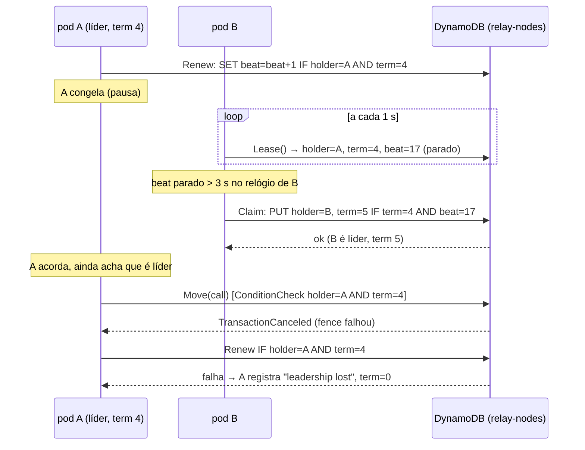

**Detalhes que tornam isso robusto:**

1. **Nenhum relógio de parede é comparado entre pods.** O `beat` é um contador; cada pod mede "há quanto tempo o
   contador não muda" no **seu próprio** relógio (`pingSeen`, `failover.go:32-37`). Relógios desalinhados não fazem um
   pod parecer morto.
2. **Só um vence a eleição.** `Claim` exige que o lease ainda seja exatamente o que o pod viu parar (`term = :t AND
   beat = :b`, `nodes.go:59-61`). Se dois pods tentam ao mesmo tempo, o DynamoDB aceita só o primeiro.
3. **Renovação em goroutine própria.** `elect` (`failover.go:82-122`) não divide laço com a vigilância. Uma renovação
   que falha **ou demora mais de 1 s** faz o pod abdicar (`failover.go:93-96`): "better a healthy leader than a slow one".
4. **Dupla checagem de saúde.** Um pod sem batimento há 3 s não é declarado morto na hora. O líder chama
   `GET http://addr/health` com timeout de 500 ms, e a resposta precisa trazer `replica` igual ao id do suspeito
   (`MR/.../httpapi/health.go:77-90`). Isso evita dois erros:
   - pod vivo mas sem acesso ao DynamoDB: ele ainda encaminha áudio, então não deve perder as chamadas (log
     `relay pod missed pings but answers health checks: no failover`, `failover.go:153-158`);
   - IP reaproveitado: um pod novo com o IP do morto responderia 200, mas com outro `replica`.
5. **Saúde do próprio enlace.** `checkLink` (`failover.go:177-183`) marca `unhealthyAt` quando uma chamada ao DynamoDB
   falha **ou demora mais de 1 s**. Durante 3 s depois disso, o líder não dá veredito (`failover.go:126-128`) e nenhum
   pod reivindica o lease (`failover.go:109`). Motivo: com o MiniStack pausado (F6), as escritas atrasam e **todos** os
   pods parecem mortos. Sem esse freio, o fim de uma queda do broker dispararia um failover falso.
6. **Suspeito herdado.** Quem vence a eleição recebe o antigo líder como suspeito, com o instante em que o lease parou
   (`failover.go:116-118`, `138-141`). Não precisa esperar mais 3 s para julgá-lo.

**`MarkDead` e `Move`.** As duas são transações com o fence no item 0:
- `MarkDead` (`nodes.go:94-103`): `status = DEAD` só se ainda `ALIVE` e com o mesmo `beat` que o líder viu;
- `Move` (`nodes.go:118-131`): `owner/host/port` da sessão só se `state = ALLOCATED AND owner = <morto>`, mais
  `RelayMoved` no outbox. Uma chamada é movida **uma vez**, e só pelo líder atual.

O destino é o pod vivo com **menos sessões ALLOCATED**; empate vai para o primeiro da varredura
(`failover.go:198-211`; teste `TestRedistributeLeastConnections`). Depois, `ForgetNode` apaga o pod morto se todas as
chamadas dele foram movidas (`failover.go:232-236`).

**Adoção pelo novo dono.** O novo dono fica sabendo de três jeitos, o que vier primeiro:
1. `POST /adopt?callId=` enviado pelo líder, melhor esforço (`failover.go:229`, `health.go:63-66`);
2. a primeira oferta WebRTC que chega (`Admit` lê o DynamoDB, `relay.go:299-326`);
3. o primeiro pacote UDP de uma chamada desconhecida (`PickUp`, no máximo 1 leitura/s por chamada, `failover.go:241-258`).

Do lado do call-signaling, `RelayMoved` atualiza `relayHost/relayPort/relaySignal` e manda SSE `relay_moved` a cada
participante (`saga.go:98-107`). O navegador refaz a oferta WebRTC no novo pod.

**`reloadOwn`.** Um pod que reinicia com o mesmo hostname (política `restart: unless-stopped`) recarrega as sessões cujo
`owner` é ele (`failover.go:261-271`) e volta a encaminhar no mesmo endereço, sem anunciar nada.

**Injeção de falha com `SIGUSR1`.** `docker kill -s USR1 <pod>` alterna `PingsPaused` (`MR/main.go:63-72`). Com isso
ligado, o pod para o heartbeat **e** a eleição (`failover.go:53`, `87-89`), mas continua encaminhando áudio e
respondendo `/health`. É a demonstração da dupla checagem: o líder vê o batimento parado, consulta `/health`, recebe
resposta e **não** faz failover.

- **Por que esse desenho (D12):** o DynamoDB com escrita condicional já é um registro linearizável por item; basta para
  lease + fencing, sem serviço extra.
- **Alternativas descartadas:** Raft/Paxos (exige um conjunto fixo de votantes e bem mais código); todos os pods
  vigiando todos (decisões duplicadas e conflitantes); ZooKeeper/etcd (mais um componente fora da tabela de serviços
  de nuvem do enunciado).
- **Limitações (ARCHITECTURE §14):** logo após uma eleição, pods ainda não observados contam como vivos, então uma
  chamada pode ir para um pod que morreu junto com o líder e ser movida de novo ~3 s depois. `MoveRelay` não atualiza
  `relayId` no call-signaling (`CS/.../dynamo/store.go:157-160`).

#### 11.2.6 Caminhos de áudio (resumo)

Dois caminhos convivem: UDP legado (`udp.Serve`, porta `UDP_PORT`) e WebRTC para navegadores (SFU com pion, porta
`WEBRTC_UDP_PORT`). Os dois passam pelo mesmo "portão" do `app.Relay` (`Forward`/`Admit`/`Touch`), então posse,
failover e presença valem igual. Detalhes de WebRTC, Opus, slots e gravação: ver seções 6–8.

### 11.3 audit-vault (C#)

O terceiro serviço, em **C# / .NET 10**, cumpre a regra de duas linguagens (D17, com o *override* do responsável:
mínimo de 3 serviços e 2 linguagens). Ele guarda a **trilha de auditoria** de cada chamada e, opcionalmente, as
gravações cifradas.

#### 11.3.1 Estrutura

Projeto plano (`AV/*.cs`, namespace `AuditVault`). Não há pastas `domain/app/adapter`, mas a ideia de portas é a mesma:
interfaces na frente de todo código AWS.

| Interface (porta) | Implementação | Arquivo |
|---|---|---|
| `IMessageQueue` | `SqsQueue` | `QueueConsumer.cs:9-36` |
| `IMessageHandler` | `MessageProcessor`, `AudioProcessor` | `AudioProcessor.cs:4`, `MessageProcessor.cs:15` |
| `IAuditStore` | `DynamoAuditStore` | `IAuditStore.cs:7-19`, `DynamoAuditStore.cs:14` |
| `IAudioStore`, `IAudioKeyProvider`, `IProcessedStore` | S3, Secrets Manager, DynamoDB | `AudioStorage.cs` (ver seção 8) |

#### 11.3.2 `Program.cs`: o host

- Configuração só por variáveis de ambiente; se faltar, imprime e **sai com 1** (`Program.cs:11-19`). O comentário
  explica: como PID 1 no contêiner, uma exceção não tratada deixava o processo girando sem sair nem reiniciar.
- `ShutdownTimeout = 15s` (`:23`), maior que o long poll de 10 s, menor que o `stop_grace_period` de 20 s.
- Clientes AWS com `Timeout = 15s` e `MaxErrorRetry = 0` (`:29-36`): mesma política dos serviços Go (R6, D7).
- Injeção de dependência do ASP.NET (`AddSingleton`), dois consumidores (`:45`, `:64`), API (`:68`).

#### 11.3.3 `QueueConsumer` e `BackgroundService`

Um `BackgroundService` é o jeito .NET de rodar um laço longo dentro do host: o host chama `ExecuteAsync` na partida e
cancela o `stoppingToken` na parada. `ConsumerService` só delega para `QueueConsumer.RunAsync`
(`QueueConsumer.cs:98-101`).

`RunAsync` (`QueueConsumer.cs:50-87`) é o espelho do `Bus.Consume` do Go:
- long poll `WaitTimeSeconds = 10`, até 10 mensagens (`:25-30`);
- erro do broker → log `broker unreachable, retrying` e backoff de 250 ms dobrando até 5 s (`:65-71`, `:89-90`);
- **parada graciosa:** o poll usa `CancellationToken.None` (`:55`), o mesmo papel do `context.WithoutCancel` em Go;
- apaga a mensagem só se o resultado for `Recorded` ou `Duplicate`; `Poison` e `Failed` ficam para reentrega/DLQ
  (`:76`).

**Armadilha resolvida (D25):** os consumidores são registrados com `AddSingleton<IHostedService>`
(`QueueConsumer.cs:111-121`), não com `AddHostedService`. Este último usa `TryAddEnumerable`, que descartaria **em
silêncio** o segundo `ConsumerService` (mesmo tipo), e a fila de áudio nunca seria consumida. Foi um bug real,
corrigido no commit `681e872` ("run the audio-chunks consumer"), e coberto por `ConsumerRegistrationTests.cs`.

#### 11.3.4 `MessageProcessor`

Traduz o resultado de uma mensagem para um `Outcome` (`MessageProcessor.cs:3-13`):

| `Outcome` | Quando | A mensagem é apagada? |
|---|---|---|
| `Recorded` | gravou | sim |
| `Duplicate` | `DuplicateMessageException` (o `messageId` já existia) | sim, sem novo efeito (R1, F3) |
| `Poison` | envelope inválido (`Envelope.TryParse`) | não; vai para a DLQ após `maxReceiveCount` (F4) |
| `Failed` | erro de armazenamento | não; volta após o visibility timeout (F2, F6) |

#### 11.3.5 Trilha só de acréscimo, estado derivado e hash por evento (D18)

`DynamoAuditStore.RecordAsync` (`DynamoAuditStore.cs:18-78`) faz **uma** `TransactWriteItems`:
- item 0: `Put audit-processed {pk: messageId}` com `attribute_not_exists(pk)`. Se ele falha, é duplicata
  (`:74-77`);
- item 1: `Update audit-records` com `SET events = list_append(if_not_exists(events, :empty), :e)` (`:58`). O evento é
  **acrescentado**, nunca sobrescrito.

Cada entrada guarda o envelope original e o SHA-256 dele (`AuditModels.cs:19-21`). Na leitura, `Verified` recalcula o
hash e compara em tempo constante (`AuditModels.cs:27-28`).

O **estado** da chamada (`status`, `participants`, `present`, duração) **não é gravado**: `CallTrail.Build` o refaz a
cada leitura, ordenando por `occurredAt` e depois `receivedAt` (`AuditModels.cs:51-103`). Consequência: um `CallEnded`
que chega antes de um `ParticipantLeft` produz o mesmo resultado final (teste
`Builds_an_ended_call_regardless_of_arrival_order`, `VaultTests.cs:148`).

- **Por que:** com 2 réplicas competindo, a ordem de chegada não é garantida (R4). Derivar o estado na leitura elimina
  a dependência de ordem; acrescentar em vez de sobrescrever preserva o histórico.
- **Alternativa descartada:** gravar o estado atual a cada evento (perde o histórico e quebra com eventos fora de
  ordem).
- **Limite honesto:** `Verified` prova que o envelope guardado bate com o hash guardado. Quem tem permissão de escrita
  em `audit-records` pode alterar os dois juntos. Não é uma cadeia de hashes.

#### 11.3.6 API de leitura (`AuditApi.cs`)

- `GET /health` aberto (`:12`).
- Grupo `/audit/*` com filtro que exige `Authorization: Bearer <AUDIT_API_TOKEN>` (`:14-19`), comparado por SHA-256 em
  tempo constante (`:60-67`). Sem token configurado, o serviço nem sobe (fail closed, `VaultConfig.cs:36`).
- `GET /audit/calls?limit=` (lista resumida), `GET /audit/calls/{callId}` (trilha completa com `verified` por evento),
  e, com gravação ligada, `GET /audit/calls/{callId}/audio` e `/audio/{userId}` (Ogg Opus decifrado; ver seção 8).

#### 11.3.7 Duas réplicas como consumidores concorrentes (R4)

`deploy.replicas: ${AUDIT_VAULT_REPLICAS:-2}` (`docker-compose.yml:98-99`). As duas réplicas leem as **mesmas** filas
(`audit-vault-call-events` e `audio-chunks`). O SQS entrega cada mensagem a um consumidor por vez; se uma réplica morre
no meio (F2), a mensagem volta após o visibility timeout e a outra a processa. A transação marcador + efeito garante
efeito único. Cada réplica expõe a API numa porta própria (8083, 8084), o que limita o compose a 2 réplicas sem
ajustar a faixa de portas.

### 11.4 web (nginx + React): o que o backend precisa saber

O front-end React/TypeScript é servido por nginx. **Não é um microsserviço** (não consome filas nem tem banco); não
conta para a regra de serviços e linguagens (D17).

O que importa para o backend:

| Aspecto | Configuração | Por quê |
|---|---|---|
| Proxy da API | `location /api/` reescreve `/api/calls` → `/calls` e faz `proxy_pass` para `SIGNALING_URL` (`web/nginx/default.conf.template:15-24`) | o navegador fala com uma origem só; sem CORS |
| SSE | `proxy_buffering off` e `proxy_read_timeout 1h` (`default.conf.template:22-23`) | sem isso o nginx acumularia os quadros SSE e o navegador receberia as notificações com atraso |
| DNS dinâmico | `resolver 127.0.0.11 valid=5s` (`default.conf.template:13`) | um call-signaling recriado ganha outro IP; o nginx não pode guardar o antigo |
| Ticket SSE | o `EventSource` usa `/api/notifications?ticket=` (`web/src/live.tsx:53`) | `EventSource` não manda cabeçalho `Authorization` |
| HTTPS | `30-tls.sh` liga `listen 443 ssl` se existirem certificados em `web/certs` (gerados por `make certs` com **mkcert**, `Makefile:49-53`) | o navegador só libera o microfone (`getUserMedia`, `web/src/voice.ts:173`) em **contexto seguro**: HTTPS ou `localhost`. Para testar de outra máquina da rede, HTTPS é obrigatório |

O cookie `refresh` sai com `Secure` por padrão (`COOKIE_SECURE=true`); em HTTP puro fora de `localhost`, é preciso
desligá-lo ou usar HTTPS.

### 11.5 Resumo das decisões desta parte

| Decisão | O que | Por que | Alternativa descartada | Onde |
|---|---|---|---|---|
| Goroutine por laço | cada laço de fundo é uma goroutine própria | esperas de rede não travam o áudio | um laço único com `select` gigante | `CS/main.go:73-82`, `MR/main.go:65-107` |
| Envio não bloqueante | SSE (16) e gravação (512) descartam quando cheios | o caminho crítico nunca espera um consumidor lento | canal sem buffer / bloquear | `hub.go:29-32`, `recorder.go:162-167` |
| Poll não cancelado na parada | `WithoutCancel` / `CancellationToken.None` | mensagens já entregues não ficam 30 s invisíveis | cancelar o poll | `bus.go:72-74`, `QueueConsumer.cs:55` |
| Hexagonal | portas em `app/ports.go`, adaptadores em `adapter/` | testes com fakes; AWS isolada | camadas misturadas | seção 10 |
| D11 | dono da chamada = réplica que puxou o `RelayRequested`; oferta SDP por HTTP síncrono até ele | todos os participantes no mesmo SFU | balanceador na frente dos relays; SDP por fila | `relay.go:200-201`, `relayhttp/client.go` |
| D12 | lease + term + fencing no DynamoDB | um decisor, e líder velho não age | Raft, todos vigiando todos | `failover.go`, `nodes.go` |
| D13 | presença por tráfego de mídia | sem heartbeat extra | heartbeat HTTP | `relay.go:334-366` |
| D14 | EdDSA só no CS | verificador não forja token | HS256 | `domain/token.go` |
| D15 | SSE | simples, stdlib, passa no nginx | WebSocket | `sse/hub.go` |
| D16 | nada compartilhado além de `contracts/` | deploy independente | módulo comum | dois `go.mod` |
| D18 | trilha só de acréscimo, estado derivado | independe da ordem | gravar estado atual | `DynamoAuditStore.cs`, `AuditModels.cs` |
| D25 | `AddSingleton<IHostedService>` | dois consumidores no mesmo host | `AddHostedService` (descarta o 2º) | `QueueConsumer.cs:111-121` |

---

# Parte 4 — Confiabilidade, concorrência, requisitos, falhas e segurança

## 12. Confiabilidade: os padrões que seguram o sistema

O enunciado diz que "a nota está nas decisões de arquitetura e no comportamento do sistema quando a rede, o broker ou um
serviço falham". Esta seção explica os seis padrões que fazem o Larpspeak se comportar bem nessas falhas. Primeiro o
conceito, do zero. Depois como o Larpspeak aplica. Depois o porquê e a alternativa descartada.

### 12.1 O problema de fundo: "pelo menos uma vez"

**Conceito.** Um broker de mensagens pode prometer três coisas:

| Garantia | O que significa | Custo |
|---|---|---|
| *at-most-once* (no máximo uma vez) | a mensagem é apagada ao ser entregue; se o consumidor cair, ela se perde | perde dados |
| *at-least-once* (pelo menos uma vez) | a mensagem só some quando o consumidor confirma; se ele cair antes, ela volta | pode chegar **duplicada** |
| *exactly-once* (exatamente uma vez) | nem perde, nem duplica | não existe de verdade entre sistemas independentes; o que existe é *at-least-once* + efeito idempotente |

O SQS padrão (não FIFO) é *at-least-once*. Funciona assim:

1. O consumidor chama `ReceiveMessage`. A mensagem **não é apagada**: ela fica **invisível** por um tempo, o
   *visibility timeout* (no Larpspeak, 30 s).
2. Se o consumidor processar e chamar `DeleteMessage`, acabou.
3. Se o consumidor morrer, travar ou não apagar, a mensagem **reaparece** depois dos 30 s e outro consumidor (ou o
   mesmo, reiniciado) a recebe de novo.
4. Cada recebimento incrementa o contador `ApproximateReceiveCount`. Ao passar de `maxReceiveCount`, o SQS move a
   mensagem para a **DLQ** (*dead-letter queue*, fila de mensagens mortas).

Analogia: é uma carta registrada que o carteiro deixa de novo na sua porta enquanto você não assinar o recibo. Se
você assinou e o recibo se perdeu, ele entrega de novo. Você precisa reconhecer que aquela carta já foi lida.

Consequência: **duplicatas são normais**, não um erro. Quem precisa ser idempotente é o **efeito**, não a entrega.

**Idempotência** é a propriedade de uma operação que, aplicada N vezes, produz o mesmo resultado que aplicada uma vez.
"Somar 1 ao saldo" não é idempotente. "Somar 1 ao saldo *se a mensagem X ainda não foi processada*" é.

Onde o Larpspeak configura isso: `infra/init/init.sh:6-13` (função `queue`). Toda fila nasce com
`VisibilityTimeout = 30` e `RedrivePolicy` apontando para `<nome>-dlq` com `maxReceiveCount = 5`
(`infra/init/init.sh:11`). São 5 filas, cada uma com sua DLQ: `relay-requests`, `relay-results`,
`media-relay-call-events`, `audit-vault-call-events` e `audio-chunks` (`infra/init/init.sh:23-27`).

### 12.2 Efeito + marcador `messageId` na mesma transação (R1, D4)

**Conceito.** Para tornar o efeito idempotente, o consumidor guarda o `messageId` de tudo que já processou. O truque é
gravar **o marcador e o efeito na mesma transação atômica**. Por quê? Veja as alternativas ingênuas:

| Ordem | O que acontece se o processo cair no meio |
|---|---|
| grava efeito, depois marcador | efeito sem marcador: a reentrega aplica o efeito **de novo** (duplicado) |
| grava marcador, depois efeito | marcador sem efeito: a reentrega é descartada e o efeito **nunca acontece** (perdido) |
| os dois numa transação | ou os dois existem, ou nenhum. A reentrega ou é descartada (já feito) ou refeita (não feito) |

O DynamoDB oferece `TransactWriteItems`: até 100 escritas em tabelas diferentes, tudo ou nada. Cada item pode ter uma
`ConditionExpression`. Se **qualquer** condição falhar, a transação inteira é cancelada com
`TransactionCanceledException`, e a exceção traz um `CancellationReasons[i]` por item. É isso que permite saber
**qual** item falhou.

**Como o Larpspeak aplica.** O marcador é um `Put` na tabela `*-processed` do próprio serviço, com
`ConditionExpression: attribute_not_exists(pk)`, sempre como **item 0** da transação:

```go
// CS/internal/adapter/dynamo/store.go:321-329
func (s *Store) markProcessed(messageID string) types.TransactWriteItem {
	return types.TransactWriteItem{Put: &types.Put{
		TableName:           &s.Cfg.ProcessedTable,
		Item:                key(messageID),
		ConditionExpression: aws.String("attribute_not_exists(pk)"),
	}}
}
```

A função `commit` põe o marcador na frente e traduz o cancelamento no índice 0 em `ErrDuplicate`:

```go
// CS/internal/adapter/dynamo/store.go:380-398
func (s *Store) commit(ctx context.Context, msgID string, items ...types.TransactWriteItem) (failed func(int) bool, err error) {
	off := 0
	if msgID != "" {
		items, off = append([]types.TransactWriteItem{s.markProcessed(msgID)}, items...), 1
	}
	_, err = s.DB.TransactWriteItems(ctx, &dynamodb.TransactWriteItemsInput{TransactItems: items})
	var codes []string
	var tce *types.TransactionCanceledException
	if errors.As(err, &tce) {
		for _, r := range tce.CancellationReasons {
			codes = append(codes, aws.ToString(r.Code))
		}
	}
	failed = func(i int) bool { i += off; return i < len(codes) && codes[i] == "ConditionalCheckFailed" }
	if off == 1 && failed(-1) {
		return failed, domain.ErrDuplicate
	}
	return failed, err
}
```

Os três serviços seguem o mesmo padrão, cada um na sua própria tabela (banco por serviço):

| Serviço | Onde | Tabela do marcador | Quem passa o marcador |
|---|---|---|---|
| call-signaling | `CS/internal/adapter/dynamo/store.go:380-398` (`commit`) | `signaling-processed` | só os caminhos de consumidor: `Activate`, `MoveRelay`, `Fail` vindo de `RelayFailed`, `leave` vindo de `ParticipantTimedOut`, `Ack`. Caminhos HTTP e o varredor passam `msgID = ""` e se protegem por condição de estado |
| media-relay | `MR/internal/adapter/dynamo/sessions.go:161-178` (`commit`) | `relay-processed` | sempre item 0 em `Allocate`, `Ack`, `Release`, `Member` (`sessions.go:60-105`). Índice 0 falhou → `ErrDuplicate`; qualquer outro índice → `ErrReleased` |
| audit-vault (trilha) | `AV/DynamoAuditStore.cs:18-78` (`RecordAsync`) | `audit-processed` | item 0 é o marcador; o item 1 faz `list_append` na trilha. `CancellationReasons[0]` falhou → `DuplicateMessageException` |
| audit-vault (áudio) | `AV/AudioProcessor.cs:30-45` | `audit-processed` | **exceção (D19)**, ver abaixo |

**A exceção do áudio (D19).** O S3 não participa de transação do DynamoDB. Então o `AudioProcessor` faz:
consulta o marcador (`SeenAsync`) → cifra → `PUT` no S3 com **chave determinística** → grava o marcador
(`MarkAsync`) (`AV/AudioProcessor.cs:32-41`). A chave é
`audio/{callId}/{userId}/{startMs:D13}-{messageId}.bin` (`AV/AudioChunks.cs:106-107`). Se o processo cair entre o
`PUT` e o marcador, a reentrega sobrescreve **o mesmo objeto**: o efeito continua único. Se duas réplicas correrem,
as duas passam pelo `SeenAsync` e escrevem o mesmo objeto; o `PutItem` condicional do marcador só aceita uma.
`MarkAsync` devolve `false` para a outra (`AV/AudioStorage.cs`), que registra `duplicate ignored` e devolve
`Outcome.Duplicate` em vez de `audio stored`. Antes dessa correção, as duas registravam `audio stored`, e o
`audit-f3.sh`, que espera exatamente uma linha dessas, falhava de vez em quando.

**Por que (D4).** "Exatamente uma vez" na entrega não existe no SQS padrão. A transação garante que nunca haja efeito
sem marcador nem marcador sem efeito.

**Alternativa descartada.** SQS FIFO com deduplicação por `MessageDeduplicationId`. A janela de deduplicação é de
5 minutos, a vazão é menor, e ela não cobre uma reentrega tardia (por exemplo, depois de 2,5 min de tentativas mais um
reinício) nem a republicação pelo outbox depois de uma queda.

### 12.3 Outbox transacional no DynamoDB (D5)

**Conceito.** Um serviço muitas vezes precisa fazer duas coisas: **mudar o próprio banco** e **publicar uma
mensagem**. São dois sistemas diferentes (DynamoDB e SNS/SQS), e não existe transação entre eles. Isso é o problema da
*dual write* (escrita dupla):

| Ordem | Falha no meio | Resultado |
|---|---|---|
| grava no banco, depois publica | processo cai depois do commit | estado mudou, ninguém fica sabendo (**mensagem perdida**) |
| publica, depois grava no banco | banco falha depois da publicação | o mundo sabe de algo que não aconteceu (**mensagem fantasma**) |

O padrão **transactional outbox** resolve assim: a mensagem a publicar vira **uma linha numa tabela de outbox**, gravada
**na mesma transação** da mudança de estado. Um processo separado (o *relay* do outbox) lê a tabela, publica e apaga.
Publicar passa a ser *at-least-once*: se cair entre publicar e apagar, publica de novo, com o **mesmo `messageId`**, e o
marcador do consumidor (12.2) descarta a cópia.

O diagrama mostra a janela de falha que o outbox fecha:

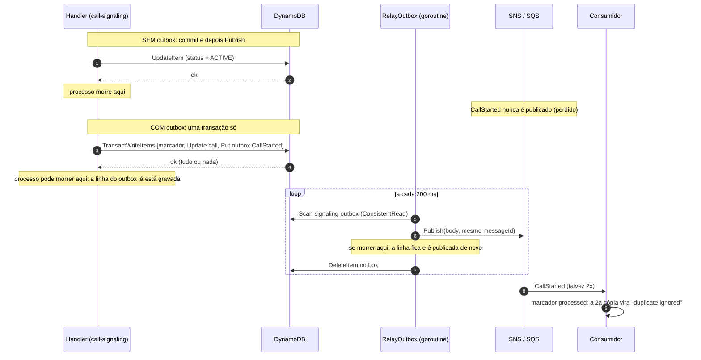

**Como o Larpspeak aplica.**
- A linha do outbox é montada por `outbox()` com `pk = messageId`, `dest`, `body` e `createdAt`
  (`CS/internal/adapter/dynamo/store.go:331-341`; igual em `MR/internal/adapter/dynamo/sessions.go:149-159`).
- Toda escrita de negócio que emite mensagem inclui essa linha na própria transação: `Create` (`store.go:136-147`),
  `transition` (usado por `Activate`, `MoveRelay`, `Fail`; `store.go:343-368`), `Join` (`store.go:168-178`), `Leave`
  (`store.go:180-191`), `Ack` (`store.go:226-234`).
- O laço `RelayOutbox` (`CS/internal/adapter/messaging/bus.go:112-138`; `MR/.../bus.go:112-136`) faz `Scan` com
  leitura consistente, publica (`SNS Publish` se `dest == "call-events"`, senão `SendMessage` na fila;
  `bus.go:140-151`), apaga e dorme 200 ms.
- Falha de publicação: loga `outbox publish failed, will retry`, faz backoff e interrompe a varredura (`break`). A
  linha continua na tabela.
- No media-relay, **todas** as réplicas varrem a tabela inteira. Qualquer uma publica o que outra deixou. O custo: duas
  réplicas podem publicar a mesma linha. O consumidor descarta a cópia pelo marcador.

**Por que (D5).** Publicar depois do commit perde a mensagem se o processo cair entre os dois passos. O F6 (broker
fora do ar) depende disso: durante a queda, as linhas se acumulam no outbox e "o outbox drena" quando o MiniStack
volta, que é exatamente o texto do enunciado.

**Alternativa descartada.** Publicar direto após o commit (perde mensagens) ou DynamoDB Streams + Lambda (mais peças,
e o suporte no emulador teria de ser conferido).

**Limitação honesta.** A varredura não tem ordem: dois itens pendentes da mesma chamada podem sair invertidos. O
sistema foi desenhado para não depender de ordem (5.8). Cada `Scan` devolve no máximo 1 MB; por isso todas as
leituras por varredura passam por um `scan` que percorre todas as páginas (`dynamodb.NewScanPaginator`, em
`CS/internal/adapter/dynamo/store.go` e `MR/internal/adapter/dynamo/sessions.go`).

### 12.4 Laço de consumo: apagar só depois do efeito, DLQ com `maxReceiveCount = 5` (D6)

**Conceito: mensagem venenosa (*poison message*).** É uma mensagem que **nunca** vai ser processada com sucesso
(JSON quebrado, contrato violado). Se o consumidor só tentar de novo para sempre, ela fica circulando e gastando
recursos. A DLQ é o "estacionamento" dessas mensagens: depois de N recebimentos sem `DeleteMessage`, o broker a tira da
fila principal, e o resto do tráfego segue.

**Como o Larpspeak aplica.** O laço Go (`CS/internal/adapter/messaging/bus.go:72-110`, idêntico no media-relay) faz,
para cada mensagem recebida, uma de quatro coisas:

| Situação | O que o laço faz | Log | Resultado |
|---|---|---|---|
| envelope inválido (`ParseEnvelope` falhou) | **não apaga** (`continue`) | `poison message left for DLQ` | volta em 30 s; após 5 recebimentos vai para a DLQ (F4) |
| handler retornou `ErrDuplicate` | apaga | `duplicate ignored` | efeito único (F3) |
| handler retornou outro erro | **não apaga** | `handling failed, will be redelivered` | volta em 30 s (F2, F6) |
| sucesso | apaga | (log do handler) | — |
| `DeleteMessage` falhou | segue | `delete failed, message will be redelivered and deduplicated` | volta e é descartada pelo marcador |

O que conta como "envelope inválido" está em `ParseEnvelope` (`CS/internal/domain/envelope.go:38-52`): JSON
inválido, `messageId`/`correlationId`/`type` vazios, `version < 1`, `occurredAt` ausente, ou `payload` que não é
objeto.

O audit-vault faz o mesmo em C#, com um `enum Outcome { Recorded, Duplicate, Poison, Failed }`
(`AV/MessageProcessor.cs:3-13`). `Poison` e `Failed` não apagam (`AV/QueueConsumer.cs:76`). O processador de áudio
ainda valida o payload do `AudioChunk` e trata payload inválido como `Poison` (`AV/AudioProcessor.cs:25-29`).

**Por que 5 e 30 s (D6).** Cinco tentativas dão margem para falhas transitórias (uma réplica que morreu, um DynamoDB
lento) sem deixar uma mensagem ruim girando para sempre. Custo: uma mensagem venenosa leva ~2,5 min (5 × 30 s) até a
DLQ, por isso o F4 espera esse tempo.

**Alternativa descartada.** Apagar ao receber (perde mensagens quando o processo cai, quebra o F2) ou reenfileirar
manualmente com um contador próprio (reinventa o `RedrivePolicy` do SQS).

**Um caso que vai para a DLQ sem ser veneno de formato.** Um `RelayAllocated` para um `callId` que não existe no
call-signaling retorna `unknown call` (`CS/internal/app/saga.go:89-91`). Ele é reentregue e vai para a DLQ após 5
recebimentos. É uma escolha consciente: melhor estacionar do que descartar em silêncio.

### 12.5 Tentativas no laço, não no SDK; backoff de 250 ms a 5 s; timeout HTTP de 15 s (D7, R6)

**Conceito: backoff exponencial.** Quando algo falha, tentar de novo **imediatamente** em laço apertado martela o
serviço que já está com problema e enche o log. O backoff exponencial dobra a espera a cada falha seguida, com um teto.

**Como o Larpspeak aplica.**

```go
// CS/internal/adapter/messaging/bus.go:54-61
type backoff struct{ d time.Duration }

func (b *backoff) fail() {
	b.d = min(max(b.d*2, 250*time.Millisecond), 5*time.Second)
	time.Sleep(b.d)
}
func (b *backoff) ok() { b.d = 0 }
```

Sequência de esperas: 250 ms, 500 ms, 1 s, 2 s, 4 s, 5 s, 5 s... Volta a zero no primeiro sucesso. O C# usa a mesma
fórmula (`AV/QueueConsumer.cs:89-90`).

Três ajustes no cliente AWS completam o desenho:

| Ajuste | Go | C# | Por quê |
|---|---|---|---|
| SDK sem retry próprio | `awsconfig.WithRetryMaxAttempts(1)` (`CS/main.go:49-50`, `MR/main.go:47-48`) | `MaxErrorRetry = 0` (`AV/Program.cs:34`) | o laço é o único dono das tentativas; cada uma aparece no log |
| Timeout HTTP | `&http.Client{Timeout: 15 * time.Second}` | `Timeout = TimeSpan.FromSeconds(15)` (`AV/Program.cs:33`) | 15 s > long poll de 10 s. Com o MiniStack **pausado**, a conexão TCP fica aberta e muda; sem timeout, o long poll ficaria preso em silêncio |
| Recursos resolvidos sob demanda | URL da fila em cache **só depois de sucesso** (`bus.go:39-52`) | `_url ??= ...` (`AV/QueueConsumer.cs:20-21`) | o serviço sobe mesmo com o MiniStack fora, e volta sozinho |
| Segredo na partida | `secrets.LoadBytes` tenta com backoff de 500 ms a 10 s (`CS/internal/adapter/secrets/secrets.go:14-33`) | `SecretsManagerKeyProvider` (ver seção 8) | o serviço não morre se subir antes do MiniStack |

Logs que aparecem durante uma queda (é o que se mostra no F6): no Go, `broker unreachable, retrying` ao resolver a
URL (`bus.go:79`), `receive failed, retrying` no `ReceiveMessage` (o caso comum, pois a URL já está em cache;
`bus.go:87`), `outbox scan failed, retrying` (`bus.go:119`) e `timeout sweep failed, retrying`
(`CS/internal/app/saga.go:386`); no C#, `broker unreachable, retrying: {Error}` para qualquer falha
(`AV/QueueConsumer.cs:67`).

**Por que (D7).** Com as tentativas padrão do SDK, uma queda do broker fica escondida dentro do SDK, e o serviço parece
"travado". Antes do timeout de 15 s, um MiniStack pausado prendia o long poll do audit-vault em silêncio
(registrado no D7 do `ARCHITECTURE.md`).

**Alternativa descartada.** As tentativas padrão do SDK (escondem a queda e podem prender a conexão).

### 12.6 Parada graciosa

**Conceito.** Quando o Docker para um contêiner (`docker compose stop`, *deploy*), ele manda `SIGTERM` e espera um
prazo antes do `SIGKILL`. O risco específico com SQS: se o processo abortar um long poll que **já recebeu** mensagens,
elas ficam invisíveis por 30 s sem ninguém processando. Na saga, 30 s é mais que o `RELAY_TIMEOUT_MS` de 3 s, então
uma chamada saudável seria compensada à toa.

**Como o Larpspeak aplica (resumo).** O laço para **entre** polls, mas o poll em andamento termina e suas mensagens
são processadas e apagadas: `context.WithoutCancel` no Go (`CS/internal/adapter/messaging/bus.go:73-74`) e
`CancellationToken.None` no C# (`AV/QueueConsumer.cs:55`). O `main` espera os consumidores (`consumers.Wait()`,
`CS/main.go:88`, `MR/main.go:114`), e os prazos fecham a conta: long poll de 10 s < `HostOptions.ShutdownTimeout = 15s`
(`AV/Program.cs:23`) < `stop_grace_period: 20s` (`docker-compose.yml:9`). `RelayOutbox`, `SweepTimeouts` e
`srv.Shutdown` não são aguardados; isso é seguro porque o outbox é *at-least-once* e o varredor é idempotente por
condição de estado.

A sequência completa, com diagrama e a lista do que é e do que não é aguardado em cada serviço: ver seção 9.4.

### 12.7 Independência de ordem

**Conceito.** Ordem global entre mensagens é cara (FIFO por grupo, consumidor único por grupo). Com SQS padrão, com 2+
réplicas consumindo a mesma fila e com o outbox publicando em qualquer ordem, **nada garante ordem** no Larpspeak.

**Como o Larpspeak aplica (resumo).** Em vez de ordenar mensagens, **cada efeito confere o estado atual** antes de ser
aplicado: é uma máquina de estados com transições condicionais (`status = :from` na saga, `taken = :n` na saída,
`state = ALLOCATED` na sessão do relay, *fence* do `term` no failover). No audit-vault, o estado é derivado na leitura
(`CallTrail.Build`) e a chave S3 do áudio começa pelo instante do trecho. A tabela completa, com exemplos fora de ordem,
o código de cada guarda e por que o SQS FIFO foi descartado, está na seção 5.8.

**O buraco conhecido:** `ParticipantJoined` e `ParticipantLeft` do **mesmo usuário** trocados de ordem no
media-relay deixam o usuário em `relay-sessions.participants` (seções 5.8 e 16.6). O call-signaling continua correto.

### 12.8 Um consumidor de ponta a ponta: `RelayAllocated` no call-signaling

Para juntar tudo, siga **uma** mensagem real pelo código.

**1. Ela nasce no media-relay** (`MR/internal/app/relay.go:200-215`), dentro de uma transação com o marcador do
pedido e a sessão.

`Allocate` é `[marcador de RelayRequested, Put sessão com attribute_not_exists(pk), Put outbox RelayAllocated]`
(`MR/internal/adapter/dynamo/sessions.go:60-70`). Duas guardas: o marcador barra a mesma mensagem; o
`attribute_not_exists` da sessão barra uma segunda alocação para a mesma chamada.

**2. O outbox do media-relay publica em `relay-results`** (`MR/.../bus.go:112-136`).

**3. O laço do call-signaling recebe** (`CS/internal/adapter/messaging/bus.go:83-98`), valida o envelope e chama
`svc.OnRelayResult` (registrado em `CS/main.go:75`).

**4. O handler decide pelo estado atual da chamada** (`CS/internal/app/saga.go:121-138`):

```go
case e.Type == "RelayAllocated" && c.Status == domain.StatusPending:
	now := s.NowFn().UnixMilli()
	out, err := message(domain.DestTopic, "CallStarted", c.ID, map[string]any{
		"callId": c.ID, "kind": c.Kind, "capacity": c.Capacity, "relayId": r.RelayID, "participants": c.Participants,
	})
	...
	c.RelayID, c.RelayHost, c.RelayPort, c.RelaySignal, c.StartedAt = r.RelayID, r.Host, r.Port, r.Signal, now
	if err := s.St.Activate(ctx, msgID, *c, out); err != nil {
		return err
	}
	s.Log.Info("call active", "correlationId", c.ID, "relayId", r.RelayID)
	s.Hub.Notify(c.CallerID, "call_active", ...)
```

**5. `Activate` vira uma transação de 3 itens** (`store.go:149-154` → `transition`, `store.go:343-368`):

| Índice | Item | Condição | Se falhar |
|---|---|---|---|
| 0 | `Put signaling-processed {pk: messageId}` | `attribute_not_exists(pk)` | `ErrDuplicate` |
| 1 | `Update signaling-calls` `SET status = ACTIVE, relayId, relayHost, relayPort, relaySignal, startedAt` | `status = PENDING` | `ErrStateChanged` |
| 2 | `Put signaling-outbox` `CallStarted` | — | — |

**6. O laço reage ao resultado** (`bus.go:98-107`):
- `nil` → `DeleteMessage`.
- `ErrDuplicate` → log `duplicate ignored` + `DeleteMessage`. É o F3.
- `ErrStateChanged` (o varredor compensou entre a leitura e a escrita) → **não apaga**. A mensagem volta em 30 s, o
  handler relê a chamada (agora FAILED) e cai no ramo de resposta atrasada (13.4).
- Erro de rede (MiniStack fora) → não apaga; volta depois. É o F6.

**7. O outbox do call-signaling publica `CallStarted` no tópico `call-events`**, e o SNS entrega uma cópia em
`media-relay-call-events` e outra em `audit-vault-call-events` (`infra/init/init.sh:29-36`). Cada consumidor tem o
próprio marcador. Catálogo de mensagens e fan-out: ver seções 5.5 e 5.6.

---

## 13. A saga da chamada e a concorrência

### 13.1 Conceito: saga, orquestração e compensação

Uma **transação distribuída** é uma operação que mexe em dados de mais de um serviço. Como cada serviço tem o próprio
banco (regra do enunciado), não há um `COMMIT` único. O protocolo clássico de *two-phase commit* (2PC) exige um
coordenador e bloqueia os participantes enquanto espera; com SQS e DynamoDB ele nem é possível.

A **saga** troca atomicidade por uma sequência de **transações locais**. Cada passo confirma no próprio banco e
publica o próximo pedido. Se um passo falha, a saga executa **compensações**: transações locais que desfazem
semanticamente os passos anteriores (não é *rollback*; é uma ação nova, como estornar um pagamento).

Duas formas de organizar:

| Forma | Como funciona | Prós / contras |
|---|---|---|
| **Coreografia** | cada serviço reage a eventos dos outros, sem dono | sem ponto central; mas o estado da saga fica espalhado e a compensação também |
| **Orquestração** | um serviço (orquestrador) guarda o estado da saga e manda comandos | estado num lugar só, compensação simples; o orquestrador é mais um papel para um serviço |

### 13.2 A saga do Larpspeak (D8)

O enunciado exige "uma transação distribuída com compensação: uma operação que atravessa pelo menos dois serviços e
precisa ser desfeita quando um passo falha" e "uma dependência lenta ou instável". No Larpspeak:

- **Operação**: criar uma chamada de voz.
- **Serviços**: call-signaling (dono da chamada e das vagas) e media-relay (dono do relay de áudio).
- **Passo instável**: a alocação do relay, com latência e taxa de falha por variável de ambiente (R5).
- **Orquestrador**: o call-signaling (`CS/internal/app/saga.go:16-19`).

Passos e compensação:

| Passo | Serviço | Transação local | Compensação |
|---|---|---|---|
| 1. criar chamada PENDING, criador ocupa 1 vaga, pedir relay | CS | `Create`: `[Put call (attribute_not_exists), Put outbox RelayRequested, Put signaling-users (attribute_not_exists)]` (`store.go:136-147`) | `Fail`: `status = FAILED`, `taken = 0`, outbox `CallFailed` (`store.go:162-166`) + `ForgetUser` + SSE `call_failed` (`saga.go:157-171`) |
| 2. alocar relay | MR | `Allocate`: `[marcador, Put sessão, Put outbox RelayAllocated]` ou `Ack` + `RelayFailed` (`relay.go:176-219`) | `Release`: `state = RELEASED` com `reason` (`sessions.go:81-91`), disparado por `ReleaseRelayRequested` ou `CallFailed` |
| 3. ativar | CS | `Activate`: `[marcador, Update PENDING→ACTIVE, Put outbox CallStarted]` | — (fim feliz) |

Máquina de estados da chamada (`CS/internal/domain/call.go:11-12` e seguintes):

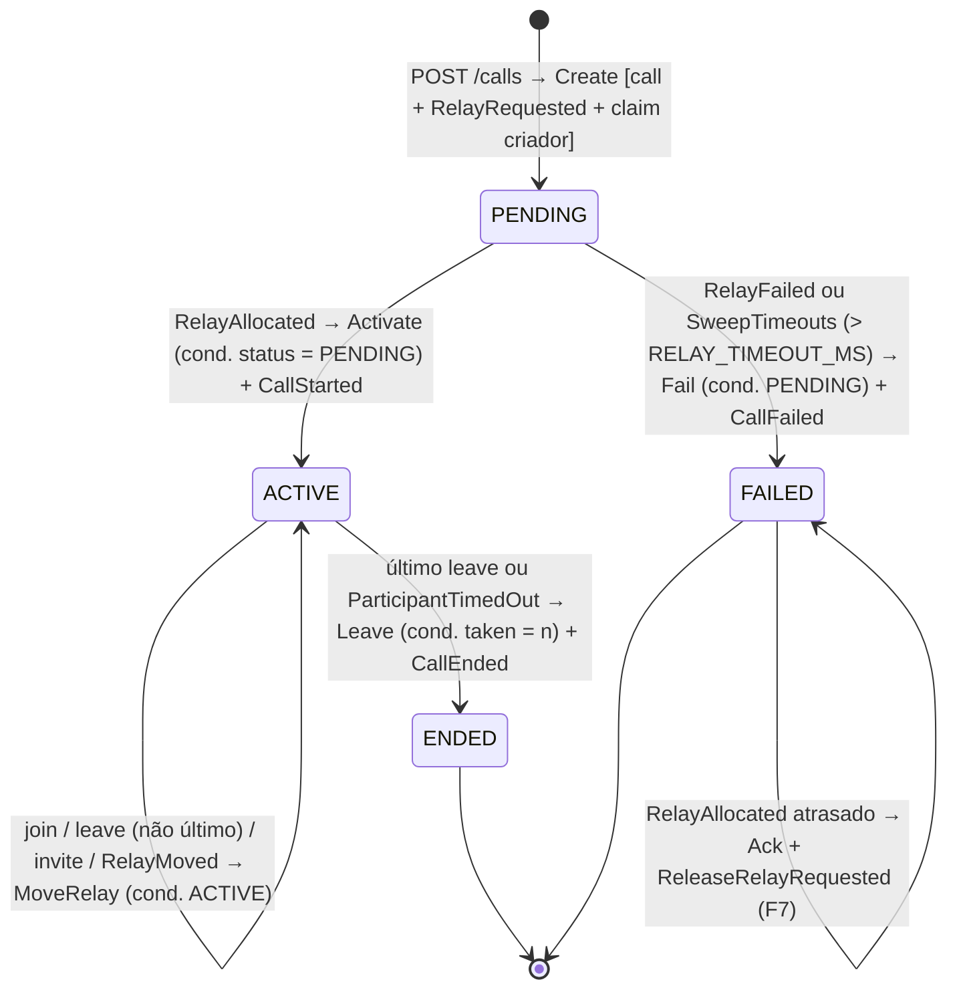

| Transição | Código | Condição que a torna segura |
|---|---|---|
| criar | `saga.go:48-57`, `store.go:137-147` | `attribute_not_exists(pk)` na chamada **e** na reserva do usuário |
| ativar | `saga.go:121-138`, `store.go:150-154` | `status = PENDING` |
| compensar | `saga.go:159-171`, `store.go:163-166` | `status = PENDING`; libera vagas (`taken = 0`) |
| resposta atrasada | `saga.go:140-150` | estado já não é `PENDING`: só marca processado e devolve o relay |
| mover relay | `saga.go:98-107`, `store.go:157-160` | `status = ACTIVE` |
| sair / terminar | `saga.go:247-290`, `store.go:302-320` | `taken` fixado no valor lido; até 3 tentativas |

**Por que a saga é orquestrada (D8):**
- **O que:** o call-signaling é o dono do estado da chamada e decide ativar ou compensar.
- **Por que:** um único dono torna a compensação simples e testável. O sweeper de timeout e o consumidor de
  `RelayFailed` podem correr um contra o outro, mas a condição `status = PENDING` garante compensação **uma vez só**
  (comentário em `saga.go:157-158`).
- **Alternativa descartada:** coreografia pura, com cada serviço reagindo a eventos sem dono do estado. A compensação
  ficaria espalhada.

**Sucesso:**

```mermaid
sequenceDiagram
    autonumber
    actor U as Navegador (ana)
    participant CS as call-signaling
    participant Q1 as relay-requests
    participant MR as media-relay (réplica X)
    participant Q2 as relay-results
    participant T as SNS call-events

    U->>CS: POST /calls
    CS->>CS: Create [call PENDING, outbox RelayRequested, signaling-users]
    CS-->>U: 202 {callId, status: PENDING, statusUrl}
    CS->>Q1: (outbox) RelayRequested
    Q1->>MR: ReceiveMessage
    MR->>MR: espera RELAY_LATENCY_MS; sorteia RELAY_FAILURE_RATE
    MR->>MR: Allocate [marcador, sessão ALLOCATED, outbox RelayAllocated]
    MR->>Q2: (outbox) RelayAllocated
    Q2->>CS: ReceiveMessage
    CS->>CS: Activate [marcador, PENDING→ACTIVE, outbox CallStarted]
    CS-->>U: SSE call_active
    CS->>T: (outbox) CallStarted → media-relay e audit-vault
```

**Falha da dependência (F1):**

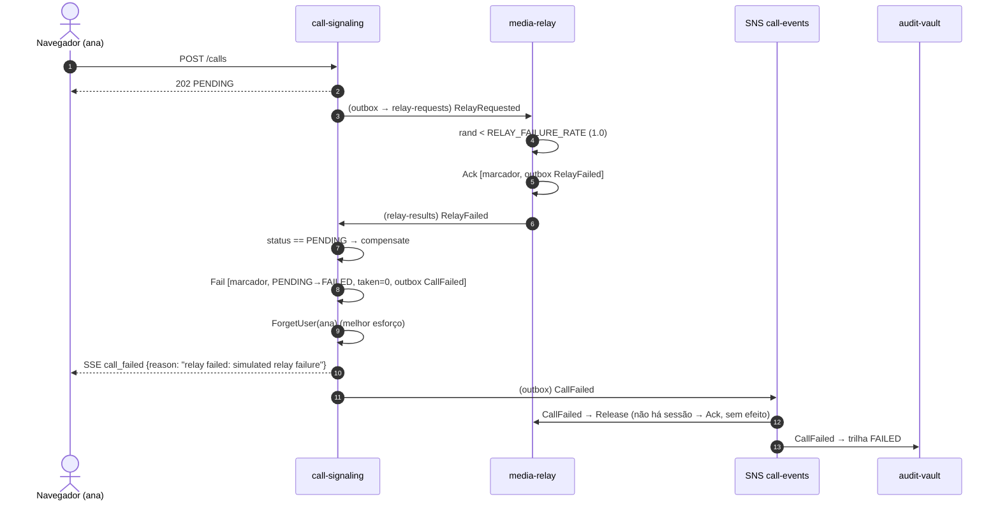

### 13.3 O varredor de timeout (`RELAY_TIMEOUT_MS`)

Uma saga com passo lento precisa de **prazo**. Senão uma chamada pode ficar PENDING para sempre se o media-relay
estiver fora.

- `SweepTimeouts` roda numa goroutine, acorda a cada 1 s (`CS/internal/app/saga.go:375-381`).
- `sweepOnce` lê as chamadas PENDING (`Store.Pending`, um `Scan` com filtro, `store.go:45-58`) e compensa as
  criadas antes de `agora - RELAY_TIMEOUT_MS` com `reason = "relay timeout"` (`saga.go:383-397`).
- O varredor passa `msgID = ""` (não há mensagem). A proteção é a condição `status = PENDING` do `Fail`: se o
  `RelayFailed` e o varredor correrem, só um vence; o outro recebe `ErrStateChanged`, que o varredor ignora
  (`saga.go:392`).
- `RELAY_TIMEOUT_MS` vem do ambiente, padrão 3000 (`CS/internal/config/config.go:60`; `docker-compose.yml:42`). Com a
  varredura de 1 s, o timeout efetivo fica entre 3 e ~4 s.

### 13.4 Resposta atrasada (F7)

O que acontece se o relay responder **depois** que a saga desistiu? A chamada já está FAILED, o criador já foi
notificado, mas o media-relay **acabou de alocar** um relay. Esse recurso ficaria preso. A compensação precisa
alcançar o resultado que chegou tarde.

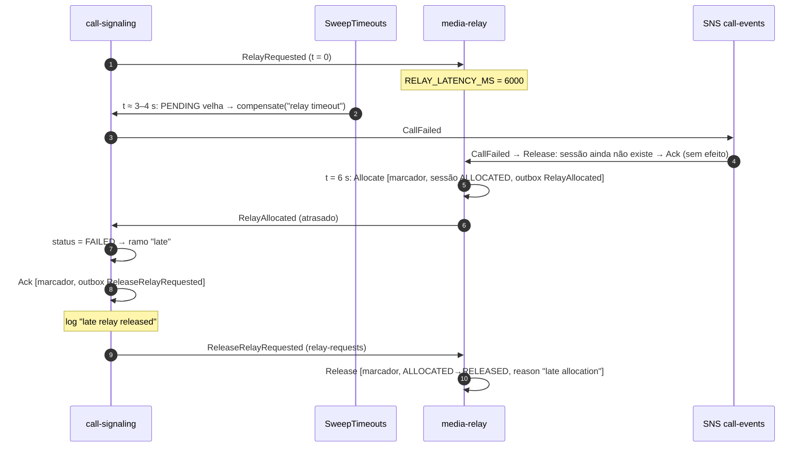

O código está em `CS/internal/app/saga.go:140-150`: monta `ReleaseRelayRequested`, grava com `Ack` e loga
`late relay released`.

Pontos importantes:
- O marcador e o pedido de liberação vão **na mesma transação** (`Ack`, `store.go:226-234`). Uma duplicata do
  `RelayAllocated` atrasado não gera dois pedidos de liberação.
- No media-relay, `ReleaseRelayRequested` chama `release(..., "late allocation")` (`MR/internal/app/relay.go:85-86`).
  `Release` só vale com `state = ALLOCATED` (`sessions.go:81-91`), então liberar duas vezes é inofensivo.
- Por que o `CallFailed` não resolve sozinho? Porque ele chega ao media-relay **antes** de a sessão existir (o relay
  ainda está "dormindo" na latência simulada). `release` acha nada, reconhece com `Ack` e segue (`relay.go:221-231`).
  Só a resposta atrasada sabe que o recurso passou a existir.
- **Corrida entre ativar e o varredor.** Se `Activate` perde para `Fail` (o varredor gravou FAILED entre a leitura e
  a escrita), `transition` devolve `ErrStateChanged`, o laço **não apaga**, e 30 s depois a mesma mensagem cai no ramo
  da resposta atrasada. O resultado é o mesmo, só que mais lento.

### 13.5 O ramo `default`: guarda da máquina de estados

```go
// CS/internal/app/saga.go:152-153
default: // RelayFailed/RelayMoved for a call no longer in that state: nothing to do.
	return s.St.Ack(ctx, msgID)
```

O `switch` de `OnRelayResult` (`saga.go:94-154`) combina **tipo + estado atual**. Tudo que não casa com uma transição
válida cai no `default`, que só grava o marcador e deixa o laço apagar a mensagem:
- `RelayFailed` para uma chamada que já não está PENDING (o varredor venceu, ou já está ACTIVE);
- `RelayMoved` para uma chamada que não está ACTIVE (terminou durante o failover);
- **qualquer tipo desconhecido** em `relay-results`.

Por que isso importa: sem o `default`, uma mensagem "fora de hora" voltaria 5 vezes e iria para a DLQ, poluindo a DLQ
com mensagens que são legítimas, só tardias. A DLQ fica reservada para o que é realmente veneno.

### 13.6 Concorrência: escrita condicional (R2, D9)

**Conceito: controle otimista de concorrência.** Duas formas de impedir que 100 pessoas peguem 10 vagas:

| Abordagem | Como | Problema |
|---|---|---|
| **Pessimista** (lock) | trava o recurso, lê, decide, escreve, destrava | lento; lock distribuído pode ficar órfão se quem travou morrer |
| **Otimista** (escrita condicional) | escreve **com uma condição** sobre o estado atual; o banco avalia a condição e aplica atomicamente; se falhar, quem perdeu é avisado | nenhum lock; o perdedor relê e decide |

O erro clássico é o **check-then-act**: `if taken < capacity { taken++ }` feito em duas idas ao banco. Entre a
leitura e a escrita, outros 99 leram o mesmo `taken`. A escrita condicional junta as duas coisas numa operação
atômica dentro do banco.

**Como o Larpspeak aplica.** A entrada numa chamada é **um** `TransactWriteItems` com 3 itens
(`CS/internal/adapter/dynamo/store.go:168-178`, item 0 em `store.go:284-298`):

```go
// CS/internal/adapter/dynamo/store.go:287-297
UpdateExpression:    aws.String("SET taken = taken + :one ADD participants :u"),
ConditionExpression: aws.String("#s = :active AND taken < #cap AND NOT contains(participants, :uid)"),
```

| Índice | Item | Condição | Erro |
|---|---|---|---|
| 0 | `Update signaling-calls`: `taken + 1`, adiciona o usuário | `status = ACTIVE AND taken < capacity AND NOT contains(participants, :uid)` | `ErrSeatLost` |
| 1 | `Put signaling-outbox` `ParticipantJoined` | — | — |
| 2 | `Put signaling-users {pk: user, callId}` | `attribute_not_exists(pk)` | `ErrStateChanged` |

O DynamoDB serializa as escritas no mesmo item. Com 10 vagas livres e 100 pedidos simultâneos, exatamente 10
transações encontram `taken < capacity` verdadeiro; as outras 90 recebem `ConditionalCheckFailed` no índice 0.

No serviço, quem perde relê a chamada (`canJoin`) para devolver o erro mais preciso; se ela continua ativa e cheia, é
`ErrRoomFull` (`CS/internal/app/saga.go:186-192`), que o handler transforma em **409** (`handlers.go:95-96`).

**A saída também é condicional** (`store.go:300-319`): `SET taken = taken - 1` com a condição
`status = ACTIVE AND contains(participants, :uid) AND taken = :n`, onde `:n` é o `taken` **lido** antes. Isso
impede que duas pessoas saindo ao mesmo tempo achem que ambas são "a última" e terminem a chamada duas vezes. Quem
perde recebe `ErrStateChanged`, relê e tenta de novo, até 3 vezes (`saga.go:247-290`).

**Por que (D9).** Atomicidade sem lock nem coordenador. O banco é o árbitro.

**Alternativa descartada.** Lock distribuído (mais lento, risco de lock órfão) ou checar antes de gravar (corrida
entre leitura e escrita).

O mesmo padrão aparece no failover do media-relay como **fencing**: um líder só move chamadas se ainda tem o
`term` atual, checado como item 0 da transação (`MR/internal/adapter/dynamo/nodes.go:82-91`, `Move` em
`nodes.go:118-130`). Analogia: o *fencing token* é o número da senha do caixa; um atendente que cochilou e acordou com
uma senha velha não consegue mais atender. Detalhes do failover: ver seção 11.2.5.

### 13.7 Uma chamada por usuário (D10)

A tabela `signaling-users` guarda `{pk: userId, callId}`. Ela é gravada com `attribute_not_exists(pk)` **na mesma
transação** de `Create` e de `Join` (`claimUser`, `store.go:264-272`) e apagada na saída com
`attribute_not_exists(pk) OR callId = :c` (`releaseUser`, `store.go:274-282`).

Mesmo que o usuário dispare dois `POST /join` para chamadas diferentes ao mesmo tempo, só um `Put` em
`signaling-users` vence; o outro cancela a transação inteira (índice 2 → `ErrStateChanged` → 503 "try again").

O comportamento de produto é o do Discord: ao entrar em outra chamada, o usuário sai da atual. `moveOut`
(`saga.go:59-77`) faz um `leave` normal da chamada anterior e manda SSE `left_call` com
`reason = "joined another call"`. `canJoin` confere o destino **antes**, para que um destino cheio não tire o usuário
de onde está (`saga.go:179-182`).

**Exceção honesta:** no `POST /calls`, `moveOut` roda **antes** da transação `Create` (`saga.go:53-56`). Se a
criação falhar, o usuário já saiu da chamada anterior.

### 13.8 F5 na prática: 100 pedidos para 10 vagas

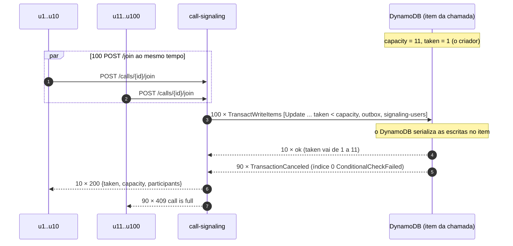

O script usa `MAX_PARTICIPANTS=11` e uma chamada de 11 lugares (criador + 10 livres), porque o padrão é 10 lugares
**contando** o criador (`scripts/demo/f5.sh:8-10`). Detalhes do script na seção 15.

---

## 14. Requisitos R1–R6, um por um

Formato: texto do enunciado → o que o Larpspeak faz → evidência no código → como demonstrar.

### R1. Entrega at-least-once com idempotência

> "Consumidores registram o messageId processado na mesma transação do efeito; mensagem repetida não gera efeito
> duplicado."

**O que o Larpspeak faz.** Todo consumidor grava o marcador `processed/{messageId}` com `attribute_not_exists(pk)` como
item 0 da mesma `TransactWriteItems` do efeito e do outbox. Uma duplicata falha no item 0, vira `ErrDuplicate` /
`DuplicateMessageException`, é logada como `duplicate ignored` e apagada (seção 12.2).

**Evidência.** `CS/internal/adapter/dynamo/store.go:321-329` (`markProcessed`) e `:380-398` (`commit`);
`MR/internal/adapter/dynamo/sessions.go:140-147` e `:161-178`; `AV/DynamoAuditStore.cs:34-77`. Exceção do áudio:
`AV/AudioProcessor.cs:32-41` + chave determinística `AV/AudioChunks.cs:106-107` (D19).

**Como demonstrar.** `make test_case3`: injeta 5 vezes o mesmo `RelayAllocated` e mostra `1` efeito e `4`
`duplicate ignored`, mais o item em `signaling-processed`. A parte do audit-vault (`audit-f3.sh`) mostra 8
`duplicate ignored` (4 de evento + 4 de áudio), 1 entrada na trilha e 1 objeto no S3.

### R2. Controle de concorrência

> "Zero venda dupla do recurso escasso sob carga."

**O que o Larpspeak faz.** O recurso escasso é a **vaga** numa chamada. A vaga é tomada por um `Update` condicional
`taken < capacity AND NOT contains(participants, :uid)` na mesma transação da reserva do usuário em `signaling-users`.
A saída fixa o `taken` lido na condição (seção 13.6). No media-relay, o failover usa *fencing* por `term`.

**Evidência.** `CS/internal/adapter/dynamo/store.go:168-178` (`Join`), `:284-298` (`join`), `:300-319` (`leave`),
`:264-272` (`claimUser`); `CS/internal/app/saga.go:173-206`. Failover: `MR/internal/adapter/dynamo/nodes.go:82-130`.

**Como demonstrar.** `make test_case5`: 100 joins simultâneos, saída `10 × 200` e `90 × 409`, e
`{taken: 11, capacity: 11, participants: 11}` em `GET /calls/{id}`.

### R3. API assíncrona

> "A entrada responde 202 Accepted com um id; o cliente consulta o status depois."

**O que o Larpspeak faz.** `POST /calls` grava a chamada PENDING e o `RelayRequested` no outbox, e responde **202**
com `{callId, status: "PENDING", statusUrl}` e cabeçalho `Location`. A alocação do relay acontece depois,
assincronamente. O cliente consulta `GET /calls/{id}` ou recebe SSE `call_active` / `call_failed`.

**Evidência.** `CS/internal/adapter/httpapi/handlers.go:44-83`; a resposta 202 está em `handlers.go:81-82`; a consulta
em `handlers.go:157-172`. O `POST /calls/{id}/leave` e o `invite` também respondem 202.

**Como demonstrar.** Qualquer cenário: `new_call` em `scripts/demo/lib.sh` lê o `callId` do 202, e `wait_status`
consulta `GET /calls/{id}` até o estado esperado. À mão:
`curl -i -XPOST -H "Authorization: Bearer $T" localhost:8081/calls -d '{}'` mostra `HTTP/1.1 202 Accepted`.

### R4. Consumidores concorrentes

> "Pelo menos um serviço roda com 2 ou mais réplicas na mesma fila, sem efeito duplicado; a apresentação discute
> ordenação."

**O que o Larpspeak faz.**
- **Conceito: *competing consumers*.** Várias réplicas fazem long poll na **mesma** fila. O SQS entrega cada mensagem
  a uma réplica por vez (a mensagem fica invisível para as outras durante o visibility timeout). A carga se divide
  sozinha, sem balanceador.
- media-relay roda com `replicas: ${MEDIA_RELAY_REPLICAS:-2}` (`docker-compose.yml:75`) em `relay-requests` e
  `media-relay-call-events`.
- audit-vault roda com `replicas: ${AUDIT_VAULT_REPLICAS:-2}` (`docker-compose.yml:99`) em `audit-vault-call-events` e
  `audio-chunks`.
- "Sem efeito duplicado" vem do R1: se duas réplicas recebem a mesma mensagem (reentrega, ou o outbox publicou duas
  vezes), só uma passa pelo marcador.
- **Ordenação:** o sistema não depende dela. Cada efeito confere o estado atual (seção 5.8).

**Evidência.** `MR/main.go:76` (comentário "competing consumers across replicas (R4)"); `AV/Program.cs:45` e `:64`;
`AV/QueueConsumer.cs:103-122` (`AddQueueConsumer`, D25).

**Como demonstrar.** `make test_case8` (3 réplicas do media-relay, 30 chamadas, imprime a divisão por réplica e
confere que nenhuma chamada foi alocada duas vezes). `audit-f8.sh` faz o mesmo com o audit-vault.

### R5. Dependência instável simulada

> "Latência e taxa de falha configuráveis por variável de ambiente."

**O que o Larpspeak faz.** A alocação de relay espera `RELAY_LATENCY_MS` (respeitando o cancelamento do contexto) e
falha com probabilidade `RELAY_FAILURE_RATE` (0 a 1). Na falha, publica `RelayFailed` com
`reason = "simulated relay failure"`.

**Evidência.** `MR/internal/app/relay.go:181-198`; validação em `MR/internal/config/config.go:62-65`; padrões no
compose: `RELAY_LATENCY_MS: ${RELAY_LATENCY_MS:-200}`, `RELAY_FAILURE_RATE: ${RELAY_FAILURE_RATE:-0.0}`
(`docker-compose.yml:79-80`).

**Como demonstrar.** `make test_case1` (`RELAY_FAILURE_RATE=1.0`) e `make test_case7` (`RELAY_LATENCY_MS=6000`). Os
logs do media-relay mostram `allocating relay` com `latency` e `relay allocation failed (simulated)`.

### R6. Reconexão

> "Os serviços sobrevivem à queda do broker e voltam a consumir sem reinício manual."

**O que o Larpspeak faz.** Laços de consumo e de outbox nunca terminam por erro do broker: logam e fazem backoff de
250 ms a 5 s. O SDK não tenta sozinho. O timeout HTTP de 15 s transforma uma conexão presa em erro. URLs de fila e
segredos são resolvidos sob demanda (seção 12.5).

**Evidência.** `CS/internal/adapter/messaging/bus.go:54-110`; `CS/main.go:49-50`; `MR/main.go:47-48`;
`AV/Program.cs:29-36`; `AV/QueueConsumer.cs:50-90`; `CS/internal/adapter/secrets/secrets.go:14-33`.

**Como demonstrar.** `make test_case6`: pausa o MiniStack por 30 s. Mostra a contagem de logs `retrying` por serviço,
a chamada criada antes da queda ficando ACTIVE, o outbox com 0 itens e uma chamada nova funcionando. `audit-f6.sh`
prova que nenhuma réplica do audit-vault reiniciou (compara `StartedAt` e `RestartCount` antes e depois).

---

## 15. Cenários de falha F1–F8 e falha surpresa

### 15.0 Como rodar

- `make test_caseN` roda `scripts/demo/fN.sh` e, se existir, `scripts/demo/audit-fN.sh` (`Makefile:112-115`). Existem
  `audit-f2`, `f3`, `f4`, `f6` e `f8`. F1 e F7 conferem a trilha do audit-vault dentro do próprio `fN.sh`, com
  `audit_failed` (`scripts/demo/lib.sh`).
- Os scripts do audit-vault fazem chamadas WebRTC reais com `tools/webrtc-probe`; precisam do ambiente em modo voz:
  `RELAY_HOST=127.0.0.1 make test_caseN`.
- `make test_audit` roda a suíte inteira do audit-vault: gravação, trilha, F2, F3, F4, F6, F8 (`Makefile:117-120`).
- Cada script muda a configuração de que precisa (`signaling VAR=...`, `relays N VAR=...`) e restaura o padrão no
  `trap restore EXIT` (`lib.sh`, funções `relays`, `signaling`, `restore`).
- Usuários são registrados e logados de verdade (`token` em `lib.sh`): só o call-signaling emite tokens.

No dia, o professor escolhe um cenário. O roteiro é sempre: **prever** → rodar → mostrar **log** e **tabela**.

### F1. Compensação

> Provocar: "Taxa de falha da dependência em 100%". Esperado: "Passos anteriores desfeitos, recurso liberado, cliente
> notificado."

**O que o script faz** (`scripts/demo/f1.sh`):
1. `relays 2 RELAY_FAILURE_RATE=1.0`: recria o media-relay com 2 réplicas que sempre falham.
2. `ana` abre o SSE (`GET /notifications`) em segundo plano e cria uma chamada convidando `bob`.
3. Espera `FAILED` em até 15 s.
4. Confere em `signaling-calls`: `status`, `reason`, `participants`, `taken`.
5. Confere que `signaling-users` **não** tem mais a `ana` (recurso liberado).
6. Confere que o SSE recebeu `call_failed` (cliente notificado).
7. Mostra os logs `simulated` do media-relay e `compensated` do call-signaling.
8. `audit_failed "$id" "relay failed"`: a trilha está FAILED, com um único evento `CallFailed`, `verified: true`.

**Mecanismo.** `RelayFailed` com a chamada PENDING → `compensate` (`CS/internal/app/saga.go:95-96`, `:157-171`) →
`Fail` grava `status=FAILED, reason, taken=0` + `CallFailed` (`store.go:162-166`) → `ForgetUser` → SSE.

**O que olhar.**
- Log: `relay allocation failed (simulated)` (media-relay), `call compensated ... seatsReleased` (call-signaling).
- Tabela: `signaling-calls` com `status: FAILED`, `reason: "relay failed: simulated relay failure"`, `taken: 0`.

**Comando:** `make test_case1`.

### F2. Serviço morre no meio

> Provocar: "docker kill no consumidor durante o processamento". Esperado: "Mensagem reentregue a outra réplica ou
> após o reinício, efeito aplicado uma única vez."

**O que o script faz** (`scripts/demo/f2.sh`):
1. `signaling RELAY_TIMEOUT_MS=90000`: dá tempo para a reentrega de 30 s sem a saga desistir.
2. `relays 2 RELAY_LATENCY_MS=8000`: a alocação leva 8 s, abrindo uma janela para matar no meio.
3. Cria a chamada.
4. Procura qual réplica logou `allocating relay.*<callId>`: essa é a vítima.
5. `docker kill` na vítima. A mensagem **não foi apagada**.
6. Espera ACTIVE em até 90 s (a mensagem reaparece após 30 s e a outra réplica aloca).
7. Conta `relay allocated.*<callId>` nos logs: tem de ser exatamente **1**.

**Mecanismo.**
- O laço só apaga depois do efeito (`CS/.../bus.go:98-107`; o media-relay usa o mesmo código).
- A vítima morreu dormindo na latência simulada, antes da transação: nada foi gravado, e a outra réplica faz o efeito.
- Se a vítima tivesse morrido **depois** do commit e antes do `DeleteMessage`, a reentrega cairia no marcador
  (`duplicate ignored`). Há ainda uma segunda guarda: a sessão tem `attribute_not_exists(pk)`
  (`MR/.../sessions.go:60-70`).

**Por que media-relay.** Ele tem 2 réplicas (há quem assuma), e a latência de 8 s cria a janela. O call-signaling tem
1 réplica e handlers de milissegundos.

**Parte do audit-vault** (`scripts/demo/audit-f2.sh`): 3 chamadas WebRTC reais, 12 s de Opus por participante. Mata a
réplica do audit-vault que já gravou algo dessas chamadas. Confere que cada trilha tem exatamente 5 eventos com
`messageId` distintos, que cada exportação Ogg tem **exatamente** os pacotes enviados e que não há objeto S3 duplicado.

**O que olhar.** Log de uma réplica: `allocating relay`; depois de ~30 s, na outra: `allocating relay` e
`relay allocated`. Tabela: `signaling-calls` ACTIVE com `relayId`.

**Comando:** `make test_case2`.

### F3. Mensagem duplicada

> Provocar: "Republicar a mesma mensagem (mesmo messageId) 5 vezes". Esperado: "Um único efeito."

**O que o script faz** (`scripts/demo/f3.sh`):
1. `signaling RELAY_TIMEOUT_MS=60000` e `relays 0`: sem relay, a chamada fica PENDING e só a mensagem injetada pode
   ativá-la.
2. Cria a chamada.
3. Monta **um** envelope `RelayAllocated` com um `messageId` fixo e envia 5 vezes em `relay-results` com
   `scripts/aws.sh sqs send-message`.
4. Espera 4 logs `duplicate ignored` com esse `messageId`.
5. Confere `call active` = 1 e `duplicate ignored` = 4, e mostra o item em `signaling-processed`.
6. Faz `leave` no fim (a sessão falsa nunca expiraria).

**Mecanismo.** O primeiro passa pelo marcador e ativa a chamada. Os outros 4 falham no índice 0 do `commit` →
`ErrDuplicate` → `duplicate ignored` + `DeleteMessage` (`store.go:394-396`, `bus.go:99-100`). Mesmo se uma cópia
chegasse com a chamada já ACTIVE, ela iria para o `default` (13.5), que também grava o marcador.

**Parte do audit-vault** (`scripts/demo/audit-f3.sh`): para o audit-vault, faz uma chamada real, "pesca" das filas um
`CallStarted` e um `AudioChunk` reais (com cuidado para não gastar recebimentos de outras mensagens) e reenvia cada um
4 vezes. Resultado esperado: 1 entrada na trilha, 1 objeto S3, exatamente 8 `duplicate ignored`. Cobre os dois
estilos de idempotência do audit-vault (transação e chave determinística).

**O que olhar.** Log: 1 × `call active` e 4 × `duplicate ignored ... messageId=<msg>`. Tabela: `signaling-processed`
com `pk = <msg>`.

**Comando:** `make test_case3`.

### F4. Mensagem venenosa

> Provocar: "Publicar payload inválido". Esperado: "N tentativas, depois DLQ; as demais mensagens seguem normalmente."

**O que o script faz** (`scripts/demo/f4.sh`):
1. Esvazia `relay-results-dlq`.
2. Envia o texto `isto nao e um envelope <RUN>` em `relay-results`.
3. **Ao mesmo tempo**, cria uma chamada normal e confere que ela chega a ACTIVE em até 15 s.
4. A cada 10 s, mostra o número de logs `poison message` e de mensagens na DLQ, até a DLQ ter 1 mensagem.
5. Mostra o conteúdo da DLQ.

**Mecanismo.** `ParseEnvelope` falha (`CS/internal/domain/envelope.go:38-52`) → `poison message left for DLQ` →
`continue` sem apagar (`bus.go:93-96`). Após 5 recebimentos (`maxReceiveCount = 5`, `infra/init/init.sh:11`), o SQS
move para a DLQ. A fila não trava: as outras mensagens do lote e dos próximos polls seguem normalmente.

**Tempo:** ~2,5 min (5 × 30 s). Vale avisar o professor antes de começar.

**Parte do audit-vault** (`scripts/demo/audit-f4.sh`): veneno em `audit-vault-call-events` e em `audio-chunks`;
enquanto isso, uma chamada real é auditada e gravada; as duas DLQs recebem ≥ 1 mensagem. Payload de `AudioChunk`
inválido com envelope válido também é veneno (`AV/AudioProcessor.cs:25-29`), coberto pelos testes unitários.

**O que olhar.** Log: 5 × `poison message left for DLQ`. Fila: `relay-results-dlq` com
`ApproximateNumberOfMessages = 1`.

**Comando:** `make test_case4`.

### F5. Corrida pelo recurso

> Provocar: "100 requisições simultâneas para 10 unidades". Esperado: "Exatamente 10 sucessos; as outras 90 recusadas
> ou compensadas."

**O que o script faz** (`scripts/demo/f5.sh`):
1. `signaling MAX_PARTICIPANTS=11` e cria uma chamada com `maxParticipants = 11`: criador + 10 vagas livres.
2. Faz login de 100 contas **antes** da corrida (fora do tempo medido).
3. Dispara 100 `POST /calls/{id}/join` em paralelo com `xargs -P 100`.
4. Conta códigos HTTP: exige exatamente 10 × `200` e 90 × `409`.
5. Confere `taken == 11` e 11 participantes.

**Mecanismo.** Escrita condicional `taken < capacity` na transação (13.6, 13.8). Nenhum lock.

**Por que call-signaling.** Ele é o dono das vagas. O audit-vault não tem recurso disputado.

**O que olhar.** Saída: `10 200` / `90 409`. Tabela: `signaling-calls` com `taken: 11`, `capacity: 11`. Log:
10 × `participant joined`.

**Comando:** `make test_case5`.

### F6. Broker fora do ar

> Provocar: "Parar o broker (ou o MiniStack) por 30 segundos". Esperado: "Serviços reconectam sozinhos, outbox drena,
> nenhuma mensagem perdida."

**O que o script faz** (`scripts/demo/f6.sh`):
1. `signaling RELAY_TIMEOUT_MS=90000`, `relays 2 RELAY_LATENCY_MS=2000`.
2. Cria uma chamada; o relay vai responder **com o broker fora**.
3. Faz login de `carl` antes da queda (o login também precisa do DynamoDB).
4. `docker compose pause ministack`: SQS, SNS, DynamoDB, S3 e Secrets Manager congelados.
5. Tenta `POST /calls` durante a queda: espera falha rápida (503 em 3 s).
6. Espera 30 s e faz `docker compose unpause ministack`.
7. Espera a primeira chamada ficar ACTIVE: **nenhuma mensagem perdida**.
8. Conta os logs `retrying` por serviço.
9. Mostra `signaling-outbox` e `relay-outbox` com 0 itens: **outbox drenou**.
10. Cria uma chamada nova e espera ACTIVE.

**Mecanismo.**
- **Pausar ≠ derrubar.** Com `pause`, o processo do MiniStack é congelado: as conexões TCP continuam abertas e mudas.
  É o pior caso; o timeout HTTP de 15 s transforma isso em erro (12.5).
- O `POST /calls` usa um contexto de 3 s (`handlers.go:73-78`) e responde 503 `try again`.
- Os laços logam e fazem backoff; quando o MiniStack volta, o próximo poll funciona e a espera volta a zero.
- O media-relay que estava no meio da alocação não consegue gravar a transação; o handler retorna erro; a mensagem não
  é apagada e volta. Ou a transação passou antes da pausa, e o `RelayAllocated` esperou no outbox.

**Parte do audit-vault** (`scripts/demo/audit-f6.sh`): chamada de 45 s com a pausa no meio. Exige trilha completa,
exportação com ≥ 98% dos pacotes, cada réplica com pelo menos um `broker unreachable, retrying`, e **nenhuma**
reinicialização. Os 2% de tolerância correspondem à gravação de melhor esforço (D20, seção 8).

**O que olhar.** Logs: `receive failed, retrying`, `outbox scan failed, retrying`, `broker unreachable, retrying`.
Tabelas: outbox com `Count = 0` depois da volta.

**Comando:** `make test_case6`.

### F7. Resposta tardia

> Provocar: "Latência da dependência maior que o tempo de expiração". Esperado: "Compensação correta do resultado que
> chegou atrasado."

**O que o script faz** (`scripts/demo/f7.sh`):
1. `signaling RELAY_TIMEOUT_MS=3000` e `relays 2 RELAY_LATENCY_MS=6000`.
2. Cria a chamada; espera FAILED em até 15 s (o varredor a compensa em ~3–4 s).
3. Consulta `relay-sessions` até a sessão ficar `RELEASED`.
4. Exige `RELEASED` com motivo contendo `late` (`late allocation`).
5. Mostra os logs `late relay released` (call-signaling) e `relay released` (media-relay).
6. `audit_failed "$id" "relay timeout"`: a trilha está FAILED por timeout, só com `CallFailed`, **sem** `CallStarted`.

**Mecanismo.** Seção 13.4 inteira: `saga.go:140-150` no call-signaling, `relay.go:85-86` e `sessions.go:81-91` no
media-relay.

**O que olhar.** Tabela `relay-sessions`: `state: RELEASED`, `reason: late allocation`. Tabela `signaling-calls`:
`status: FAILED`, `reason: relay timeout`. A resposta atrasada **não** reviveu a chamada.

**Comando:** `make test_case7`.

### F8. Escala horizontal

> Provocar: "Subir 3 réplicas de um consumidor". Esperado: "Carga dividida entre as réplicas, sem efeito duplicado."

**O que o script faz** (`scripts/demo/f8.sh`):
1. `relays 3`.
2. Cria 30 chamadas e espera todas ACTIVE.
3. Para cada réplica, conta quantas das 30 ela alocou (`relay allocated`).
4. Procura `callId` repetido entre as alocações: tem de ser vazio.

**Mecanismo.** *Competing consumers* (R4) + marcador e `attribute_not_exists` na sessão. Nenhuma coordenação entre
réplicas: o SQS divide.

**Parte do audit-vault** (`scripts/demo/audit-f8.sh`): 4 chamadas simultâneas com as 2 réplicas. Cada réplica tem de
ter gravado ≥ 1 mensagem; nenhum `messageId` gravado duas vezes; total gravado = 20 eventos + objetos S3.

**O que olhar.** A saída `media-relay-1: N chamadas`, `media-relay-2: M`, `media-relay-3: K`. A divisão não é
perfeitamente igual (long poll é oportunista), mas todas recebem trabalho.

**Comando:** `make test_case8`.

### 15.9 Falha surpresa

> "O professor pode pedir uma falha surpresa durante a apresentação (ex.: derrubar um serviço específico). O grupo
> deve prever o que vai acontecer antes de executar."

Previsão para `docker kill` em cada componente, derivada do código. Um contêiner morto por `docker kill` **não** volta
sozinho: `restart: unless-stopped` (`docker-compose.yml:13`) não reinicia um contêiner parado explicitamente pelo
usuário. Para voltar: `docker compose up -d <serviço>`.

| O que cai | O que para | O que continua | Quando volta |
|---|---|---|---|
| **call-signaling** (única réplica) | API inteira (nginx responde 502 em `/api/`), SSE. Ninguém cria, entra, sai ou convida | Áudio das chamadas ativas (vai direto ao pod do relay). Linhas do outbox ficam na tabela. Tokens de acesso continuam válidos (stateless) | O outbox publica o pendente. `SweepTimeouts` compensa PENDING velhas; `RelayAllocated` atrasado vira `ReleaseRelayRequested`. Corrida legítima: se a resposta chega antes da 1ª varredura, a chamada é ativada uma vez. Mensagens presas no long poll do processo morto voltam em 30 s. Navegador reconecta o SSE e recebe convites pendentes (`ReplayInvites`) |
| **um pod do media-relay** | Áudio das chamadas daquele pod; trechos de gravação em memória dele | Os outros pods. Se era o líder, outro assume o lease após > 3 s | Em ~3 s o líder move as chamadas para o pod vivo com menos sessões, critério só do failover (`RelayMoved` → SSE `relay_moved` → nova oferta). A mensagem em processamento volta em 30 s para outra réplica (F2). O outbox dele é publicado pelas outras réplicas |
| **todos os media-relay** | Novas chamadas: PENDING → FAILED `relay timeout`. Todo o áudio | Chamadas ACTIVE continuam ACTIVE no call-signaling (a detecção de silêncio roda no media-relay) | Cada pod recarrega suas sessões (`reloadOwn`); pedidos que esperavam na fila são alocados; os que chegam com a chamada já FAILED são liberados (F7) |
| **uma réplica do audit-vault** | API daquela porta | A outra réplica consome as duas filas | Mensagens que a morta segurava voltam em 30 s. Sem perda, sem duplicata (`audit-f2.sh`) |
| **todo o audit-vault** | Trilha e gravações deixam de ser escritas; API de leitura fora | Todo o resto: graças ao fan-out (D1) os eventos esperam em `audit-vault-call-events` e os trechos em `audio-chunks` | Consome o acumulado. Retenção = padrão do SQS (o `init.sh` não define `MessageRetentionPeriod`) |
| **MiniStack pausado** (F6) | Tudo que é AWS. `POST /calls` responde 503 em 3 s. O failover não dá veredito (link com o DynamoDB marcado ruim) | Áudio já estabelecido (encaminhamento em memória) | Laços voltam sozinhos (backoff ≤ 5 s, timeout 15 s), outbox drena |
| **MiniStack reiniciado** | **Tudo que estava nele**: o MiniStack guarda estado em memória; tabelas, filas, gravações e as duas chaves somem. `infra-init` não roda de novo sozinho | — | Recriar: `docker compose down && docker compose up --build`. Contas e chamadas anteriores não existem mais |
| **web** (nginx) | Interface e proxy `/api/` | Áudio WebRTC já conectado; `voice-client` (fala direto com a porta 8081) | Recarregar a página; a sessão volta pelo cookie de refresh |

**Demonstrações com script:**
- **call-signaling**: `RELAY_HOST=127.0.0.1 scripts/demo/surprise-kill-call-signaling.sh`. Passos: (1) chamada WebRTC
  real de 30 s entre `ana` e `bob`; (2) `carl` cria uma chamada e o call-signaling é morto logo em seguida; (3) confere
  contêiner `exited` e nginx `502`; (4) sobe de novo; (5) aceita os dois desfechos corretos: **A** FAILED
  `relay timeout` + `late relay released` e nenhum `call active`, ou **B** ativada exatamente uma vez; (6) confere
  que a sessão do relay não ficou `ALLOCATED` e que houve só 1 `relay allocated`; (7) confere que a chamada em
  andamento não perdeu áudio.
- **um pod do relay, na LAN com navegadores reais**: `make kill_relay [CALL=<callId>]`
  (`scripts/demo/kill-call-relay.sh`). Acha o dono da chamada em `relay-sessions.owner`, dá `docker kill`, espera o
  `owner` mudar (até 20 s) e mostra os logs `relay pod dead`, `call moved from dead relay pod` e
  `call picked up after failover`. No navegador, o áudio volta depois de `relay_moved`. Para religar: `docker start
  <nome>`. Roteiro completo: `presentation/DEMO-LAN.md` seção 3.
- **gravação de uma chamada real**: `make recording [CALL=<callId>]` (`scripts/demo/call-recording.sh`). Mostra os
  trechos no S3 começando por `LSA1` (cifrados, não tocáveis), a chave só no Secrets Manager, **401** sem token, **500**
  `recording failed authentication` quando um trecho é copiado para a pasta de outro participante, e um `.ogg` por
  participante. Roteiro: `presentation/DEMO-LAN.md` seção 4. Internals de áudio e criptografia: ver seções 6–8.

As outras linhas da tabela não têm script; a previsão vem do código.

---

## 16. Segurança e limitações conhecidas

### 16.1 Autenticação: tokens EdDSA emitidos só pelo call-signaling (D14)

**Conceito.** Um JWT é `header.payload.assinatura`, em base64url. Quem tem a chave de **verificação** confere que o
token não foi alterado e que foi emitido por quem tem a chave de **assinatura**.
- Com **HS256** (HMAC), as duas chaves são a mesma: quem verifica também consegue emitir.
- Com **EdDSA** (Ed25519, assimétrico), a chave privada assina e a pública verifica. Dar a chave pública a outro
  serviço não dá a ele poder de emitir.

**Como o Larpspeak aplica.**
- A semente Ed25519 fica no Secrets Manager, em `larpspeak/jwt-key`, criada pelo `init.sh` (`infra/init/init.sh:60-63`).
  Só o call-signaling a lê (`CS/main.go:61-69`).
- Assinatura e verificação usam só a biblioteca padrão (`crypto/ed25519`) em `CS/internal/domain/token.go:38-68`.
- `VerifyToken` rejeita qualquer `alg` diferente de `EdDSA`, o que fecha os ataques `alg: none` e confusão com HS256
  (`token.go:53`). Também confere `typ`, `sub` e `exp` (`token.go:64`).
- O media-relay busca a chave pública em `GET /auth/public-key` (`MR/internal/adapter/pubkey/pubkey.go:30`) e tem uma
  cópia **só de verificação** do código de token (`MR/internal/domain/token.go:12-14`).

**Tipos de token** (`CS/internal/domain/token.go:12-18`). Uma chave serve a todos; o campo `typ` os separa:

| `typ` | Para quê | Validade | Onde |
|---|---|---|---|
| `access` | `Authorization: Bearer` na API HTTP | `ACCESS_TOKEN_TTL_S`, padrão 300 s (`CS/internal/config/config.go:65`) | `httpapi/auth.go` `user` |
| `sse` | `?ticket=` no `GET /notifications` (o `EventSource` não manda cabeçalhos) | 1 min | `httpapi/auth.go`, rota `POST /sse-ticket` |
| `join` | enviado ao media-relay junto com a oferta WebRTC; `cid = callId` | 1 min | `CS/main.go:70-71`; verificado em `MR/internal/adapter/httpapi/health.go:37-40` |

**Escopo do token `join`.** `VerifyJoin` exige `typ == "join"`, `cid == callId` da oferta, `sub` não vazio e não
expirado (`MR/internal/domain/token.go:44`). O handler ainda exige `c.Sub == in.UserID` e responde **403** caso
contrário (`health.go:38-40`). Um token emitido para a chamada A não abre a chamada B, nem serve para outro usuário.
Como ele só vale 1 min e é cunhado no momento da oferta, roubá-lo tem pouco valor.

**Por que (D14).** Quem verifica não consegue emitir. Se o media-relay for comprometido, o atacante não forja tokens.

**Alternativa descartada.** HS256 com chave compartilhada entre os serviços; e uma biblioteca JWT externa (para um
único algoritmo, a biblioteca padrão basta e o código fica auditável). O teste `TestToken` cobre `alg: none`, troca para
HS256, assinatura, expiração e tipo (`CS/internal/domain/token_test.go:10-51`).

**Senhas e refresh** (detalhes na seção 11.1.2): PBKDF2 com sal, login com tempo igual para usuário inexistente e senha
errada (`CS/internal/app/auth.go:67-87`); refresh opaco, guardado como SHA-256, rotacionado a cada uso, e reuso fora
da janela de 5 s revoga a família inteira (`auth.go:89-118`).

### 16.2 Cookies

O refresh token vai num cookie `refresh` com `HttpOnly` (scripts da página não leem), `SameSite=Strict` (outros sites
não o enviam, o que bloqueia CSRF no refresh) e `Secure` controlado por `COOKIE_SECURE`, padrão `true`
(`CS/internal/adapter/httpapi/auth.go:154-160`; `CS/internal/config/config.go:51`). O access token não fica em cookie:
vai no cabeçalho `Authorization`.

### 16.3 Segredos no Secrets Manager

| Segredo | Quem cria | Quem lê | Uso |
|---|---|---|---|
| `larpspeak/jwt-key` | `infra/init/init.sh:61-62` (32 bytes de `/dev/urandom`) | só call-signaling | semente Ed25519 dos tokens |
| `larpspeak/audio-key` | `infra/init/init.sh:57-58` | só audit-vault | chave AES-256 das gravações |

O nome do segredo vem de variável de ambiente (regra do enunciado). Os segredos são lidos sob demanda, com novas
tentativas, para que o serviço suba mesmo antes do MiniStack (R6).

### 16.4 Áudio: AES-256-GCM com AAD (resumo; detalhes na seção 8)

- Cada trecho é cifrado **antes** de ir para o S3 com AES-256-GCM (D23). O bucket ainda tem SSE `AES256` e bloqueio de
  acesso público (`infra/init/init.sh:49-56`).
- A **AAD** (*additional authenticated data*) é `callId\nuserId\nstartMs` (`AV/AudioCrypto.cs:44-45`). Ela não é
  cifrada, mas é autenticada: abrir um trecho com outra AAD falha. Mover um trecho para outra chamada, outro usuário
  ou outro horário quebra a autenticação. A API responde 500 `recording failed authentication`
  (`AV/AuditApi.cs:49-53`), que é o passo 5 do `make recording`.
- Por quê: o SSE do S3 sozinho não protege contra quem tem leitura no bucket.

### 16.5 API de auditoria com Bearer token obrigatório (D21)

- `AUDIT_API_TOKEN` é obrigatório: `Need("AUDIT_API_TOKEN")` (`AV/VaultConfig.cs:36`). Sem ele, `VaultConfig.Load`
  lança exceção, e o `Program` sai com código 1 (`AV/Program.cs:11-19`). É *fail closed*: a API nunca sobe aberta.
- Todas as rotas `/audit/*` passam por um filtro que exige `Authorization: Bearer <token>` e responde 401 caso
  contrário (`AV/AuditApi.cs:14-19`). `/health` fica aberto.
- A comparação é em tempo constante sobre os SHA-256 dos dois valores (`CryptographicOperations.FixedTimeEquals`,
  `AV/AuditApi.cs:60-67`). Isso evita vazar o token por diferença de tempo e também por diferença de tamanho.
- Por quê: a API entrega **áudio decifrado**.
- Alternativa descartada: token opcional, ou validar o JWT do call-signaling (acoplaria os serviços).

**Ressalva encontrada no código.** O compose define um padrão de demonstração:
`AUDIT_API_TOKEN: ${AUDIT_API_TOKEN:-larpspeak-audit-demo}` (`docker-compose.yml:108`). O *fail closed* vale para o
processo, mas, em `docker compose up` sem a variável, o token é um valor conhecido. Em produção, a variável teria de
vir de um segredo.

### 16.6 Limitações conhecidas (honestas)

Esta lista junta o `ARCHITECTURE.md` §14 e o que apareceu na leitura do código.

**Escala e implantação**

| Limitação | Por quê | O que faria com mais tempo |
|---|---|---|
| call-signaling roda com **1 réplica** | o hub SSE fica em memória (D15) | separar as notificações num 4º serviço (fan-out por SNS, uma fila por réplica) e pôr um balanceador; isso também resolveria o "3 serviços / 2 linguagens" (D17) |
| audit-vault comporta só 2 réplicas | faixa de portas `8083-8084` no compose | publicar a API atrás de um proxy em vez de portas fixas |
| MiniStack guarda tudo em memória | característica do emulador | volume persistente ou AWS real (o código só lê variáveis de ambiente) |
| varreduras (`Scan` paginado) em `Pending`, `PendingOutbox`, `ActiveInvites`, `Allocated`, `Nodes` | leem a tabela toda a cada ciclo; suficiente na escala da demo | GSI por `status` para consultar só o que interessa |
| `docker compose up` sozinho não publica as portas UDP do media-relay | o áudio de fora do Docker precisa de `RELAY_HOST` e de uma porta por pod (`compose.voice.yml`) | áudio no navegador só no modo voz (`make start`); na nuvem, um IP público por pod |
| streams SSE abertos não são encerrados na parada do call-signaling | cortados quando o processo sai; o `EventSource` do navegador reconecta sozinho | fechar os streams no `Shutdown` antes de sair |
| todos os serviços usam as mesmas credenciais `test/test` | o MiniStack não separa permissões | um papel IAM por serviço, com acesso só às próprias tabelas, filas e segredos |

**Mensageria e consistência**

| Limitação | Onde | O que faria |
|---|---|---|
| outbox sem ordem | `bus.go:112-138` | já tolerado (5.8); se precisasse, `createdAt` como chave de ordenação por chamada |
| `ParticipantTimedOut` emitido sem marcador (`Emit`) | `MR/.../sessions.go:107-110`, `relay.go:369-373` | marcador no emissor; hoje a duplicata é tratada pelo call-signaling (`leave` com `ErrNotIn` → `Ack`, `saga.go:113-114`) |
| `ParticipantJoined`/`Left` do mesmo usuário invertidos deixam o usuário em `relay-sessions.participants` | `MR/internal/app/relay.go:116-141` | versão por participante, ou ignorar `ADD` mais velho que o último `DELETE` |
| nenhuma tabela tem TTL | `infra/init/init.sh:15-20` | TTL em `*-processed` (maior que retenção da fila + tentativas) e em refresh tokens |
| `moveOut` antes de `Create` no `POST /calls` | `saga.go:53-56` | mover a saída para dentro da transação `Create` |
| `ForgetUser` na compensação é melhor esforço, fora da transação | `saga.go:168`, `store.go:88-96` | incluir o `Delete signaling-users` na transação `Fail` |
| `RelayAllocated` de chamada inexistente vai para a DLQ após 2,5 min | `saga.go:89-91` | aceitável; poderia virar `Ack` com log |

**Failover** (detalhes na seção 11.2.5): logo depois de uma eleição, pods ainda não observados contam como vivos, e um
pod que morreu junto com o líder pode receber chamadas que serão movidas de novo ~3 s depois. `MoveRelay` não atualiza
`relayId` (`store.go:156-160` grava só `relayHost`, `relayPort`, `relaySignal`): depois de um failover, a API e o
`CallEnded` mostram o id do relay original.

**Autenticação e acesso**
- Qualquer usuário autenticado lê qualquer chamada pelo id (`handleGet`, `handlers.go:157-172`) e pode entrar em
  qualquer chamada ACTIVE com vaga. O convite notifica, mas não restringe a entrada.
- O convite não confere se o convidado existe.
- Toda falha de condição na rotação do refresh token responde "just rotated, retry" e mantém o cookie.
- O media-relay busca a chave pública por HTTP simples dentro da rede Docker (`pubkey.go`); confia na rede interna.
- Padrão de demonstração do `AUDIT_API_TOKEN` no compose (16.5).

**Gravação** (detalhes na seção 8): só o áudio do navegador é gravado (o `voice-client` UDP não); silêncios entre
trechos não são preenchidos no `.ogg`; a gravação é melhor esforço (D20), por isso o F6 do audit-vault aceita ≥ 98% dos
pacotes; `AUDIO_CHUNK_MS` não tem máximo (trechos enormes de silêncio podem ir para a DLQ); a chave AES é única e sem
rotação (com mais tempo: *envelope encryption* com id de chave no cabeçalho `LSA1`).

**Auditoria**
- `verified` prova que a mensagem guardada bate com o hash guardado, mas quem tem escrita em `audit-records` pode
  alterar os dois (D18). Com mais tempo: encadear os hashes (cada evento inclui o hash do anterior) ou assinar.
- O audit-vault grava qualquer tipo com envelope válido que chegue em `audit-vault-call-events`.

**Contra o enunciado**
- O sistema tem **3 serviços e 2 linguagens** (Go e C#). O texto do enunciado pede "três linguagens, no mínimo" nas
  Regras. O responsável pelo projeto leu o "4 / 3" como erro de digitação (D17, override do responsável). Vale citar
  isso abertamente na apresentação.

### 16.7 Se houvesse mais uma semana

1. Serviço de notificações separado, numa terceira linguagem: tira o limite de 1 réplica do call-signaling e fecha a
   questão das 3 linguagens.
2. TTL nas tabelas de marcador e de refresh token; `ForgetUser` e `moveOut` dentro das transações da saga.
3. Autorização por participante/convidado, hashes encadeados na trilha, rotação da chave de áudio e tracing com
   OpenTelemetry (o `correlationId` já está em todos os logs).
